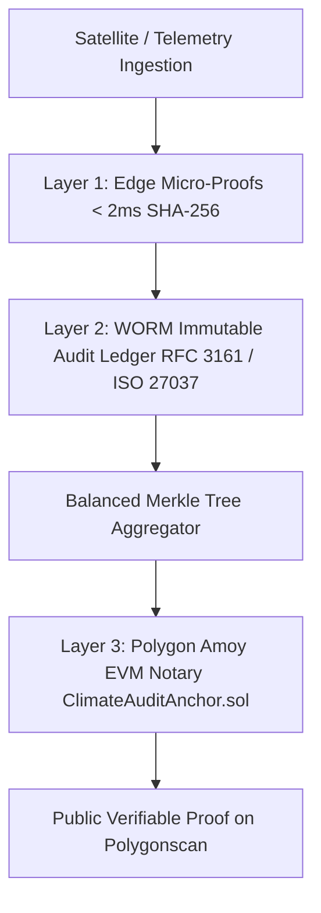
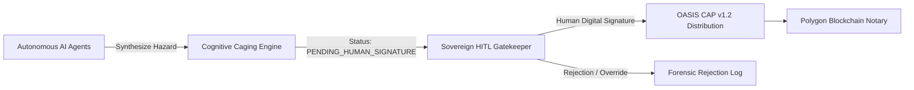

# AMARU-GLOBAL: Sovereign Multi-Agent C2 Framework & Triple-Layer Blockchain Notary for UN-EW4All Climate Resilience

> **Submitted to:** [IEEE ClimateChain Global Hackathon: AI and BLOCKCHAIN Innovate Today for a Sustainable Tomorrow](https://ieee-climatechain-hack.devpost.com/)  
> **Track:** **Track 4 — Climate Data & Environmental Monitoring**  
> **Cross-Track Integration:** Track 1 (Carbon & Emission/Audit Transparency) & Track 3 (Sustainable Supply Chains)  
> **Smart Contract:** [`ClimateAuditAnchor.sol`](contracts/ClimateAuditAnchor.sol) deployed & verified on **Polygon Amoy Testnet** ([0x5462C7F1aC5a0C58356A21e25F883d6aF92289c0](https://amoy.polygonscan.com/address/0x5462C7F1aC5a0C58356A21e25F883d6aF92289c0))  
> **Live Production C2 (Auto-English for IEEE Judges):** [coen-frontend-289004262994.us-central1.run.app/incendios?lang=en](https://coen-frontend-289004262994.us-central1.run.app/incendios?lang=en)  
> **Live Production C2 (Spanish Testbed):** [coen-frontend-289004262994.us-central1.run.app/incendios](https://coen-frontend-289004262994.us-central1.run.app/incendios)  
> **Public API Gateway:** [coen-backend-289004262994.us-central1.run.app/api/v1/incendios/clusters-activos](https://coen-backend-289004262994.us-central1.run.app/api/v1/incendios/clusters-activos)  
> **Devpost Submission:** [AMARU-CLIMATE Submission #1243712](https://devpost.com/submit-to/29114-ieee-climatechain-global-hackathon/manage/submissions/1243712/edit)  

---

## 📑 Table of Contents
1. [Executive Summary & Core Mission](#1-executive-summary--core-mission)
2. [The Core Dilemma: The Golden Window vs. Post-Disaster Corruption](#2-the-core-dilemma-the-golden-window-vs-post-disaster-corruption)
3. [Global Architecture: The 6 UN-EW4All / WMO Links](#3-global-architecture-the-6-un-ew4all--wmo-links)
4. [Triple-Layer Cryptographic Trust Engine & Polygon Blockchain Notary](#4-triple-layer-cryptographic-trust-engine--polygon-blockchain-notary)
5. [Ethical AI & C2 Governance: Cognitive Caging & Sovereign HITL Chain](#5-ethical-ai--c2-governance-cognitive-caging--sovereign-hitl-chain)
6. [Cybersecurity & Data Privacy: Off-Chain Privacy Protection](#6-cybersecurity--data-privacy-off-chain-privacy-protection)
7. [Smart Contract Verification on Polygonscan](#7-smart-contract-verification-on-polygonscan)
8. [The Field Validation Testbed: Wildfires & Blind Fires](#8-the-field-validation-testbed-wildfires--blind-fires)
9. [Technology Stack](#9-technology-stack)
10. [Quickstart: Local Execution & Testing](#10-quickstart-local-execution--testing)
11. [License & IEEE Acknowledgement](#11-license--ieee-acknowledgement)

---

## 1. Executive Summary & Core Mission

**AMARU-GLOBAL** is a sovereign Command & Control (C2) framework and triple-layer cryptographic notary engineered for the United Nations Secretary-General’s **"Early Warnings for All" (UN-EW4All)** initiative. 

Disaster Risk Management (DRM) worldwide faces a severe operational tension: **bureaucratic paralysis during the pre-disaster "Golden Window"** (where local authorities hesitate to declare emergencies due to fear of prosecution) versus **rampant corruption and phantom procurement after impact**. 

AMARU-GLOBAL solves this systemic failure by combining:
- **Autonomous Multi-Agent Satellite Fusion:** Continuous orbital nowcasting aggregating NASA FIRMS, Sentinel-3 and ensemble weather telemetry to uncover "Blind Emergencies" in real-time.
- **Cognitive Caging & Human-In-The-Loop (HITL) Governance:** Strict AI guardrails ensuring no autonomous alarms can trigger public panic or financial release without verified human officer credentials.
- **Citizen Privacy & Off-Chain Data Protection:** Sensitive disaster census data remains protected off-chain; only cryptographic hashes/Merkle roots are anchored onto Polygon, ensuring public auditability without exposing personal citizen information.
- **Polygon Blockchain Notary (`ClimateAuditAnchor.sol`):** Cryptographic Merkle-root commits providing tamper-proof, publicly auditable proofs on Polygon Amoy.


---

## 2. The Core Dilemma: The Golden Window vs. Post-Disaster Corruption

Despite billions allocated globally under the Sendai Framework and multilateral funds, Disaster Risk Management suffers from two systemic failure modes:

1. **The "Tragedy of the Golden Window" (Bureaucratic Paralysis):** Local mayors and civil defense authorities face criminal prosecution and audits if they disburse disaster funds without exhaustive justification. However, hydraulic concentration times for flash floods are between 4 and 12 hours, and wildfires propagate uphill at 4 km/h through chimney effects. Terrified of wrongful liability, honest officials wait until devastation is already underway before declaring emergencies.
2. **Post-Disaster Humanitarian Corruption & Price Gouging:** Once emergency status is hastily unlocked under non-competitive tenders, the lack of auditable data opens the door to phantom machinery rentals, inflated invoices, and aid diversion.

**AMARU-GLOBAL eliminates this trade-off:** it mathematically protects honest officials with immutable pre-disaster evidence while closing the door to post-disaster fraud.

---

## 3. Global Architecture: The 6 UN-EW4All / WMO Links

AMARU-GLOBAL bridges predictive climate intelligence with cryptographic accountability by implementing the **6 Core Links** mandated by the **World Meteorological Organization (WMO)** and the UN Secretary-General's **"Early Warnings for All" (EW4All)** initiative:

### Autonomous AI Agent Swarm & Blockchain Binding
```
┌────────────────────────────────────────────────────────────────────────────────────────┐
│                   AMARU-GLOBAL: AUTONOMOUS AI AGENT SWARM ARCHITECTURE                 │
└──────────────────────────────────────────┬─────────────────────────────────────────────┘

                                           │
         ┌─────────────────────────────────┼─────────────────────────────────┐
         ▼                                 ▼                                 ▼
┌─────────────────────────────┐ ┌─────────────────────────────┐ ┌─────────────────────────────┐
│ 1. AGENT KURAQ              │ │ 2. AGENT YUPAQ              │ │ 3. AGENT FISCALIZADOR       │
│ (Master Telemetry Ingestion)│ │ (Geodesic Kinematic Engine) │ │ (Anti-Corruption Auditor)    │
├─────────────────────────────┤ ├─────────────────────────────┤ ├─────────────────────────────┤
│• 27 streams in real-time    │ │• Geodesic DBSCAN R=12 km    │ │• Public tender benchmarks   │
│• NASA FIRMS (VIIRS 375m)    │ │• 48h Thermal Persistence    │ │• Ley 30225 Art. 27 dossiers │
│• Sentinel-3 SLSTR & Doppler │ │• 38 Blind Wildfires Engine  │ │• D8 Bulldozer calculations  │
│• NOAA & Pacific Ocean Buoys │ │• Basin Runoff Wave Models   │ │• Price-gouging protection   │
└──────────────┬──────────────┘ └──────────────┬──────────────┘ └──────────────┬──────────────┘
               │                               │                               │
               └───────────────────────┬───────┴───────────────────────────────┘
                                       │
                                       ▼
                     ┌───────────────────────────────────┐
                     │   4. AGENT SENTINEL & QILQAY      │
                     │   (Nowcasting & OASIS CAP v1.2)   │
                     ├───────────────────────────────────┤
                     │ • Cognitive Caging Protocol       │
                     │ • Status: PENDING_HUMAN_SIGNATURE │
                     │ • Zero-PII Damage Dossier Output  │
                     └─────────────────┬─────────────────┘
                                       │
                                       ▼
                     ┌───────────────────────────────────┐
                     │ 🛡️ SOVEREIGN HUMAN GATEKEEPER    │
                     │ (HITL Digital Officer Signature)  │
                     └─────────────────┬─────────────────┘
                                       │
                                       ▼
       ═════════════════════════════════════════════════════════════════════
       ⛓️ TRIPLE-LAYER BLOCKCHAIN NOTARY (POLYGON AMOY EVM ANCHOR)
       ═════════════════════════════════════════════════════════════════════
        • Layer 1 (Edge): Local SHA-256 micro-proofs (< 2ms offline)
        • Layer 2 (WORM): Immutable audit ledger (RFC 3161 / ISO 27037)
        • Layer 3 (On-Chain): Merkle Root commit -> ClimateAuditAnchor.sol
```

| UN-EW4All Link | AMARU-GLOBAL Implementation | Technical Core Component |
| :--- | :--- | :--- |
| **Link 1: Observation** | Ingestion of real-time satellite Sea Surface Temperature (SST) anomalies, Doppler radar networks, and hydrometric telemetry. | Open-Meteo IFS 9km, NOAA OI-SST, Copernicus Sentinel feeds |
| **Link 2: Forecasting** | Multi-day predictive engine calculating hydrometeorological runoff and thermal anomalies up to 7 days in advance. | `backend/services/meteo_service_pro.py` |
| **Link 3: Impact Prediction** | Spatial GIS cross-validation of physical hazards against population vulnerability, road networks, and health facilities. | Spatial inference engine & risk exposure catalog parser |
| **Link 4: Authorized Warning** | **OASIS Common Alerting Protocol (CAP v1.2)** formatting, strictly caged until authorized by a credentialed human authority. | `backend/services/alerts_cascade_service.py` |
| **Link 5: Action & Logistics** | Automated dispatch of relief supply manifests, secure evacuation routing, and fair-market procurement dossiers. | `backend/services/routing/humanitarian_router.py` |
| **Link 6: Forensic Audit** | Cryptographic anchoring of decisions, tenders, and censuses onto the Polygon public blockchain via Merkle Trees. | `contracts/ClimateAuditAnchor.sol` |

---

## 4. Triple-Layer Cryptographic Trust Engine & Polygon Blockchain Notary

To resolve the trade-off between **sub-second emergency response** and **public blockchain confirmation latency**, AMARU employs a 3-Layer architecture:



1. **Layer 1 (Edge Micro-Proofs):** Generates local SHA-256 telemetry hashes at municipal edge servers in $< 2\text{ ms}$, ensuring zero-latency offline operation during grid blackouts.
2. **Layer 2 (WORM Anti-Corruption Ledger):** Write-Once-Read-Many cryptographic audit ledger with RFC 3161 timestamps and ISO 27037 chain of custody, benchmarking machinery rental rates against national procurement price ceilings.
3. **Layer 3 (Polygon Blockchain Anchor):** Batches event hashes into balanced Merkle Trees and commits the 32-byte Merkle root onto Polygon Amoy (`ClimateAuditAnchor.sol`), providing immutable public notary proof.

---

## 5. Ethical AI & C2 Governance: Cognitive Caging & Sovereign HITL Chain

*Directly answering IEEE Hackathon Session 4: AI Ethics, Cybersecurity, and Responsibility in ClimateChain.*

AMARU-GLOBAL establishes the principle of **Cognitive Caging**:



1. **No Autonomous Public Sirens:** The AI engine is strictly prohibited from triggering public cell-broadcast sirens or mass media channels unilaterally.
2. **Mandatory Human Signature:** An alert generated by AI remains in the `PROPUESTA_AGENTICA_PENDIENTE` state. It cannot transition to active distribution until a certified operational officer provides their cryptographic institutional identity, verifying the hazard parameters.
3. **Decentralized Dual Quorum:** At the local operational level, emergency budget disbursements require dual cryptographic sign-off (Local Executive Authority + Civil Protection/Police Chief), preventing unilateral fund abuse.

---

## 6. Cybersecurity & Data Privacy: Off-Chain Privacy Protection

*Directly answering IEEE Hackathon Session 2: Cybersecurity & Data Privacy in Climate Tech.*

Publishing disaster damage reports on a public blockchain introduces severe privacy risks under international data protection frameworks. 

AMARU-GLOBAL solves this with a clean, privacy-first off-chain architecture:
- **Zero Plaintext PII on Chain:** Sensitive citizen data (identity numbers, names, and precise coordinates of affected households) remain securely stored off-chain in encrypted storage.
- **On-Chain Cryptographic Integrity:** Only irreversible cryptographic hashes and Merkle roots are committed to Polygon. This guarantees that disaster records cannot be altered or retroactively fabricated, while strictly safeguarding personal privacy.
- **Audit Traceability without Surveillance:** External auditors can mathematically verify that a specific damage dossier matches the timestamped blockchain root without needing public access to citizens' personal private data.


---

## 7. Smart Contract Verification on Polygonscan

The notary smart contract is deployed and verified on the **Polygon Amoy EVM Testnet**:

* **Contract Address:** [`0x5462C7F1aC5a0C58356A21e25F883d6aF92289c0`](https://amoy.polygonscan.com/address/0x5462C7F1aC5a0C58356A21e25F883d6aF92289c0)
* **Polygonscan Explorer:** [View on Polygonscan Amoy](https://amoy.polygonscan.com/address/0x5462C7F1aC5a0C58356A21e25F883d6aF92289c0)
* **Network:** Polygon Amoy Testnet (ChainID `80002`)
* **Solidity Source:** [`contracts/ClimateAuditAnchor.sol`](contracts/ClimateAuditAnchor.sol)

### Core Interface (`ClimateAuditAnchor.sol`)

```solidity
// SPDX-License-Identifier: MIT
pragma solidity ^0.8.20;

import "@openzeppelin/contracts/access/Ownable.sol";

contract ClimateAuditAnchor is Ownable {
    struct AnchorRecord {
        bytes32 merkleRoot;
        uint256 startBlock;
        uint256 endBlock;
        uint256 eventCount;
        uint256 timestamp;
        string recordType;        // e.g., "OASIS_CAP_ALERT", "HUMANITARIAN_CENSUS", "EMERGENCY_TENDER"
        string ipfsMetadataUri;   // Decentralized storage metadata
    }

    mapping(bytes32 => AnchorRecord) public anchors;
    bytes32[] public anchorHistory;

    event AuditAnchorCommitted(
        bytes32 indexed merkleRoot,
        string recordType,
        uint256 eventCount,
        uint256 timestamp
    );

    constructor() Ownable(msg.sender) {}

    function commitAnchor(
        bytes32 _merkleRoot,
        uint256 _startBlock,
        uint256 _endBlock,
        uint256 _eventCount,
        string memory _recordType,
        string memory _ipfsMetadataUri
    ) external onlyOwner {
        require(anchors[_merkleRoot].timestamp == 0, "Error: Record already anchored");
        anchors[_merkleRoot] = AnchorRecord({
            merkleRoot: _merkleRoot,
            startBlock: _startBlock,
            endBlock: _endBlock,
            eventCount: _eventCount,
            timestamp: block.timestamp,
            recordType: _recordType,
            ipfsMetadataUri: _ipfsMetadataUri
        });
        anchorHistory.push(_merkleRoot);
        emit AuditAnchorCommitted(_merkleRoot, _recordType, _eventCount, block.timestamp);
    }
}
```

---

## 8. The Field Validation Testbed: Wildfires & Blind Fires

To prove practical usefulness beyond theoretical whitepapers, AMARU operates live on real climate emergencies:

* **Geodesic DBSCAN Clustering ($R = 12\text{ km}$):** Aggregates thousands of raw NASA FIRMS (VIIRS 375m & MODIS) thermal hotspots into **86 high-severity national wildfire complexes**.
* **48-Hour Thermal Persistence (PTT):** State-machine tracking keeps incidents active even during optical cloud occlusion or nighttime thermal inversion.
* **Ground-Truth Cross-Validation & The SINPAD/EDAN Latency Bridge:** Correlates active satellite complexes against 118 official civil defense bulletins and administrative registries. While mobile field tools (such as INDECI's newly launched *EDAN Digital*) require evaluators to physically reach disaster sites post-impact, AMARU's autonomous orbital fusion confirms **48 validated incidents** while uncovering **38 "Blind Wildfires"** (high-FRP blazes spreading in remote topography completely absent from administrative systems).
* **Parametric Evidence for Agricultural Insurance (SAC):** Outputs standardized geospatial damage dossiers (burned hectares, Fire Radiative Power, perimeter polygons) without citizen PII, allowing agrarian agencies to certify catastrophe claims in hours instead of months.

---

## 9. Technology Stack

- **Blockchain & Web3:** Solidity `^0.8.20`, Polygon Amoy EVM, OpenZeppelin, Web3.py.
- **Backend C2 Architecture:** Python 3.12, FastAPI, PyCryptodome (Shamir Secret Sharing & SHA-256), NumPy, Haversine geodesic algorithms.
- **Mission-Control Frontend:** Next.js 14 App Router, TypeScript, Tailwind CSS, Lucide Icons, Glassmorphic Tactical C2 UI, Leaflet / Google Maps Platform integration.
- **Cloud Infrastructure:** Google Cloud Run serverless containers, Google Cloud Build automated CI/CD.
- **Earth Observation Feeds:** NASA FIRMS API, Open-Meteo Global Ensemble (ECMWF IFS 9km), NOAA Coral Reef Watch SST, Copernicus Sentinel layers.

---

## 10. Quickstart: Local Execution & Testing

### Prerequisites
- Node.js >= 18.x
- Python >= 3.11

### 1. Backend Service
```bash
cd backend
python -m venv .venv
# Windows:
.\.venv\Scripts\activate
# Linux/macOS:
# source .venv/bin/activate

pip install -r requirements.txt
uvicorn main:app --reload --port 8000
```

### 2. Frontend C2 Console
```bash
cd frontend
npm install
npm run dev
# Access: http://localhost:3000
```

### 3. Automated Verification Test Suite
```bash
cd backend
python -m unittest tests/test_blockchain_anchor.py tests/test_alerts_cascade.py
```

---

## 11. License & IEEE Acknowledgement

Developed for the **IEEE ClimateChain Global Hackathon 2026** (Organized by IEEE Blockchain Türkiye, IEEE Blockchain Technical Committee, IEEE Orange County & AI Ecosystem Association).

Licensed under the **Apache License 2.0**.
