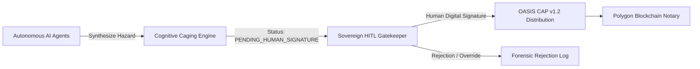

# AMARU-GLOBAL: Sovereign Multi-Agent C2 Framework & Triple-Layer Blockchain Notary for UN-EW4All Climate Resilience

> **Submitted to:** [IEEE ClimateChain Global Hackathon: AI and BLOCKCHAIN](https://ieee-climatechain-hack.devpost.com/)  
> **Track:** **Track 4 — Climate Data & Environmental Monitoring**  
> **Cross-Track Integration:** Track 1 (Carbon & Emission/Audit Transparency) & Track 3 (Sustainable Supply Chains)  
> **Smart Contract:** `ClimateAuditAnchor.sol` deployed on **Polygon Amoy Testnet** (`ChainID 80002`)  
> **International Standards:** UN-EW4All (Early Warnings for All - 6 Links), WMO Guidelines, OASIS CAP v1.2, Sendai Framework for Disaster Risk Reduction (2015-2030), UN SDG 13.1  
> **Operational Verification Testbed:** The Andean-Pacific Multi-Hazard Corridor (AMARU-CLIMATE)

---

## 1. Lineage & Research Genealogy: From WFP to Global Standard

The AMARU ecosystem is structured into three distinct, complementary evolutionary tiers:

```
┌────────────────────────────────────────────────────────────────────────────────────────┐
│                               THE AMARU ECOSYSTEM GENEALOGY                            │
└──────────────────────────────────────────┬─────────────────────────────────────────────┘
                                           │
         ┌─────────────────────────────────┼─────────────────────────────────┐
         ▼                                 ▼                                 ▼
┌─────────────────────────────┐ ┌─────────────────────────────┐ ┌─────────────────────────────┐
│ 1. AMARU-CLIMATE (WFP SEED) │ │ 2. AMARU-CLIMATE (PERU)     │ │ 3. AMARU-GLOBAL (IEEE)      │
│ Foundational Research Track │ │ Sovereign Regional Sandbox  │ │ Universal Standard Framework│
├─────────────────────────────┤ ├─────────────────────────────┤ ├─────────────────────────────┤
│• Focus: Climate Anticipatory│ │• Focus: Municipal C2 Command│ │• Focus: Global Multi-Agent  │
│  Action (EAP) & Food Secu-  │ │  & Multi-Hazard Response    │ │  Reasoning & EVM Blockchain │
│  rity under extreme ENSO.   │ │  for Peru's river basins.   │ │  Evidence Notary.           │
│• Origin: WFP AFCIA LAC 2026 │ │• Architecture: 4-Tier Civil │ │• Hackathon: IEEE Climate-   │
│  Innovation Initiative.     │ │  Protection C2 Suite.       │ │  Chain Global 2026.         │
│• Role: The Scientific Seed  │ │• Role: High-Stress Real-    │ │• Role: Universal Standard   │
│  and Prior Art foundation.  │ │  World Validation Testbed.  │ │  Engine for UN-EW4All MHEWS.│
└─────────────────────────────┘ └─────────────────────────────┘ └─────────────────────────────┘
```

1. **AMARU-CLIMATE (WFP AFCIA LAC 2026 Seed):** The foundational research on predictive triggers and anticipatory action protocols (EAP) recognized under the **UN World Food Programme** innovation challenge. It demonstrated how predictive analytics can protect vulnerable livelihoods before climate disasters strike.
2. **AMARU-CLIMATE (Andean-Pacific Field Testbed):** The operational, real-world deployment across Peru's 1,891 districts. It acts as our rigorous validation laboratory, demonstrating that the architecture functions under extreme geographic stress (coastal flash floods vs. high-altitude freeze surges).
3. **AMARU-GLOBAL (This Repository):** The universal, jurisdiction-agnostic Command & Control (C2) engine built for international disaster resilience. It operationalizes the **UN-EW4All 6-link protocol**, enforces **Human-in-the-Loop (HITL)** ethical constraints, and anchors decisions onto **Polygon** as mathematical proof against humanitarian corruption.

---

## 2. The Problem: The Double Dilemma in Modern Early Warning Systems

Despite billions allocated globally under the Sendai Framework and multilateral funds, Disaster Risk Management suffers from two systemic failure modes:

1. **The Unchecked AI / Ethical Siren Paradox:** Autonomous AI agents that dispatch unilateral public alarms cause mass panic, severe civil disruption, and catastrophic legal liabilities when false positives occur. Conversely, traditional bureaucratic validation takes days—missing the narrow hydrologic **Golden Window** ($4\text{ to }12\text{ hours}$).
2. **Post-Disaster Humanitarian Corruption & Price Gouging:** Once emergency status is declared, non-competitive procurement and expedited relief distribution are plagued by phantom supplier cartels, manipulated casualty registries, and aid diversion.

---

## 3. Global Architecture: The 6 UN-EW4All / WMO Links

AMARU-GLOBAL bridges predictive climate intelligence with cryptographic accountability by implementing the **6 Core Links** mandated by the **World Meteorological Organization (WMO)** and the UN Secretary-General's **"Early Warnings for All" (EW4All)** initiative:

```
[1. Global Observation] ──> [2. Multi-Hazard Forecast] ──> [3. Vulnerability Prediction]
                                                                        │
[6. Blockchain WORM Audit] <── [5. C2 Humanitarian Logistics] <── [4. HITL Sovereign Gatekeeper]
```

| UN-EW4All Link | AMARU-GLOBAL Implementation | Technical Core Component |
| :--- | :--- | :--- |
| **Link 1: Observation** | Ingestion of real-time satellite Sea Surface Temperature (SST) anomalies, Doppler radar networks, and hydrometric telemetry. | Open-Meteo IFS 9km, NOAA OI-SST, Copernicus Sentinel feeds |
| **Link 2: Forecasting** | Multi-day predictive engine calculating hydrometeorological runoff and thermal anomalies up to 7 days in advance. | `backend/services/meteo_service_pro.py` |
| **Link 3: Impact Prediction** | Spatial GIS cross-validation of physical hazards against population vulnerability, road networks, and health facilities. | Spatial inference engine & risk exposure catalog parser |
| **Link 4: Authorized Warning** | **OASIS Common Alerting Protocol (CAP v1.2)** formatting, strictly caged until authorized by a credentialed human authority. | `backend/services/alerts_cascade_service.py` |
| **Link 5: Action & Logistics** | Automated dispatch of relief supply manifests, secure evacuation routing, and fair-market procurement dossiers. | `backend/services/routing/humanitarian_router.py` |
| **Link 6: Forensic Audit** | Cryptographic anchoring of decisions, tenders, and censuses onto the Polygon public blockchain via Merkle Trees. | `contracts/ClimateAuditAnchor.sol` |

---

## 4. Ethical AI & C2 Governance: The Concentric HITL Chain

*Directly answering IEEE Hackathon Session 4: AI Ethics, Cybersecurity, and Responsibility in ClimateChain.*

AMARU-GLOBAL establishes the principle of **Cognitive Caging**:



1. **No Autonomous Public Sirens:** The AI engine is strictly prohibited from triggering public cell-broadcast sirens or mass media channels unilaterally.
2. **Mandatory Human Signature:** An alert generated by AI remains in the `PROPUESTA_AGENTICA_PENDIENTE` state. It cannot transition to active distribution until a certified operational officer provides their cryptographic institutional identity, verifying the hazard parameters.
3. **Decentralized Dual Quorum:** At the local operational level, emergency budget disbursements require dual cryptographic sign-off (Local Executive Authority + Civil Protection/Police Chief), preventing unilateral fund abuse.

---

## 5. Cybersecurity & Citizen Privacy: Zero-PII Shamir Secret Sharing

*Directly answering IEEE Hackathon Session 2: Cybersecurity & Data Privacy in Climate Tech.*

Publishing disaster damage censuses on a public blockchain introduces severe privacy risks under international data protection laws (GDPR). 

AMARU-GLOBAL implements **Zero-PII Identity Protection via Shamir’s Secret Sharing Scheme ($k=3, n=5$)**:
- **No Plaintext PII on Chain:** Sensitive citizen data (National Identity IDs, names, exact geolocated coordinates of destroyed homes) are encrypted into a secure off-chain vault.
- **Irreversible Hash Integrity:** Only the irreversible SHA-256 root hash of the census registry is committed to Polygon.
- **Threshold Key Management:** Decryption requires $k=3$ out of $n=5$ independent institutional keys (e.g., Civil Defense Authority + Public Prosecutor + Red Cross + Municipal Auditor + Ombudsman), guaranteeing zero unilateral surveillance while mathematically preventing phantom victims from being added retroactively.

---

## 6. Smart Contract Implementation: `ClimateAuditAnchor.sol`

The notary smart contract is deployed on the **Polygon Amoy Testnet** (`ChainID 80002`):

```solidity
// SPDX-License-Identifier: MIT
pragma solidity ^0.8.20;

import "@openzeppelin/contracts/access/Ownable.sol";

/**
 * @title ClimateAuditAnchor
 * @notice Cryptographic Notary for UN-EW4All Early Action Decisions & Humanitarian Audits
 * Deployed for IEEE ClimateChain Global Hackathon 2026
 */
contract ClimateAuditAnchor is Ownable {
    struct AnchorRecord {
        bytes32 merkleRoot;
        uint256 startBlock;
        uint256 endBlock;
        uint256 eventCount;
        uint256 timestamp;
        string recordType;        // e.g., "OASIS_CAP_ALERT", "HUMANITARIAN_CENSUS", "EMERGENCY_TENDER"
        string ipfsMetadataUri;   // Decentralized storage metadata
    }

    mapping(bytes32 => AnchorRecord) public anchors;
    bytes32[] public anchorHistory;

    event AuditAnchorCommitted(
        bytes32 indexed merkleRoot,
        string recordType,
        uint256 eventCount,
        uint256 timestamp
    );

    constructor() Ownable(msg.sender) {}

    function commitAnchor(
        bytes32 _merkleRoot,
        uint256 _startBlock,
        uint256 _endBlock,
        uint256 _eventCount,
        string memory _recordType,
        string memory _ipfsMetadataUri
    ) external onlyOwner {
        require(anchors[_merkleRoot].timestamp == 0, "Error: Record already anchored");
        anchors[_merkleRoot] = AnchorRecord({
            merkleRoot: _merkleRoot,
            startBlock: _startBlock,
            endBlock: _endBlock,
            eventCount: _eventCount,
            timestamp: block.timestamp,
            recordType: _recordType,
            ipfsMetadataUri: _ipfsMetadataUri
        });
        anchorHistory.push(_merkleRoot);
        emit AuditAnchorCommitted(_merkleRoot, _recordType, _eventCount, block.timestamp);
    }
}
```

---

## 7. The Real-World Operational Testbed: AMARU-CLIMATE

To demonstrate real-world effectiveness rather than a superficial mock-up, AMARU-GLOBAL uses the **Andean-Pacific Corridor (Peru)** as its high-stress validation testbed:

* **Dual-Extreme Validation:** Ingestion and real-time stress testing against both tropical marine heat anomalies (**El Niño Costero** flooding across northern coastal basins) and severe Andean freeze surges (**La Niña / Friaje** across 106 high-altitude districts above 3,800 m.a.s.l.).
* **Wildfire C2 Tactical Response:** Near-real-time satellite ingestion of **NASA FIRMS (VIIRS 375m active thermal hotspots)** cross-referenced against the official baseline of **492 fire-exposed districts (CENEPRED 2018 study)**, sub-metric Google Maps Platform 3D hybrid terrain, and subterranean soil moisture ($0\text{--}7\text{ cm}$) from Open-Meteo Pro (ECMWF IFS 9km) to automate D8 mechanized firebreak emergency procurement under Peruvian Law 30225.
* **Civil Protection Catalog Ingestion:** Automated spatial parsing of official government disaster mitigation plans, matching real-time telemetry against critical risk points with 0.0m geodesic precision.
* **Fiscal Anti-Corruption Safeguards:** Benchmarking heavy machinery emergency rental requests against historic public market price ceilings, blocking inflated post-disaster invoices before payment disbursement.

---

## 8. Technology Stack

- **Blockchain Layer:** Solidity `^0.8.20`, Polygon Amoy EVM Testnet, OpenZeppelin, Web3.py.
- **Agentic C2 Backend:** Python 3.12, FastAPI, PyCryptodome (Shamir Secret Sharing & SHA-256), NumPy, Haversine spatial algorithms.
- **Mission-Control Frontend:** Next.js 14 App Router, TypeScript, Tailwind CSS, Lucide Icons, Glassmorphic Tactical C2 UI, Leaflet / Google Maps Platform integration.
- **Environmental Data Feeds:** Open-Meteo Global Ensemble (ECMWF IFS 9km), NOAA Coral Reef Watch SST, Copernicus Sentinel layers.

---

## 9. Quickstart: Local Execution

### Prerequisites
- Node.js >= 18.x
- Python >= 3.11

### 1. Backend Service
```bash
cd backend
python -m venv .venv
# Windows:
.\.venv\Scripts\activate
# Linux/macOS:
# source .venv/bin/activate

pip install -r requirements.txt
uvicorn main:app --reload --port 8000
```

### 2. Frontend C2 Console
```bash
cd frontend
npm install
npm run dev
# Access: http://localhost:3000
```

### 3. Verification & Automated Test Suite
```bash
cd backend
python -m unittest tests/test_blockchain_anchor.py tests/test_alerts_cascade.py
```

---

## 10. License & IEEE Acknowledgement

Developed for the **IEEE ClimateChain Global Hackathon 2026** (Organized by IEEE Blockchain Türkiye, IEEE Blockchain Technical Community, IEEE Orange County & AI Ecosystem Association).

Licensed under the **Apache License 2.0**.
