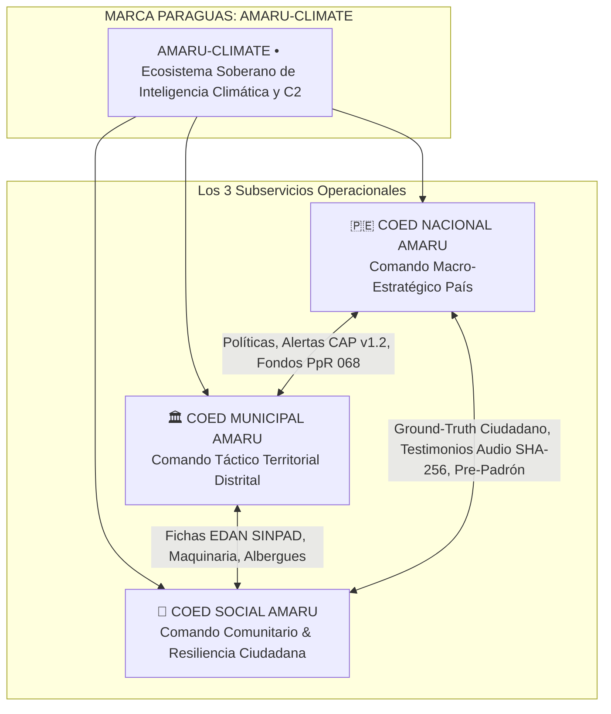
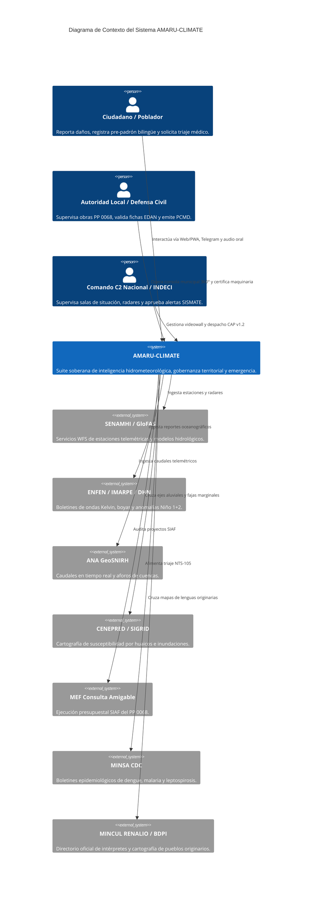
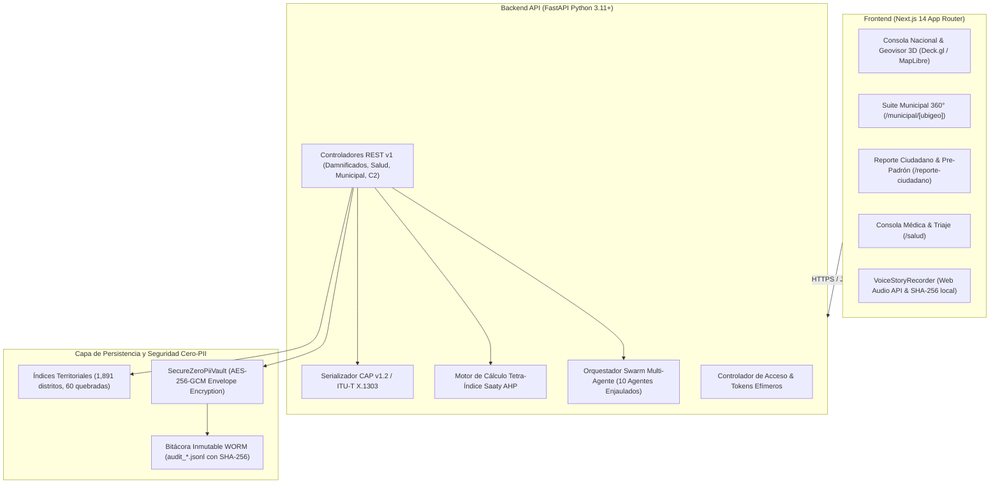
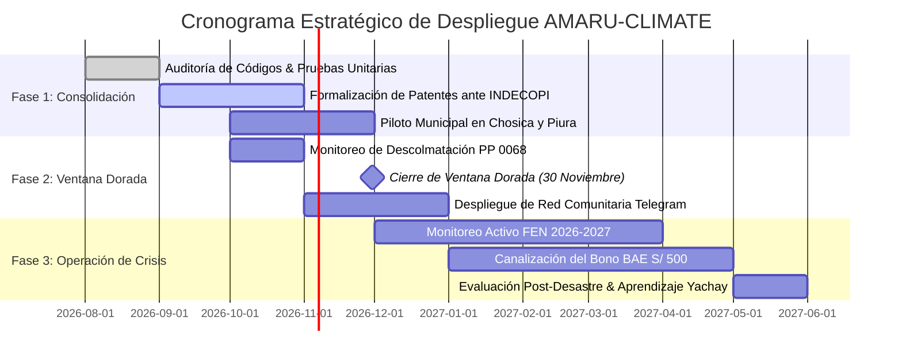

# ⚡ AMARU-CLIMATE: Análisis Estratégico, Arquitectura de Marca Paraguas y Diseño de Sistemas de Misión Crítica
## Suite Soberana de Inteligencia Territorial, Alerta Temprana y Gobernanza Anticipatoria ante el Fenómeno El Niño 2026-2027

---

## 1. Resumen Ejecutivo & Declaración de Misión Soberana

### 1.1. Contexto Histórico y Problemática Nacional
El territorio peruano enfrenta una recurrencia cíclica y catastrófica de fenómenos hidrometeorológicos extremos, personificados en el **Fenómeno El Niño (FEN)** y las heladas y friajes altoandinos (**AMARU-CHIRI**). Históricamente (FEN 1982-1983, 1997-1998, El Niño Costero 2017 y Ciclón Yaku 2023), la respuesta del Estado se ha visto severamente limitada por tres fallas estructurales:
1. **Fragmentación del Conocimiento:** Más de 27 entidades públicas (SENAMHI, IMARPE, ENFEN, ANA, CENEPRED, INDECI, MEF, MINSA, MINEDU, COEN) producen datos en silos desconectados, con formatos heterogéneos, desfases temporales y ausencia de un cuadro operativo común.
2. **Asimetría de Capacidades en Gobiernos Locales:** De las **1,891 municipalidades del Perú**, más del 85% carece de herramientas de modelamiento hidrológico, cartografía satelital en tiempo real o asesoría técnica para la formulación de planes de contingencia y ejecución oportuna del presupuesto de mitigación (Programa Presupuestal 0068 - PP 0068).
3. **Inacción Funcional y Temor Penal:** Los funcionarios locales enfrentan la parálisis administrativa por temor a sanciones de la Contraloría General de la República (CGR) o denuncias penales bajo el **Art. 377 del Código Penal (Inacción Funcional)**, derivando en la pérdida de la "Ventana Dorada" previa a las lluvias y en sobrecostos por contrataciones directas mal sustentadas.
4. **La Brecha entre Lima y la Quebrada:** La desconexión histórica entre el burócrata ministerial en Lima, el alcalde provincial en el terreno y la dirigenta vecinal en la ladera de la quebrada o faja marginal.

### 1.2. La Misión de AMARU-CLIMATE
**AMARU-CLIMATE** nace como una **plataforma tecnológica soberana e interoperable** concebida no como un software aislado de escritorio, sino como un **ecosistema integral de misión crítica** que unifica la macro-estrategia nacional, la gestión municipal táctica y la resiliencia comunitaria de primera línea, bajo un régimen estricto de **Soberanía Humana (Human-in-the-Loop)** y **Privacidad Cero-PII**.

---

## 2. Arquitectura de Marca Paraguas (Masterbrand) & Subservicios Operacionales

### 2.1. El Mapa de Arquitectura de Marca



### 2.2. Desglose Comparativo de los 3 Subservicios en 7 Dimensiones Críticas

| Dimensión Crítica | 🇵🇪 COED Nacional AMARU | 🏛️ COED Municipal AMARU | 👥 COED Social AMARU |
| :--- | :--- | :--- | :--- |
| **1. Rol en la Emergencia** | **Estratégico / Decisional Macro:** Planificación nacional, reservas de contingencia, decretos de emergencia y articulación multisectorial. | **Táctico / Operativo:** Ejecución de obras ribereñas, descolmatación, padrón municipal oficial, certificación de maquinaria y fiscalización. | **Humano / Resiliencia:** Autoprotección vecinal, ollas comunes, reporte de campo en tiempo real, registro de damnificados y ayuda directa. |
| **2. Público Objetivo** | Presidencia del Consejo de Ministros (PCM), INDECI, COEN, Ministerios (VIVIENDA, MTC, MINSA, MIDAGRI), Comando Conjunto de las FFAA. | Alcaldes provinciales y distritales, Gerentes de Gestión del Riesgo (GTGRD), Defensa Civil distrital, Residentes de Obra, Serenazgo. | Ciudadanos damnificados y afectados, dirigentas de ollas comunes (Ley 31458), juntas vecinales (JUVESC), comunidades campesinas/nativas. |
| **3. Escala Espacial** | Las **159 cuencas hidrográficas** y los **1,891 distritos** del territorio nacional. | **1 Distrito específico** por código UBIGEO (ej. Catacaos `200105`, Chosica `150118`, Íllimo `140303`). | **1 Barrio, Caserío, Quebrada o Faja Marginal** de primera línea comunitaria. |
| **4. Módulos y Rutas en la Plataforma** | • `/` (Videowall C2 Nacional 3D)<br>• `/geovisor` (Deck.gl 3D cuencas)<br>• `/enfen` e `/imarpe` (Boyas y Ondas Kelvin)<br>• `/fuentes` (27 fuentes oficiales KURAQ)<br>• `/doctrina` (Tetra-Índices IRCE/IPH) | • `/municipal/[ubigeo]` (Consola 360° del Alcalde)<br>• `/historico` (Memoria FEN 1983-2017)<br>• `/meteo` (Open-Meteo local calibrado)<br>• `/lex` (Asesoría jurídica y decretos D.U.)<br>• `/contraloria` (Auditoría preventiva CGR) | • `/reporte-ciudadano` (Reporte georreferenciado blindado)<br>• Pre-Padrón EDAN Intercultural (Bono BAE S/ 500)<br>• `/ayni` (Ollas Comunes, Juntas y Albergues)<br>• `/yachay` (Bioindicadores y saberes ancestrales)<br>• `/salud/triaje` (Triaje NTS-105 MINSA) |
| **5. Agentes de IA Asignados (Swarm Enjaulado)** | • **KURAQ:** Ingesta y validación de 27 fuentes oficiales.<br>• **CENTINELA:** Escaneo continuo batch de 159 cuencas.<br>• **DISPATCHER:** Serializador CAP v1.2 / SISMATE. | • **YUPAQ:** Hidrocinética local, $t_c$, $T_{\text{lag}}$ y caudales.<br>• **QILQAY:** Redactor de resoluciones y planes PCMD.<br>• **FISCALIZADOR:** Auditor de obras PpR 068 y maquinaria. | • **LINGÜÍSTICO (RENALIO):** Adaptación Quechua/Aymara.<br>• **AYNI:** Coordinador de faenas y víveres para ollas.<br>• **AUDIO-STT:** Custodia de testimonios de voz SHA-256.<br>• **SALUD-AMARU:** Triaje preliminar NTS-105. |
| **6. Dispositivos e Infraestructura de Red** | Pantallas de Videowall C2, estaciones de trabajo de alto rendimiento, fibra óptica e infraestructura nube GCP (Cloud Run, GPU). | Laptops de campo, PCs municipales de escritorio, internet satelital/banda ancha municipal y base de datos SQLite local sincronizable. | **Smartphones básicos, tablets comunitarias, cobertura celular 2G/3G/4G, bots de Telegram y enlaces de WhatsApp Web.** |
| **7. Modelo de Privacidad y Seguridad** | Gestión de permisos institucionales RBAC, monitoreo de amenazas perimetrales y tokenización de salas de crisis. | Protocolo Break-the-Glass municipal con DNI del inspector de Defensa Civil registrado en bitácora inmutable WORM. | **Bóveda Criptográfica Envelope Zero-PII (AES-256-GCM), códigos opacos CUP-DAMN/CUP-MINSA y hash SHA-256 en dispositivo.** |

---

## 3. El Flujo de Datos Bidireccional (El Gran Valor Diferencial)

La genialidad arquitectónica del modelo tripartito es que la información fluye en **doble sentido sincronizado**, con un canal ascendente de **doble vía de impacto humanitario (Hábitat + Salud Vital)**:

```
      FLUJO DESCENDENTE (TOP-DOWN)                           FLUJO ASCENDENTE DUAL (BOTTOM-UP)
┌──────────────────────────────────────┐          ┌────────────────────────────────────────────────────────┐
│        COED NACIONAL AMARU           │          │                  COED NACIONAL AMARU                   │
│ Emite Alerta Roja CAP v1.2 / SISMATE │          │ • SINPAD: 15,000 Viviendas Colapsadas (Bono BAE)       │
└──────────────────┬───────────────────┘          │ • MINSA COE-Salud: Capacidad Hospitalaria y Camas UCI │
                   │                              └───────────────────────────▲────────────────────────────┘
                   ▼                                                          │
┌──────────────────────────────────────┐          ┌───────────────────────────┴────────────────────────────┐
│        COED MUNICIPAL AMARU          │          │                  COED MUNICIPAL AMARU                  │
│ Alerta a Cuadrillas y despliega D8   │          │ [VÍA HÁBITAT]               │ [VÍA SALUD (AMARU-SALUD)]│
└──────────────────┬───────────────────┘          │ Valida Ficha EDAN 2B        │ Despacha SAMU / DIRESA   │
                   │                              │ Filtro Consistencia 4 Capas │ Triage Médico Manchester │
                   ▼                              └───────────────────────────▲────────────────────────────┘
┌──────────────────────────────────────┐                                      │
│         COED SOCIAL AMARU            │          ┌───────────────────────────┴────────────────────────────┐
│ Recibe aviso bilingüe por Telegram   │          │                   COED SOCIAL AMARU                    │
│ y evacúa hacia zona segura alta      │          │        [Sensor Humano Dual en Borde Comunitario]       │
└──────────────────────────────────────┘          │ • Reporte Estructural Vivienda ➔ emite CUP-DAMN        │
                                                  │ • Reporte de Salud y Heridos  ➔ emite CUP-MINSA        │
                                                  │ • Audio en Memoria RAM SHA-256 (Zero-Cloud PII)         │
                                                  └────────────────────────────────────────────────────────┘
```

### 3.1. Caso Operativo 1: Flujo Descendente (Top-Down)
1. **Detección Satelital y Oceanográfica:** El satélite Sentinel/ECMWF y las boyas del IMARPE en Paita (`COED Nacional`) detectan una onda Kelvin cálida (+2.6 °C) y lluvias extremas de cuenca alta proyectadas en 4 horas.
2. **Traducción Táctica Distrital:** El sistema notifica al `COED Municipal` de Lurigancho-Chosica (`150118`), calculando que el tiempo de retardo hidrocinético ($T_{\text{lag}}$) en la Quebrada Quirio es de **24 minutos** tras el inicio de la precipitación cumbral. El alcalde despliega excavadoras y motobombas en puntos críticos ya auditados con el certificador de maquinaria de la Ley N.º 30225.
3. **Alerta Temprana Comunitaria:** El `COED Social` despacha una notificación bilingüe (Castellano y Runasimi Chanka) a los canales de Telegram y WhatsApp de los comités vecinales y ollas comunes de la quebrada, permitiendo la evacuación preventiva de niños y ancianos hacia los albergues temporales antes del desborde.

### 3.2. Caso Operativo 2: Flujo Ascendente Dual (Bottom-Up)
1. **Captura Ciudadana en Terreno:** Una madre de familia en el caserío Simbilá (Catacaos, Piura) ve colapsar su vivienda de adobe y a su hijo con traumatismo y fiebre alta tras la crecida del río Piura. Abre el enlace de `COED Social`, selecciona la altura del agua (`🧍 Cintura`), reporta herido grave (`Triaje Rojo`), graba un testimonio oral de 30 segundos en su lengua materna y presiona enviar. Su teléfono genera el hash SHA-256 localmente y emite dos códigos opacos de custodia: `CUP-DAMN-200105-A7B8` (vivienda) y `CUP-MINSA-200105-M3F1` (salud).
2. **Pre-Calificación y Validación Municipal:** El expediente aparece inmediatamente en la bandeja distrital de `COED Municipal`:
   - **Línea Civil/Hábitat:** El motor de consistencia territorial confirma que el predio está dentro de la faja marginal de la ANA y coincide con otros 4 reportes del sector (Score 92%). El inspector distrital ejecuta el protocolo Break-the-Glass civil, formaliza la Ficha EDAN 2B y la ratifica en el SINPAD.
   - **Línea Médica (AMARU-SALUD):** Se activa la alerta en el puesto de salud local y la central de ambulancias SAMU bajo código `CUP-MINSA`, despachando auxilio prehospitalario prioritario.
3. **Canalización Centralizada de Asistencia:** El `COED Nacional` recibe la consolidación distrital validada:
   - En Vivienda/INDECI: habilita la transferencia directa del **Bono de Arrendamiento de Emergencia (Bono BAE de S/ 500)** del MVCS y autoriza el despacho de Bienes de Ayuda Humanitaria (BAH).
   - En Salud/MINSA: el COE-Salud Nacional monitorea la demanda de camas UCI y dispone la evacuación aeromédica coordinada con las Fuerzas Armadas si el hospital distrital queda aislado.

---

## 4. Ventajas Comerciales, Legales y de Despliegue Operativo

### 4.1. Empaquetamiento Comercial Modular (Licitación Flexible)
La separación en tres subservicios permite modelos de contratación pública y despliegue sumamente ágiles y adaptables:
- **Nivel Macro (GOREs y Ministerios):** Se puede licitar la **Suite Completa AMARU-CLIMATE** para un Gobierno Regional (ej. GORE Piura, GORE Áncash, GORE Lima) o ministerios rectores (PCM, INDECI, MVCS).
- **Nivel Local (Municipalidades Distritales y Provinciales):** Se puede comercializar o implementar de manera autónoma el módulo **`COED Municipal AMARU`** para una alcaldía distrital específica (ej. Municipalidad de Catacaos, Chosica o Carabayllo), incluyendo de fábrica el acceso a **`COED Social AMARU`** para su comunidad sin costo adicional para los vecinos.

### 4.2. Optimización Tecnológica (Cero Colapsos de Infraestructura)
- **Perfil Comunitario Ultraligero:** La interfaz de **`COED Social`** pesa menos de **3 MB**, optimizada para teléfonos de gama baja y conexiones rurales 2G/3G inestables. No carga motores cartográficos 3D ni WebGL pesado.
- **Perfil de Mando de Alto Rendimiento:** El operador de **`COED Nacional`** dispone de aceleración gráfica por hardware (Deck.gl, MapLibre GL 3D) en salas de situación con pantallas multimonitor y videowalls 4K.
- **Tolerancia a Fallos y Operación Fuera de Línea:** Si la conexión a internet se interrumpe temporalmente durante el desastre, el dispositivo almacena el pre-padrón y el hash SHA-256 del audio en `localStorage` o `IndexedDB` y lo sincroniza tan pronto detecta señal celular.

### 4.3. Soberanía de Datos y Blindaje Funcional
- **Protección Cero-PII para el Vecino:** Los datos de filiación ciudadana están sellados mediante cifrado simétrico AES-256 en memoria volátil. Ningún funcionario puede traficar con padrones políticos ni exponer a los damnificados (Ley N.º 29733).
- **Blindaje Jurídico y Penal para el Alcalde:** El alcalde cuenta con la asesoría algorítmica de **AMARU-LEX**, el cálculo de precios oficiales para contratación directa de maquinaria (Art. 27 Ley N.º 30225) y las alertas preventivas de la Ventana Dorada, protegiéndolo de denuncias por **Inacción Funcional (Art. 377 del Código Penal)** ante la Contraloría y el Ministerio Público.

---

## 5. Análisis Estratégico PESTEL y Evaluación de Coste Total (TCO)

### 5.1. Matriz PESTEL Aplicada a la Gestión del Riesgo en el Perú

| Dimensión | Factor Crítico de Entorno | Respuesta de AMARU-CLIMATE |
|---|---|---|
| **Político** | Descentralización inconclusa y alta rotación de autoridades distritales. | Generador automático de expedientes técnicos (Planes PCMD y Resoluciones de Alcaldía formalizadas). |
| **Económico** | Destrucción de infraestructura productiva y sobrecostos por compras de pánico. | Monitoreo riguroso de la "Ventana Dorada" ($Q < 15\text{ m}^3/\text{s}$) para descolmatación preventiva a costo regular. |
| **Social** | Desconfianza ciudadana en el reparto de donaciones y exclusión de hablantes de lenguas originarias. | Bóveda Zero-PII con códigos `CUP-DAMN`, pre-padrón en Quechua/Aymara y solicitud de evaluador bilingüe MINCUL. |
| **Tecnológico** | Brecha digital en cuencas altas y dependencia de software privativo extranjero en dólares. | Solución soberana: Web Audio API nativa sin costo, bots gratuitos de Telegram y serializador celular CAP v1.2. |
| **Ecológico** | Calentamiento anómalo del mar (Niño Costero) y activación simultánea de cientos de quebradas. | Fusión hidrometeorológica multi-fuente que combina radar Banda C, satélite y estaciones telemétricas ANA. |
| **Legal** | Responsabilidad penal por omisión (Art. 377 CP) y temor a auditorías de la Contraloría. | Certificador de razonabilidad de precios de maquinaria conforme al Art. 27 de la Ley N.º 30225. |

### 5.2. Evaluación de Coste Total de Propiedad (TCO) y Soberanía Económica

| Criterio | Soluciones Comerciales Privativas (SaaS USA) | Arquitectura Soberana AMARU-CLIMATE |
|---|---|---|
| **Licenciamiento Recurrente** | $0.05 a $0.20 USD por minuto de voz (ej. Vapi AI, Twilio); tarifas fijas por mensaje en Meta Cloud API. | **$0.00 USD en licencias recurrentes.** Web Audio API estándar en el navegador + bot Telegram 100% gratuito. |
| **Soporte Dialectal Indígena** | Alucinaciones severas en variantes del Quechua y Aymara; impone traducción forzada al inglés o español. | Diccionario etnolingüístico oficial integrado para 5 variantes (Chanka, Collao, Áncash, Aymara, Castellano). |
| **Soberanía Criptográfica** | Biometría de voz enviada a servidores de terceros fuera del Perú, violando la Ley N.º 29733. | **Zero-Cloud PII:** Hash SHA-256 calculado localmente en el dispositivo; el audio no viaja a nubes extranjeras. |
| **Resiliencia Operativa** | Colapso total si se pierde el enlace submarino internacional de internet. | Canales redundantes locales: Telegram, WhatsApp Web, base de datos sincronizable y difusión celular SISMATE. |

---

## 6. Arquitectura de Software y Sistemas (Modelo C4)

### 6.1. Nivel 1: Diagrama de Contexto de Sistema



### 6.2. Nivel 2: Diagrama de Contenedores



---

## 7. Portafolio de Propiedad Intelectual & Patentes

### 7.1. Cuadro Comparativo: Herencia de Lab1 vs. Nuevas Invenciones de Lab4

```
┌────────────────────────────────────────────────────────────────────────────────────────┐
│                        MAPA DE PROPIEDAD INTELECTUAL & PATENTES                        │
├───────────────────────────────────────────┬────────────────────────────────────────────┤
│   ACTIVOS HEREDADOS / VALIDADOS EN LAB1   │  NUEVAS INVENCIONES PATENTABLES EN LAB4    │
├───────────────────────────────────────────┼────────────────────────────────────────────┤
│ • SecureZeroPiiVault (Envelope AES-256)   │ ★ PATENTE MADRE: Sistema Bidireccional C2  │
│ • Bitácora WORM Break-the-Glass           │ 1. AMARU-METEO-FUSION (Sesgo Orográfico)   │
│ • Enjaulamiento Cognitivo de Agentes      │ 2. Motor Tetra-Índice con Amortiguador     │
│ • Generación de Códigos Opacos CUP        │ 3. Zero-Cloud PII Oral Witness con SHA-256 │
│                                           │ 4. Reloj Táctico Polar Multi-escala        │
│                                           │ 5. Serializador Dual CAP / Cell Broadcast  │
└───────────────────────────────────────────┴────────────────────────────────────────────┘
```

### 7.2. PATENTE MADRE / INSIGNIA DE SISTEMA (Arquitectura General Multiescala)

- **Título de la Invención:**  
  *Sistema computacional y método de comunicación bidireccional multiescala para la sincronización hidrocinética, certificación criptográfica de daños en el borde y retroalimentación humanitaria en tiempo real.*
- **Reclamo Esencial y Nivel Inventivo:**  
  > *La novedad radica en que el sistema sincroniza en tiempo real un modelo predictivo hidrodinámico centralizado descendente con una malla de verificación territorial ascendente protegida por encriptación de sobre (Zero-PII), cerrando el ciclo mediante la emisión automatizada de comprobantes de elegibilidad a subsidios de arrendamiento de emergencia (Bono BAE) sin exponer datos biométricos ni depender de servicios de mensajería comercial de pago.*
- **Efecto Técnico Diferencial:**  
  Resuelve la histórica desconexión entre el modelamiento meteorológico macroscópico y la realidad de campo comunitaria mediante un doble bucle cerrado: mientras el flujo descendente (Top-Down) realiza un downscaling hidrocinético para calcular el tiempo de retardo aluvial distrital ($T_{\text{lag}}$) y despachar alertas celulares geocercadas en lenguas originarias, el flujo ascendente (Bottom-Up) adquiere testimonios acústicos locales sellados criptográficamente con SHA-256 en la memoria volátil del dispositivo móvil, valida su consistencia técnica espacial con un algoritmo de cuatro capas ($I_{\text{CT}} \ge 0.70$) y emite un comprobante inmutable de asistencia civil con identificador opaco `CUP-DAMN`.

---

### 7.3. Fichas Técnicas de las 5 Patentes de Subsistema Especializado (Componentes Físicos y Algorítmicos)

#### Invención 1: *AMARU-METEO-FUSION*
- **Título de Patente:** *Sistema y método de fusión hidrometeorológica multi-sensor con corrección de sesgo orográfico andino y detección automatizada de la ventana dorada de inyección fluvial.*
- **Reclamo Principal:** Método computacional que corrige las subestimaciones de precipitación de modelos globales de malla gruesa (ECMWF 9km) en laderas de la vertiente occidental andina mediante calibración dinámica con reflectividad $Z$ de radares Banda C Vaisala, y emite una alerta temprana de cierre de obras cuando el caudal modelado $Q$ desciende por debajo de $15\text{ m}^3/\text{s}$ antes del inicio de la crecida estacional.

#### Invención 2: *Motor Tetra-Índice con Amortiguador Asintótico*
- **Título de Patente:** *Procedimiento algorítmico multicriterio para el cálculo de vulnerabilidad territorial en cuencas de régimen torrencial mediante matrices jerárquicas y factor de amortiguamiento asintótico.*
- **Reclamo Principal:** Algoritmo que integra el Índice de Riesgo Climático Extremo (IRCE), Índice de Peligro Hidrológico (IPH), Índice de Prioridad de Intervención (IPI) e Índice de Susceptibilidad de Huaicos (ISH) mediante ponderaciones AHP de Saaty, incorporando una constante no lineal de $+0.35$ en cuencas áridas secas que previene la atenuación de alertas en quebradas de activación repentina.

#### Invención 3: *Zero-Cloud PII Oral Witness & EDAN Intercultural*
- **Título de Patente:** *Dispositivo y método para la recepción, certificación criptográfica en borde y pre-calificación pericial de testimonios orales de desastres en lenguas indígenas sin exposición de datos biométricos en la nube.*
- **Reclamo Principal:** Procedimiento en cliente ligero que captura el audio del poblador damnificado en su lengua materna, calcula el resumen criptográfico SHA-256 del búfer de audio en la memoria volátil del navegador y transmite exclusivamente los metadatos estructurados y el hash probatorio, garantizando la validez forense ante órganos de control fiscal sin requerir suscripciones a nubes de terceros.

#### Invención 4: *Reloj Táctico Polar Multi-escala de Emergencia*
- **Título de Patente:** *Interfaz humano-máquina de representación polar concéntrica para la sincronización temporal de tiempos de concentración, retardo hidrocinético y toma de decisiones en salas de crisis.*
- **Reclamo Principal:** Sistema de representación gráfica interactivo que proyecta simultáneamente en coordenadas polares el tiempo transcurrido desde la lluvia cumbral, el retardo aluvial hacia el cono de deyección ($T_{\text{lag}}$) y la cuenta regresiva hacia el colapso hidráulico, permitiendo la activación de alarmas de evacuación en un solo plano visual.

#### Invención 5: *Serializador Dual CAP v1.2 / Cell Broadcast Rural*
- **Título de Patente:** *Método y aparato para la compresión semántica y serialización redundante de alertas de emergencia bilingües sobre canales celulares de ancho de banda cero.*
- **Reclamo Principal:** Algoritmo de compresión que transforma un paquete completo XML OASIS CAP v1.2 en una trama binaria y de texto ultra-compacta capaz de transmitirse sobre canales de difusión celular (Cell Broadcast / SMS / SISMATE) en castellano y lengua originaria de la zona afectada, operativa durante la desconexión total del servicio de datos móviles IP.

---

## 8. Estrategia de Despliegue, Resiliencia y Roadmap Operativo

### 8.1. Topología Cloud Soberana (Google Cloud Platform)
1. **Frontend y Microservicios:** Desplegados en **Cloud Run** (serveless escalable de 0 a 100 instancias en segundos ante saturación por huaico).
2. **Seguridad Perimetral:** **Cloud Armor** con mitigación DDoS y reglas WAF para proteger las consolas de mando gubernamentales.
3. **Custodia Criptográfica:** **Cloud KMS** con claves custodiadas por el Estado peruano, asegurando que ninguna entidad extranjera tenga acceso a los sobres de datos personales.
4. **Almacenamiento Inmutable:** **Cloud Storage** en configuración de retención inmutable (WORM) para las bitácoras forenses de auditoría.

### 8.2. Hoja de Ruta Operativa (Roadmap 2026-2027)



---

## 9. Conclusión y Recomendaciones de Gobernanza

AMARU-CLIMATE representa una transformación paradigmática en la gestión del riesgo de desastres en el Perú:
1. **Soberanía Integral:** Rompe la dependencia de plataformas extranjeras de alquiler recurrente, protege la identidad ciudadana y establece una infraestructura tecnológica que pertenece al Estado y a su pueblo.
2. **Equidad Intercultural Real:** Integra a los pueblos originarios mediante herramientas orales nativas con valor legal y fe pública pericial (ReNITLI / RENALIO).
3. **Certeza Técnica y Jurídica Municipal:** Concede a los alcaldes y gerentes de las 1,891 municipalidades las herramientas para ejecutar el gasto del PP 0068 en la Ventana Dorada sin temor a la persecución penal por inacción funcional.
4. **Resiliencia Bidireccional:** Conecta el macro-radar satelital con el celular del poblador en la quebrada, convirtiendo la respuesta ante desastres en una coreografía sincronizada donde cada segundo salva vidas.
