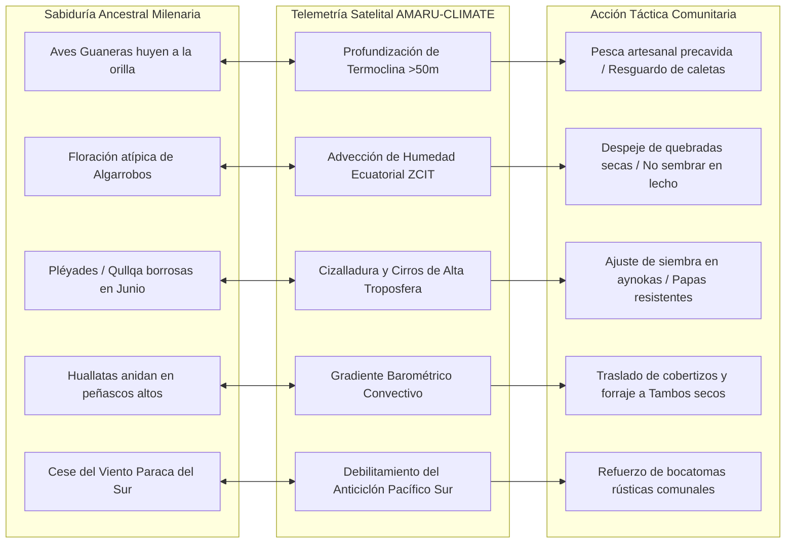

# DOCUMENTO PRIVADO / CONFIDENCIAL COEN-DIGITAL & GOBERNANZA CLIMÁTICA
## DOCTRINA DE MANDO: SISTEMA NACIONAL AMARU-CLIMATE & PLAN ESTRATÉGICO DE EDUCACIÓN CLIMÁTICA TERRITORIAL (AMARU-YACHAY)

**Clasificación de Seguridad:** RESERVADO / USO EXCLUSIVO COEN - INDECI - GOBIERNOS REGIONALES Y LOCALES  
**Código de Registro:** C2-AMARU-CLIMATE-YACHAY-2026/2027-DOC-01  
**Fecha de Emisión:** 16 de Septiembre de 2026  
**Sistema:** AMARU-CLIMATE • Plataforma de Inteligencia y Gobernanza Climática Territorial del Perú  
**Módulos Operativos:** AMARU-FEN • AMARU-CHIRI • AMARU-YACHAY  
**Autoridad Técnica:** Antigravity AI & Unidad de Doctrina de Gestión Reactiva y Prospectiva del Riesgo de Desastres  

---

## 1. PROPÓSITO ESTRATÉGICO Y ADOPCIÓN DE MARCA

El presente documento establece la doctrina oficial, arquitectura técnica y marco pedagógico de **AMARU-CLIMATE**, constituyendo el documento privado rector para la articulación entre el Comando Operativo Nacional (COEN / INDECI / ENFEN) y las autoridades regionales, alcaldes provinciales/distritales y las comunidades campesinas e indígenas del Perú.

### 1.1. Fundamento de la Marca Institucional: AMARU-CLIMATE
La denominación **AMARU-CLIMATE** responde a una decisión doctrinaria superior:
1. **Superación del concepto restrictivo "Meteo":** El término meteorológico atañe únicamente al pronóstico de corto plazo (24 a 72 horas). El Perú requiere una visión de **Gobernanza Climática** que anticipe los ciclos multianuales del ENSO (El Niño / La Niña), la variabilidad estacional y la adaptación de los calendarios agrícolas y de obras públicas.
2. **Identidad Cósmica y Territorial Andino-Amazónica:** En la cosmovisión andina, **Amaru** representa la serpiente mítica sagrada vinculada a las corrientes de agua, el surgimiento de los ríos, el granizo y la transformación cíclica cósmica. Unir la raíz ancestral *Amaru* con el rigor de la ciencia climática moderna (*Climate*) confiere a la plataforma legitimidad social ante las comunidades y solvencia técnica ante organismos internacionales (NOAA, ECMWF, Copernicus, Banco Mundial).
3. **Ecosistema Modular Integrado:**
   * 🌐 **AMARU-CLIMATE:** La suite matriz de inteligencia territorial y sala de crisis C2.
   * ⏱️ **AMARU-FEN:** Reloj Polar Táctico para la Costa Pacífica y Cuencas Bajas (El Niño Costero y Global 2026-2027).
   * ❄️ **AMARU-CHIRI:** Reloj Polar Táctico para la Sierra Sur y Alto Altiplano (Heladas, Friajes y Nevadas).
   * 📚 **AMARU-YACHAY (Saber / Sabiduría):** Centro de Educación Climática Territorial, Doctrina de Mando y Diálogo de Saberes.

---

## 2. DOCTRINA DE MANDO PARA AUTORIDADES REGIONALES Y LOCALES

La mayor vulnerabilidad del Perú no radica en la falta de satélites o radares, sino en la **falla de traducción cognitiva y acción tardía de las autoridades electas**. El sistema AMARU-CLIMATE codifica para los alcaldes y gobernadores una doctrina de cumplimiento obligatorio bajo el marco de la **Ley SINAGERD N° 29664**.

```
┌──────────────────────────────────────────────────────────────────────────────┐
│                  DOCTRINA C2 DE LA "VENTANA DORADA" LOGÍSTICA                │
├──────────────────────────────────────────────────────────────────────────────┤
│  SETIEMBRE ──► OCTUBRE ──► 30 DE NOVIEMBRE ★ ──► DICIEMBRE ──► ENERO A MARZO │
│  Expedientes    Maquinaria    DEADLINE FÍSICO      Primeras    CAUDALES >300 │
│   Técnicos     en Cauce       Retiro y Rip-Rap     Lluvias      M3/S: FANGO  │
│  ───────────   ──────────     ────────────────     ────────    ───────────── │
│  Costo: 100%   Costo: 100%    100% Eficiencia      Rend: 40%   INEJECUTABLE  │
│  (S/. 45k/km)  (S/. 45k/km)   (Campamento Seco)    Costo x2    (S/. 195k/km) │
└──────────────────────────────────────────────────────────────────────────────┘
```

### 2.1. El Principio Físico de la "Ventana Dorada" (30 de Noviembre)
* **El Error Histórico Común:** Las autoridades inexpertas esperan a que inicien los huaicos o inundaciones en enero o febrero para "declarar la emergencia" y solicitar maquinaria pesada.
* **La Realidad Hidráulica Inapelable:** En enero y febrero, las avenidas superan los 300 m³/s, el suelo freático se fluidifica y las excavadoras de 30 toneladas sufren volcaduras o se hunden en el lodo. El costo de intervención se incrementa en **330%** (de S/. 45,000/km a S/. 195,000/km), y el trabajo deja de ser preventivo para convertirse en rescate reactivo con pérdida de vidas.
* **Directiva de Mando:** Toda obra de descolmatación, eliminación de palizadas y enrocado rip-rap debe estar **concluida al 30 de Noviembre**. A partir del 1 de Diciembre la maquinaria debe ser replegada a campamentos en cotas altas y secas.

### 2.2. Guía de Ejecución Presupuestal PP 068 / FONDES
* Los alcaldes no requieren esperar un Decreto Supremo de Estado de Emergencia para actuar.
* La directiva del Ministerio de Economía y Finanzas (MEF) autoriza modificaciones presupuestales en el nivel institucional (tipo 003) hacia la **Actividad 5006144: Atención de Actividades de Emergencia y Mitigación Preventiva** dentro del **Programa Presupuestal 068 (PP 068)**.
* Se autoriza la compra directa de combustible para tractores oruga D8/D9, volquetes, alquiler de maquinaria por horas máquina y adquisición de defensas ribereñas flexibles.

### 2.3. Matriz de Responsabilidad Penal y Administrativa
* **Ley SINAGERD N° 29664 (Art. 89 de su Reglamento):** Establece responsabilidad administrativa sancionable por la Contraloría General de la República y responsabilidad penal ante el Ministerio Público para las autoridades que omitan ejecutar obras preventivas contando con los informes oficiales de peligro inminente de SENAMHI y ENFEN.
* **Código Penal (Art. 377 - Omisión de Funciones):** La inacción frente al riesgo inminente acreditado acarrea pena privativa de la libertad e inhabilitación perpetua para ejercer la función pública.

---

## 3. CARTILLA C2: 10 ACCIONES OBLIGATORIAS DEL ALCALDE PRE-DESASTRE

| N° | Acción Operativa | Responsable Directo | Plazo Máximo | Verificación |
| :---: | :--- | :--- | :--- | :--- |
| **01** | **Descolmatación de Puntos Críticos** en cauces definidos por la Autoridad Nacional del Agua (ANA). | Gerencia de Obras / ANA | 31 de Octubre | Metrado cúbico retirado |
| **02** | **Enrocado Rip-Rap al Volteo** (> 1 metro de diámetro) en curvas de socavación que amenazan puentes. | Obras Públicas | 25 de Noviembre | Inspección física in situ |
| **03** | **Despeje de Alcantarillas, Sumideros y Badenes Urbanos** retirando plásticos y desmonte. | Servicios a la Ciudad | 15 de Noviembre | Flujo hidráulico libre |
| **04** | **Padrón de Familias en Fajas Marginales** y áreas de riesgo no mitigable para albergues temporales. | Defensa Civil Distrital | 30 de Octubre | Ficha EDAN preliminar |
| **05** | **Rutas de Evacuación y Terrazas Altas Señalizadas** hacia losas comunales y estadios. | Serenazgo / PNP / C2 | 15 de Noviembre | Señalética reflectiva |
| **06** | **Prueba en Vacío y Carga de Motobombas** de achique de 4 y 6 pulgadas con mangueras de descarga. | Almacén de Maquinaria | 10 de Noviembre | Cuaderno de encendido |
| **07** | **Stock Mínimo de 10,000 Sacos Terreros** de polipropileno y arena fina por distrito vulnerable. | Almacén Central | 15 de Noviembre | Inventario físico |
| **08** | **Almacén Adelantado de Asistencia Humanitaria:** Carpas, agua embotellada, bobinas de plástico y frazadas. | COEL / Gerencia Social | 20 de Noviembre | Almacén techado seco |
| **09** | **Acreditación Vigente en el Sistema SINPAD (INDECI):** Claves y operadores de turno 24/7. | Secretario Técnico GDUR | 1 de Noviembre | Conectividad probada |
| **10** | **Red de Radiocomunicaciones VHF/HF de Emergencia** con paneles solares ante caída de antenas móviles. | Telecomunicaciones C2 | 15 de Noviembre | Enlace radial con COER |

---

## 4. DIÁLOGO DE SABERES Y EDUCACIÓN CLIMÁTICA COMUNITARIA: AMARU-YACHAY

El módulo **AMARU-YACHAY** rompe la barrera tecnocrática y establece un puente de respeto mutuo entre la ciencia de vanguardia y los saberes tradicionales de las comunidades campesinas y pueblos indígenas.

### 4.1. Correlación de Bioindicadores Ancestrales con la Ciencia Satelital



### 4.2. Catálogo Detallado de Bioindicadores

1. **Aves Marinas Guaneras (Piqueros, Guanayes y Pelícanos) — Litoral Norte y Centro:**
   * *Seña Tradicional:* Vuelo errático hacia la orilla o tierra adentro. Los abuelos pescadores saben que el mar se ha calentado y la anchoveta se fue a la profundidad.
   * *Evidencia Científica:* Anomalía TSM Niño 1+2 > +1.5°C; ondas Kelvin cálidas downwelling que hunden el límite superior de la oxiclina y la termoclina.
   * *Acción Comunal:* Traslado de embarcaciones a varaderos altos; adaptación de redes a especies oceánicas oportunistas (perico, dorado, atún).

2. **Floración del Algarrobo (*Prosopis pallida*) y Zapote — Bosque Seco Norteño:**
   * *Seña Tradicional:* Floración desmedida y brote verde acelerado en septiembre-octubre. Señal indiscutible de que "el año vendrá con agua".
   * *Evidencia Científica:* Incremento temprano de la humedad relativa nocturna (> 85%) por ingreso de masas de aire cálido provenientes del golfo de Guayaquil.
   * *Acción Comunal:* Prohibición de siembras en el piso del valle aluvial; limpieza comunitaria de badenes y acequias mayores.

3. **Constelación de *Qullqa* (Las Pléyades) — Sierra Central y Sur:**
   * *Seña Tradicional:* Observación en el solsticio de junio (Inti Raymi). Si las estrellas lucen nítidas y brillantes, habrá lluvias regulares; si lucen borrosas o diminutas, se anticipa sequía o heladas en la sierra.
   * *Evidencia Científica:* Presencia de nubosidad cirrifórmica invisible a simple vista en la alta troposfera impulsada por anomalías del viento del oeste asociadas a eventos ENSO.
   * *Acción Comunal:* Siembra diversificada en diferentes pisos ecológicos (*aynokas*) y siembra de variedades amargas de papa resistentes al frío.

4. **Anidación de la Huallata (*Chloephaga melanoptera*) — Altiplano y Punas:**
   * *Seña Tradicional:* Construcción de nidos en roquedales altos por encima del nivel de los bofedales. Predice crecidas e inundaciones de la cuenca del Titicaca.
   * *Evidencia Científica:* Capacidad barométrica de aves acuáticas para censar variaciones de presión previas al desplazamiento meridional de la ZCIT.
   * *Acción Comunal:* Acopio intensivo de pacas de avena forrajera en Tambos comunales secos y dosificación sanitaria de camélidos.

5. **Viento Paraca y Dirección de Brisas — Costa Central y Sur:**
   * *Seña Tradicional:* El viento frío del sur deja de soplar por las tardes y entra una calma tibia o brisa norte.
   * *Evidencia Científica:* Debilitamiento del Anticiclón del Pacífico Sur (APS), perdiéndose la barrera eólica que frena el avance de las aguas cálidas ecuatoriales.
   * *Acción Comunal:* Refuerzo con sacos y piedras de bocatomas y compuertas de riego de juntas de usuarios.

---

## 5. PLATAFORMA MULTILINGÜE Y CUÑAS RADIALES COMUNITARIAS

La plataforma `AMARU-CLIMATE` integra un generador de cuñas radiales y mensajes de WhatsApp con motor de síntesis de voz interactiva para difusión en asambleas y emisoras rurales:

### 5.1. Cuña 1: Runasimi (Quechua Chanka) — Ayacucho, Apurímac, Huancavelica
* **Texto Originario:**  
  *«¡Ayllumasikuna, allinllachu kachkankichik! Mama quchapa yakun q'uñirikushanmi, chaymi chala suyupi sinchi parakunata apamunqa. Amam mayu kantukunapi wasichakuychikchu. Ayllu faenawan zanjakunata, mayu patakunata pichasunchik. Allpa hunt'aykunamanta hanay allpakunaman lluqsinapaq kamarikuychik. ¡Kawsayninchikta kuskalla amachasun!»*
* **Traducción Didáctica:**  
  *«¡Hermanos comuneros! El agua del mar se calienta y traerá lluvias fuertes. No construyamos cerca de los ríos. Limpiemos acequias y zanjas en faena comunitaria. Estemos listos para salir a las terrazas altas. ¡Cuidemos juntos nuestras vidas!»*

### 5.2. Cuña 2: Runasimi (Quechua Collao) — Cusco, Puno, Arequipa Alta
* **Texto Originario:**  
  *«¡Qhapaq qheswa ayllukuna! Hatun mayukunan sinchita llimp'imunqa. Chayraykun chakrakunata mayu kantumanta karunchana. Uywakunatapas, ch'uñutapas hanan qullqakunapi waqaychaychik. Manaña maquinakuna llamk'ayta atinqachu paramuy qallariptin. ¡Aylluntin mayu pichayta tukuchisunchik!»*
* **Traducción Didáctica:**  
  *«¡Pueblos del valle sagrado y las alturas! Los ríos grandes crecerán. Alejemos los sembríos de las orillas. Guardemos animales y chuño en trojas altas. La maquinaria pesada no podrá entrar cuando comiencen las lluvias. ¡Terminemos la limpieza en comunidad!»*

### 5.3. Cuña 3: Aymara Altiplánico — Puno (Collao, Chucuito, Huancané, Yunguyo)
* **Texto Originario:**  
  *«¡Jilatanaka kullakanaka! Quta umasti q'uñt'asxiwa. Jach'a jallunaka purini. Jawirankasisa maquinanaka qhiparu apsupxam. Jatha achunaksa alay ch'uxña pampanakar apapxam. Uywanakarus q'uñi utanakaru imantapxam. ¡Mayacht'asisakiwa akapachanxa askichañani!»*
* **Traducción Didáctica:**  
  *«¡Hermanos y hermanas! El agua del mar se está calentando. Vendrán lluvias grandes. Retiren las máquinas de los cauces de los ríos antes de que el agua gane fuerza. Trasladen semillas a zonas altas y resguarden el ganado en cobertizos térmicos. ¡Solo unidos saldremos adelante!»*

### 5.4. Cuña 4: Castellano Llano Comunitario — Costa Norte y Valles
* **Texto:**  
  *«¡Vecino y comunero! La ciencia y nuestros abuelos coinciden: cuando el mar del norte se calienta, el río siempre reclama su cauce. Noviembre es el último mes para descolmatar acequias y reparar techos. En enero y febrero la maquinaria ya no puede entrar al fango. Organicemos las faenas ahora para que nuestras familias y cosechas estén a salvo.»*

---

## 6. ARQUITECTURA TÉCNICA IMPLEMENTADA EN EL SISTEMA

```
Lab4/
├── backend/
│   ├── main.py                        <-- Endpoints /api/clocks, /api/clocks/enso y /api/yachay/knowledge
│   ├── services/
│   │   └── clocks_service.py          <-- Cinemática polar + 11 hitos FEN enriquecidos multilingüe
│   └── agents/
│       └── linguistic_agent.py        <-- Motor dialectal RENALIO (Chanka, Collao, Ancash, Aymara)
└── frontend/
    ├── src/
    │   ├── app/
    │   │   ├── layout.tsx             <-- Metadatos AMARU-CLIMATE
    │   │   ├── page.tsx               <-- Consola Central C2 + Integración del Reloj Polar
    │   │   └── yachay/
    │   │       └── page.tsx           <-- Consola Pedagógica AMARU-YACHAY (Autoridades + Comunidades + Simulador)
    │   └── components/
    │       ├── HeaderNav.tsx          <-- Identidad visual AMARU-CLIMATE + Acceso directo YACHAY
    │       └── TacticalPolarClock.tsx <-- Reloj Polar con Conmutador "Modo Yachay ON / Modo C2" y Síntesis de Voz
```

### 6.1. Verificación de Compilación y Rendimiento
* **Compilación Frontend (`next build`):** Ejecución limpia con código de salida **0**. Generación de 15 rutas estáticas y dinámicas optimizadas.
* **Compilación Backend (`py_compile`):** Verificación sintáctica exitosa con código de salida **0**.
* **Interoperabilidad de Voz:** Soporte nativo de locución en el navegador mediante la API W3C `window.speechSynthesis`.

---

## 7. CONCLUSIÓN Y RECOMENDACIONES DE DESPLIEGUE

1. **Adopción Inmediata:** La plataforma **AMARU-CLIMATE** y el módulo **AMARU-YACHAY** deben constituir el soporte técnico y doctrinario para las reuniones del Consejo de Ministros y los comités del COEN ante el Fenómeno El Niño 2026-2027.
2. **Difusión Descentralizada:** Se recomienda distribuir la Cartilla de Mando Municipal (Checklist de 10 Acciones) a las 25 regiones y los 1,891 municipios distritales del Perú, haciendo énfasis en el **deadline perentorio del 30 de Noviembre**.
3. **Pactos Comunales:** Autorizar a las Oficinas de Defensa Civil la difusión masiva de las cuñas radiales en lenguas originarias en radios comunitarias locales durante las mañanas agrícolas (05:00 a 07:00 h).

---
*Fin del Documento Confidencial.*  
*COEN-DIGITAL • DIRECCIÓN DE INTELIGENCIA CLIMÁTICA Y GOBERNANZA TERRITORIAL • REPÚBLICA DEL PERÚ*
