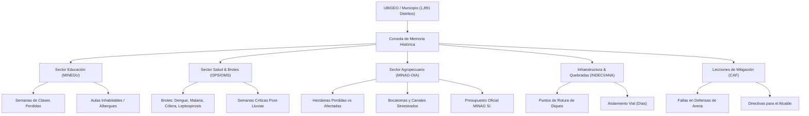

# DOCUMENTO TÉCNICO PRIVADO - DOCTRINA DE SEGURIDAD NACIONAL Y ALERTA TEMPRANA ETNOTERRITORIAL

---

**CLASIFICACIÓN DE SEGURIDAD:** `RESERVADO / USO OFICIAL EXCLUSIVO`  
**DESTINATARIOS:** ALCALDÍAS PROVINCIALES Y DISTRITALES DEL PERÚ • COMANDO GENERAL COEN • CCFFAA • INDECI • MIDAGRI • MINEDU • MINSA / OPS • MEF (DIRECCIÓN GENERAL DE PRESUPUESTO PÚBLICO)  
**ASUNTO:** Implementación Doctrinal, Algorítmica y Cartográfica de la Consola de Memoria Histórica Municipal de Desastres (FEN 1982-1983, 1997-1998 y 2017) para los 1,891 Distritos del Perú  
**FECHA DE EMISIÓN:** 17 de Septiembre de 2026  
**ESTADO DE VIGENCIA:** VIGENTE / OPERACIONAL EN SISTEMA C2 COEN-DIGITAL  

---

## 1. RESUMEN EJECUTIVO Y PROPÓSITO ESTRATÉGICO

El presente documento técnico confidencial certifica y formaliza el despliegue de la **Consola de Memoria Histórica Municipal de Desastres** dentro de la plataforma soberana **AMARU-CLIMATE (COEN-Digital)**.

Históricamente, la Gestión del Riesgo de Desastres (GRD) a nivel municipal en el Perú ha padecido de una severa **amnesia institucional intergubernamental**:
* Cada 4 años, nuevas autoridades ediles asumen funciones sin un inventario técnico estandarizado de los eventos catastróficos precedentes.
* Los informes de daños, evaluaciones sectoriales y lecciones de ingeniería permanecían archivados en tomos dispersos en PDF o impresos de la **CAF**, **INDECI**, **MINAG**, **OPS/OMS** y **MINEDU**, inaccesibles para el operador municipal en sala de crisis.
* En consecuencia, los gobiernos locales repetían los mismos errores operativos: colocación de diques de arena sin refuerzo, asentamientos en fajas marginales desbordadas en 1983 y 1998, falta de desazolve de drenes troncales y omisión de reservas de medicamentos para brotes epidémicos previsibles.

A través de esta implementación:
1. Se ha unificado, parseado e indexado en un modelo de datos común la memoria documental de los **1,891 distritos del Perú**.
2. Los alcaldes, regidores y secretarios técnicos de Defensa Civil pueden consultar en segundos por **UBIGEO o nombre de municipio** la radiografía exacta de los impactos ocurridos en los eventos FEN 1982-1983, 1997-1998 y 2017.
3. Se integran en un solo panel de comando los 5 sectores vitales: **Educación (MINEDU)**, **Salud y Brotes (OPS/OMS)**, **Sector Agropecuario y Riego (MINAG-OIA)**, **Puntos Críticos Fluviales y Quebradas (ANA/CENEPRED)** y **Lecciones de Ingeniería (CAF)**.
4. Se habilita la generación instantánea de la **Ficha Ejecutiva Municipal**, documento oficial listo para imprimir y sustentar transferencias presupuestales ante el **MEF / FONDEN / INDECI**.

---

## 2. FUNDAMENTO DOCTRINAL: "LA GEOGRAFÍA NO OLVIDA"

En el territorio peruano, los fenómenos hidrometeorológicos extremos no operan al azar:
* Las quebradas que se activaron en el Mega-Niño de 1983 volvieron a activarse en 1998, 2017 y durante el Ciclón Yaku de 2023.
* Las compuertas, bocatomas y puentes que colapsaron en el Bajo Piura o en el Valle de La Leche fallaron en las mismas progresivas kilométricas.
* Los brotes de dengue, malaria, leptospirosis y cólera emergen con precisión matemática entre 4 y 12 semanas después del cese de las lluvias si los colectores y norias de agua colapsan.

> [!IMPORTANT]
> **PRINCIPIO OPERATIVO COEN:**  
> *"Conocer la catástrofe del pasado es la única garantía de no financiar con vidas y recursos públicos la imprevisión del futuro."* La Consola Histórica proporciona al alcalde la hoja de ruta de lo que indefectiblemente volverá a ocurrir si no se ejecutan las obras de contingencia antes del inicio de las lluvias.

---

## 3. FUENTES DOCUMENTALES TÉCNICAS INTEGRADAS (`data/`)

La base de conocimientos de la Consola Histórica se nutre estrictamente de documentación técnica oficial auditada:

| Entidad Emisora | Documento Oficial | Extensión | Variables Clave Extraídas |
| :--- | :--- | :--- | :--- |
| **CAF** (Corporación Andina de Fomento) | *Las lecciones de El Niño: Memoria, Retos y Soluciones (Volumen V Perú)* | 304 págs. | Fallas de obras civiles de mitigación, colapso de defensas ribereñas sin enrocado, costos directos e indirectos de reconstrucción y directivas municipales. |
| **MINAG - OIA** (Ministerio de Agricultura) | *Áreas Perdidas y Afectadas Durante el Fenómeno de El Niño (Campañas 1982-1983 y 1997-1998)* | 338 págs. | Hectáreas perdidas (100%) vs afectadas por valle agrícola, familias campesinas damnificadas, daños en bocatomas/canales (S/. 204.8M) y respuesta fisiológica de cultivos. |
| **INDECI / SINPAD** | *Compendio Estadístico del FEN 2017* y *Cap. 6.3 FEN 1997-1998* | 54 págs. | Estadísticas oficiales de damnificados, fallecidos, viviendas colapsadas/inhabitables, red vial destruida y puentes colapsados. |
| **OPS / OMS** (Org. Panamericana de la Salud) | *Crónica de Desastres FEN 1997-1998 (Cap. 11 Perú)* e *IRIS PAHO Enfermedades FEN* | 295 págs. | Perfil epidemiológico post-inundación: brotes de Dengue, Malaria, Cólera, Leptospirosis, EDAs, IRAs, colapso de postas de salud y contaminación de pozos. |
| **MINEDU / PUCP CISE** | *Colección Especial Manuel Etesse: El Fenómeno del Niño y la Escuela Peruana* | 50 págs. | Semanas lectivas perdidas, escuelas inhabitables, afectación de mobiliario escolar y colegios aptos como albergues comunitarios temporales. |
| **PCM / CENEPRED** | *D.S. Nº 124-2026-PCM* y *Catálogo Nacional SIGRID MEF (1,891 distritos)* | Oficial | Condición de Estado de Emergencia vigente, niveles de peligro SIGRID y georreferenciación de distritos. |

---

## 4. ARQUITECTURA TÉCNICA E IMPLEMENTACIÓN DEL SISTEMA

### 4.1. Pipeline de Ingesta y Generación de Datos (`backend/scripts/`)
* **Script Generador:** [`backend/scripts/build_historical_district_memory.py`](file:///c:/Users/Usuario%20Libre/Documents/recuperacion%20de%20USB%2014%20de%20setiembre/curso-gcp-google-adk-01/Lab4/backend/scripts/build_historical_district_memory.py).
* Cruza el catálogo nacional de 1,891 distritos de CENEPRED/MEF con:
  * Datos **bespoke de alta especificidad** para distritos críticos emblemáticos (*Catacaos, Piura, Castilla, Tambogrande, Íllimo, Chiclayo, Chosica, El Porvenir, Huarmey, Tumbes*).
  * Matrices departamentales oficiales del **MINAG-OIA (Cuadros V.81 a V.84)** para cuantificación de daños en valles agrícolas y presupuesto de rehabilitación en soles.
  * Perfiles arquetípicos regionales de la OPS/OMS (Costa Norte, Costa Centro-Sur, Sierra, Selva) para el 100% de municipios restantes.
* **Archivo de Salida:** `data/distritos_memoria_historica_fen.json` (8.4 MB, 1,891 expedientes distritales completos).

### 4.2. Servicio Unificado del Backend (`HistoricalDataService`)
* **Ubicación:** [`backend/services/historical_data_service.py`](file:///c:/Users/Usuario%20Libre/Documents/recuperacion%20de%20USB%2014%20de%20setiembre/curso-gcp-google-adk-01/Lab4/backend/services/historical_data_service.py).
* Carga indexada en memoria al iniciar el servicio con soporte de recarga en caliente (`reload_datasets()`).
* Métodos principales:
  * `get_historical_district_memory(ubigeo)`: Retorna el expediente unificado de educación, salud OPS, sector agrario MINAG, hidrología y lecciones CAF.
  * `get_historical_summary_metrics()`: Retorna métricas macro y balance nacional de distritos de alta recurrencia.
  * `search_districts(query, limit)`: Buscador omnicanal con normalización fonética y alias populares peruanos.

### 4.3. Endpoints de API REST (`backend/main.py`)
* `GET /api/historico/distrito/{ubigeo}`: Consulta individual por código de 6 dígitos del INEI.
* `GET /api/historico/resumen`: Estadísticas globales y detalle de fuentes auditadas.
* `POST /api/historico/reload`: Disparador de recarga de memoria en caliente sin caída de servicio.

### 4.4. Interfaz Táctica de Usuario en Frontend (`Next.js / TypeScript / Tailwind CSS`)
* **Ruta Dedicada:** [`frontend/src/app/historico/page.tsx`](file:///c:/Users/Usuario%20Libre/Documents/recuperacion%20de%20USB%2014%20de%20setiembre/curso-gcp-google-adk-01/Lab4/frontend/src/app/historico/page.tsx).
* **Navegación:** Enlace directo con distintivo `1983-2017` incorporado en [`HeaderNav.tsx`](file:///c:/Users/Usuario%20Libre/Documents/recuperacion%20de%20USB%2014%20de%20setiembre/curso-gcp-google-adk-01/Lab4/frontend/src/components/HeaderNav.tsx).
* Componentes clave:
  1. **Buscador Omnicanal con Autocompletado en Tiempo Real:** Filtra por UBIGEO, distrito, provincia o departamento en menos de 100 ms.
  2. **Selector Rápido de Casos Emblemáticos:** Catacaos, Castilla, Piura, Tambogrande, Íllimo, Chosica, El Porvenir, Tumbes y Huarmey.
  3. **Tarjeta de Identidad y Amparo Legal:** Exhibe código UBIGEO, cuenca hidrográfica, amparo legal del D.S. 124-2026-PCM, nivel SIGRID CENEPRED y contactos directos del responsable municipal de GRD.
  4. **Pestañas Modulares Especializadas:**
     * *1. Radiografía Comparativa (1983 - 1998 - 2017):* Comparación interanual de daños físicos y humanos.
     * *2. Impacto Educativo (MINEDU / CISE):* Colegios anegados, pérdida de semanas lectivas y escuelas albergue.
     * *3. Alerta Sanitaria & Brotes (OPS/OMS):* Semáforo de vectores (*Aedes aegypti*, *Anopheles*), semanas críticas de contagio y estado de postas médicas.
     * *4. Puntos Críticos & Quebradas:* Zonas de rotura de diques, activación de conos de deyección y vías de aislamiento.
     * *5. Sector Agropecuario & Riego (MINAG-OIA):* Hectáreas perdidas, valles oficiales, cultivos vulnerables y presupuesto de rehabilitación.
     * *6. Lecciones CAF & Hoja de Ruta:* Errores del pasado y decálogo de prevención inmediata.
  5. **Modo Imprimible / Ficha Ejecutiva para Concejo Municipal:** Estilo adaptado para impresión directa en formato A4 con firmas para sesiones de concejo y COED.

---

## 5. RADIOGRAFÍA SECTORIAL INCORPORADA

---

## 6. EXPEDIENTE DE MUESTRA: CASO CATACAOS (UBIGEO 200105)

Como ejemplo de la profundidad analítica que la consola provee a las autoridades ediles:

* **Valle Oficial:** Valle Medio y Bajo Piura (Cuenca Río Piura).
* **Nivel de Peligro SIGRID:** Muy Alto • Declarado en Emergencia D.S. Nº 124-2026-PCM.
* **Impacto Agropecuario MINAG:**
  * Superficie agrícola perdida en 1998: **5,200 hectáreas** (Algodón Pima y Arroz).
  * Familias campesinas damnificadas: **14,200 productores**.
  * Presupuesto de rehabilitación de infraestructura de riego: **S/. 12,850,000**.
  * Falla crítica: Rotura del Canal Matriz Biaggio Arbulu y colapso del Dique Pedregal.
  * Vulnerabilidad fisiológica: Asfixia radicular e hipersalinidad residual prolongada en suelos de planicie.
* **Impacto Educativo MINEDU:**
  * 1998: 45 colegios afectados, 19 aulas inhabitables, 10 semanas de clases perdidas.
  * Escuelas usadas como albergue: *Colegio Juan de Mori*, *I.E. San Juan Bautista*.
* **Impacto Epidemiológico OPS:**
  * Brote récord de Cólera y Malaria en 1998; brote severo de Dengue con signos de alarma y Leptospirosis en 2017 (7,400 casos).
  * Colapso de desagües durante 50 días consecutivos.
* **Lección Doctrinal de la CAF:**
  * *"La colocación de sacos de arena sin geobolsas ni enrocado en el Dique Pedregal falló repetidamente. Se requiere salida directa y definitiva del río Piura al mar y refuerzo de compuertas de retención automática."*

---

## 7. PROTOCOLO OPERATIVO PARA ALCALDES Y COMITÉS DE GRD

1. **Revisión Obligatoria en Sesión de Concejo:**  
   El alcalde distrital descargará e imprimirá la **Ficha Ejecutiva Municipal** de su UBIGEO para ser anexada al acta de la Plataforma Provincial/Distrital de Defensa Civil.
2. **Coordinación con Juntas de Usuarios de Agua:**  
   Contrastar las bocatomas y canales siniestrados identificados por el MINAG contra el plan de mantenimiento preventivo de la Junta de Regantes antes del inicio del periodo de lluvias.
3. **Pre-posicionamiento de Almacenes Sanitarios:**  
   Verificar que la posta médica local cuente con stock de pastillas de cloro (Aquatabs) y sales de rehidratación oral para cubrir el estimado de casos de emergencia reportados en el expediente OPS.
4. **Sustentación Presupuestal FONDEN / MEF:**  
   Utilizar las cifras oficiales de pérdida de hectáreas, aislamiento vial y daños educativos consignadas en la consola como base técnica para solicitudes de financiamiento ante la Autoridad Nacional de Infraestructura (ANIN) y el Ministerio de Economía y Finanzas.

---

**REGISTRADO Y DISTRIBUIDO EN EL ARCHIVO MAESTRO DE DOCTRINA C2 COEN-DIGITAL.**  
*Documento protegido bajo normas de seguridad de la información del Centro de Operaciones de Emergencia Nacional.*
