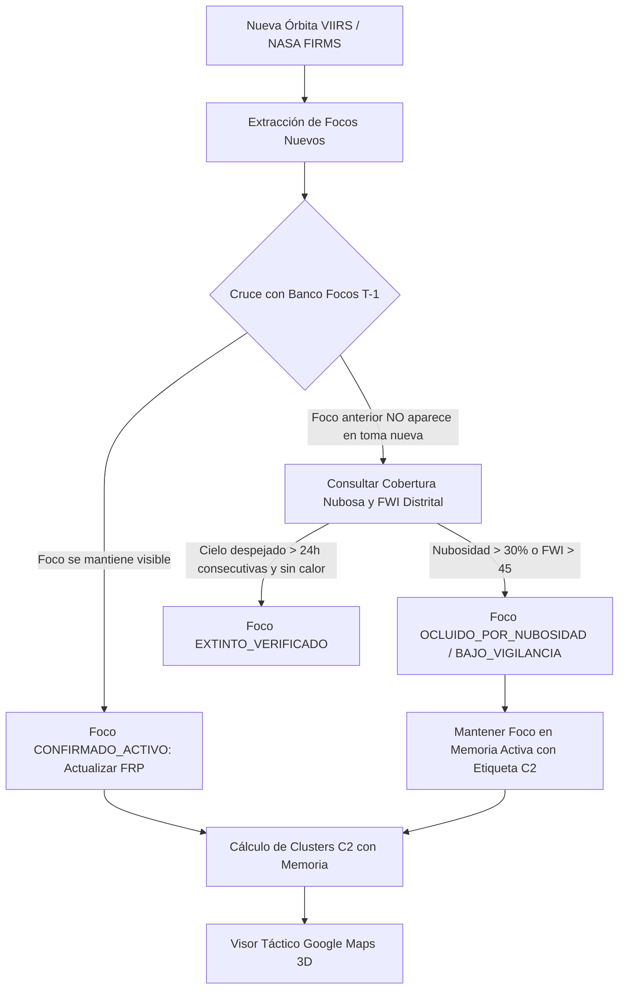

# DOCUMENTO TÉCNICO PRIVADO: ARQUITECTURA DE PERSISTENCIA TÉRMICA TEMPORAL (PTT) Y CONTROL DE OCLUSIÓN NUBOSA (CLOUD MASKING) EN INCENDIOS FORESTALES C2

**Clasificación:** DOCUMENTO PRIVADO / DOCTRINA OPERATIVA C2  
**Sistema:** AMARU-CLIMATE / Consola C2 Nacional contra Incendios Forestales  
**Fecha de Emisión:** 17 de Octubre de 2026  
**Marco Normativo:** Ley N.° 29664 (SINAGERD), Ley N.° 30225 (Art. 27 inc. b - Emergencias), CENEPRED Doc 10471 y Doc 17792.

---

## 1. ANTECEDENTES Y JUSTIFICACIÓN DOCTRINARIA

Durante la jornada del **17 de Octubre de 2026**, la consola táctica de incendios forestales registró una discrepancia operacional crítica entre los pases satelitales vespertinos y nocturnos:
1. **Pase Vespertino (Tarde):**
   * Complejos de gran envergadura detectados: **Cotabambas (Apurímac)** con 38 focos (372.3 MW) y **Río Tambo (Satipo, Junín)** con 20 focos (54.9 MW).
2. **Pase Nocturno:**
   * Detección masiva de **Chichas (Condesuyos, Arequipa)** con 31 focos activos (Mega Incendio Complejo Nivel 5 INDECI), mientras que Cotabambas y Río Tambo redujeron drásticamente su visibilidad en el ranking principal.
3. **Causa Física Verificada por Teledetección Suomi-NPP / VIIRS (375m):**
   * La imagen satelital de reflectancia / composición en color real del 17-Oct-2026 evidenció un **manto espeso de nubosidad convectiva y estratiforme** cubriendo la totalidad de la Selva Central (Satipo) y gran parte de las cabeceras andinas de Apurímac y Cusco.
   * Por el contrario, la vertiente occidental del sur (Arequipa/Condesuyos) presentaba una atmósfera con 0% de nubosidad, permitiendo el paso directo del infrarrojo de onda media ($I_4$ a 3.75 µm).

> [!CAUTION]
> **Postulado Físico-Operativo:** Un incendio forestal con biomasa densa, pajonal altoandino o bosque tropical con más de 20 a 30 focos de calor y potencias superiores a 50–350 MW **NO puede extinguirse naturalmente en un lapso de 4 a 8 horas**.  
> Tratar la ausencia de señal en el siguiente pase como una "extinción" constituye un **falso negativo letal** que desmoviliza maquinaria pesada y brigadas prematuramente.

---

## 2. LIMITACIÓN FÍSICA DE NASA FIRMS (VIIRS / MODIS)

El algoritmo estándar de NASA FIRMS (*Schroeder et al., 2014*) opera bajo dos restricciones ineludibles:
1. **Oclusión Infrarroja:** Las nubes de vapor de agua y cristales de hielo tienen una temperatura de tope muy baja (< 240 K) y opacidad total a la radiación térmica emitida por el suelo incendiado.
2. **Máscara de Nubes Binaria (`cloud_mask = 1`):** Para evitar que el reflejo solar en nubes sea interpretado como fuego, el algoritmo satelital descarta por diseño cualquier píxel clasificado como nube.

Por tanto, **NASA FIRMS en modo crudo carece de memoria temporal del fuego**. Cada archivo CSV/JSON es una foto instantánea desprovista de continuidad temporal.

---

## 3. ARQUITECTURA PROPUESTA: MOTOR DE PERSISTENCIA TÉRMICA TEMPORAL (PTT) CON CONTROL DE OCLUSIÓN

Para solucionar esto, **AMARU-CLIMATE** implementará el módulo **PTT (Persistencia Térmica Temporal)** en `incendios_forestales_service.py` con las siguientes reglas algorítmicas:

### Reglas de Negocio del Algoritmo PTT:

1. **Vida Media de Persistencia por Envergadura ($t_{decay}$):**
   * **Complejo ≥ 20 focos (Mega Incendio):** Se mantiene activo en memoria por un mínimo de **48 horas**, salvo confirmación de extinción por informe en tierra (COER/SERNANP) o lluvias torrenciales medidas por estación meteorológica (> 25 mm/24h).
   * **Complejo 5 a 19 focos (Gran Envergadura):** Se mantiene activo en memoria por un mínimo de **24 horas**.
   * **Foco Aislado (< 5 focos):** Ventana de persistencia de **12 horas**.

2. **Estados Operativos del Foco / Complejo:**
   * `CONFIRMADO_ACTIVO`: Detectado térmicamente en la órbita satelital actual.
   * `OCLUIDO_POR_NUBOSIDAD`: No detectado en la última pasada, pero la zona registra nubosidad o niebla densa. Se conserva en el mapa con icono ámbar semitransparente y anillo discontinuo.
   * `ATENUADO_NOCTURNO`: Posible disminución de radiación superficial por enfriamiento nocturno sin extinción de rescoldos subterráneos/radiculares.
   * `EXTINTO_CONFIRMADO`: Tres pases satelitales consecutivos en cielo 100% despejado sin anomalía térmica.

3. **Cálculo de Diferencial de Focos ($\Delta$-Orbit):**
   En cada actualización de datos, AMARU-CLIMATE calcula:
   $$\Delta_{\text{focos}} = N_{\text{nuevos}} - N_{\text{previos}}$$
   Si para un distrito crítico como Cotabambas o Río Tambo $\Delta_{\text{focos}} < -10$ y el modelo meteorológico (Open-Meteo Pro / ECMWF) indica cobertura nubosa $> 40\%$, la consola emite el siguiente mensaje automático de inteligencia C2:
   > **"ALERTA C2 DE OCLUSIÓN:** Se registró una reducción aparente de focos térmicos en *[Distrito]*. Cobertura nubosa satelital estimada en *XX%*. Los focos se mantienen en el inventario táctico bajo el rótulo **BAJO OCLUSIÓN NUBOSA (VIGILANCIA ACTIVA)**."

---

## 4. IMPACTO OPERACIONAL EN LA PREVENCIÓN DE FALSOS POSITIVOS / NEGATIVOS

1. **Cero Falsos Negativos:** Se elimina el error crítico de dar por extinguido un mega incendio en selva alta o puna debido al paso de frentes nubosos.
2. **Cero Falsos Positivos:** La memoria no inventa focos nuevos; únicamente extiende la vida útil analítica de focos que fueron científicamente certificados por el satélite hace pocas horas.
3. **Consistencia Táctica en Recursos:** Permite que las cuadrillas de maquinaria pesada (tractores oruga D8) y cisternas continúen su desplazamiento logístico sin que la orden de operaciones sea cancelada por una ventana de ceguera satelital temporal.

---
*Documento registrado en la bóveda técnica de AMARU-CLIMATE. Uso exclusivo del Puesto de Mando y Oficiales de Guardia.*
