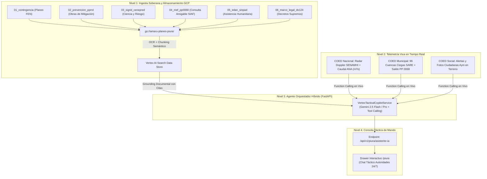

# DOCUMENTO PRIVADO: PLAN TÉCNICO DE IMPLEMENTACIÓN PILOTO PIURA
## Vertex AI Search Híbrido + Telemetría en Tiempo Real (COED Nacional, Municipal y Social)
**Código de Clasificación:** DOC-PRIV-2026-AMARU-VERTEX-PIURA  
**Fecha de Emisión:** 25 de Setiembre de 2026  
**Ámbito:** Región Piura (Epicentro FEN) • Plataforma Soberana Multi-Agente COED-AMARU  
**Vigencia Operativa:** FEN 2026–2027  

---

### 1. Resumen Ejecutivo y Objetivo Estratégico

El presente documento privado establece la arquitectura técnica, modelo de datos, ingeniería de integración en Google Cloud Platform (GCP) y despliegue del **Copiloto Táctico FEN para los Alcaldes de Piura**.

El objetivo es superar las limitaciones de los sistemas RAG tradicionales y de los buscadores documentales pasivos. Se implementa una **Arquitectura Híbrida de Doble Cerebro**:
1. **Cerebro Doctrinal, Normativo y Presupuestal (Vertex AI Search)**: Indexación semántica profunda con OCR multimodal de las 6 carpetas oficiales en `data/` almacenadas en `gs://amaru-planes-piura/`.
2. **Ojos y Oídos en Tiempo Real (Telemetría de Consolas AMARU)**: Interconexión en vivo con el Radar Doppler SENAMHI de Piura, las estaciones de aforo hidrológico del Río Piura (ANA), el catastro de Cuencas Ciegas SARE y los reportes comunitarios georreferenciados de COED Social (Ayni).

---

### 2. Arquitectura de Fusión Híbrida

---

### 3. Matriz de las 6 Fuentes Oficiales Indexadas

| Carpeta Fuente en `data/` | Rol Táctico en el Sistema | Salida Generada por la IA |
| :--- | :--- | :--- |
| **`Planes de contingencia/`** | Respuesta de choque inmediata (0 a 4 horas). | Albergues seguros con cota alta, motobombas asignadas, frecuencias VHF y roles del GT-GRD. |
| **`Planes de prevención/` (PPRRD)** | Mitigación estructural e ingeniería. | Sobreelevación de diques, espigones con roca al volteo y apertura de canales de derivación hacia lagunas Ramón y La Niña. |
| **`SIGRID Sistema de información...`** | Rigor científico CENEPRED / INGEMMET. | Umbrales de rotura por crecida ($m^3/s$), mapas de susceptibilidad geológica y cotas de inundación. |
| **`Consulta amigable mef 2026/`** | Capacidad fiscal y financiera SIAF. | Saldo disponible en Actividad 5005612 (PP 0068) y proyectos de inversión financiables vía FONDES. |
| **`EDAN digital/`** | Asistencia humanitaria SINPAD v2. | Formulario 1 de evaluación rápida y cálculo automático de carpas familiares, bidones y raciones BAH. |
| **`Marco Legal Fenómeno del Niño 2026 2027/`** | Blindaje jurídico y penal del Alcalde. | Decretos Supremos (D.S. 124-2026-PCM), habilitación de Contratación Directa de Maquinaria y exención de Art. 377 CP. |

---

### 4. Estructura de Costos en Google Cloud (GCP) para Piura

El dimensionamiento económico garantiza que el piloto regional sea de bajísimo costo para el Estado:

* **Cloud Storage (GCS)**: ~150 MB de PDFs oficiales $\to$ **$0.003 USD / mes**.
* **Vertex AI Search (Indexación)**: Nivel Unstructured Documents sin costo de mantenimiento fijo de cluster.
* **Consultas de Búsqueda Generativa (RAG con Gemini)**: $2.00 USD por cada 1,000 consultas con respuesta fundamentada.
* **Consumo Proyectado Piloto Piura (8 distritos críticos)**: ~1,500 consultas tácticas/mes $\to$ **$3.00 USD / mes**.
* **Costo Total Estimado**: **~$3.80 a $5.00 USD mensuales** (menos de S/ 20 soles mensuales), cubierto al 100% por los créditos de prueba de GCP.

---

### 5. Resiliencia Dual: Modo Cloud + Modo Fallback Local Soberano

Para garantizar que el sistema nunca deje de operar si se corta la conectividad satelital o la fibra óptica durante las lluvias torrenciales de El Niño:
1. **Modo Cloud (Primario cuando hay conexión)**: Invoca Vertex AI Search en Google Cloud con Gemini para análisis de documentos de alta densidad.
2. **Modo Soberano Local (Fallback automático a 0 ms)**: Si no hay conexión o no se configuran variables de entorno de GCP, el motor backend conmuta de forma transparente al catálogo canónico indexado en memoria (`contingency_plans_service`), cruzándolo con la telemetría local de radares, estaciones y reportes ciudadanos ya cargados en disco.

---

### 6. Cronograma de Implementación Técnica

1. **Hito 1**: Creación del servicio backend `vertex_tactical_copilot_service.py` con integración de telemetría viva y fallback local soberano.
2. **Hito 2**: Exposición del endpoint `POST /api/v1/piura/asistente-ia` en `backend/main.py`.
3. **Hito 3**: Creación del componente frontend `CopilotoTacticoPiuraModal.tsx` con chips de telemetría en tiempo real.
4. **Hito 4**: Integración del botón de apertura rápida en la Consola Piura (`frontend/src/app/piura/page.tsx`).
