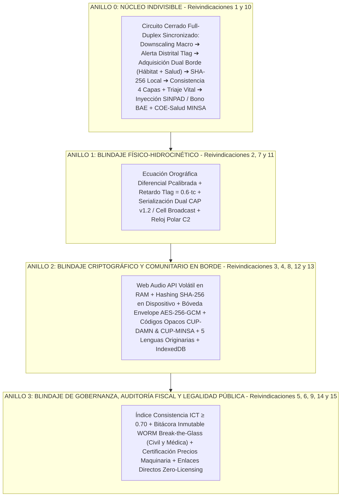

# SOLICITUD DE PATENTE DE INVENCIÓN – MEMORIA DESCRIPTIVA Y PLIEGO REIVINDICATORIO
### REPÚBLICA DEL PERÚ – INSTITUTO NACIONAL DE DEFENSA DE LA COMPETENCIA Y DE LA PROTECCIÓN DE LA PROPIEDAD INTELECTUAL (INDECOPI)
**DIRECCIÓN DE INVENCIONES Y NUEVAS TECNOLOGÍAS**  
*Tramitada bajo el amparo de la Decisión 486 de la Comisión de la Comunidad Andina y el Decreto Legislativo N.º 1075*

---

## 1. IDENTIFICACIÓN DE LA SOLICITUD Y DECLARACIÓN DE TITULARIDAD

- **Denominación Oficial / Título de la Invención:**  
  *SISTEMA COMPUTACIONAL Y MÉTODO DE COMUNICACIÓN BIDIRECCIONAL MULTIESCALA PARA LA SINCRONIZACIÓN HIDROCINÉTICA, CERTIFICACIÓN CRIPTOGRÁFICA DE DAÑOS EN EL BORDE Y RETROALIMENTACIÓN HUMANITARIA EN TIEMPO REAL.*
- **Tipo de Patente:** Patente de Invención (Procedimiento y Sistema Físico-Lógico Implementado en Computador).
- **Régimen de Titularidad y Naturaleza Jurídica:**  
  La presente invención constituye un desarrollo tecnológico autónomo de **titularidad privada independiente**, de carácter universal, modular y licenciable a nivel nacional e internacional. Las referencias operacionales a entidades públicas, ordenamientos normativos, plataformas de gestión gubernamental o idiomas específicos (tales como INDECI, SINPAD, MINSA, SISMATE, Bono BAE o el territorio peruano) se divulgan exclusivamente a título de **realizaciones preferentes, entornos de prueba y casos de aplicación ejemplificativos**, sin que limiten el campo técnico universal de protección reivindicado, el cual es extensible a cualquier gobierno, entidad humanitaria, consorcio privado o cuenca hidrográfica internacional.
- **Clasificación Internacional de Patentes (CIP):**  
  - **G08B 21/10:** Sistemas de alarma de condiciones ambientales o meteorológicas amenazantes.
  - **G06F 21/60:** Protección de datos personales, seguridad criptográfica y aislamiento de identidad.
  - **G06Q 50/26:** Sistemas computacionales aplicados a la administración pública, defensa civil y ayuda humanitaria.
  - **H04L 9/32:** Protocolos criptográficos para autenticación de integridad y verificación de firmas/resúmenes digitales.
  - **G01W 1/10:** Modelamiento predictivo hidrometeorológico y pronóstico de amenazas climáticas.
  - **H04W 4/90:** Servicios de comunicaciones de emergencia sobre redes celulares móviles.

---

## 2. SECTOR TECNOLÓGICO Y CARÁCTER TÉCNICO DE LA INVENCIÓN (DOCTRINA IIC)

La presente invención se fundamenta en la **Doctrina de Invenciones Implementadas por Computador (IIC)** y en los criterios de examen de patentabilidad de la Decisión 486 de la Comunidad Andina (Resolución N.º 001372-2021/TPI-INDECOPI y Directrices para el Examen de Solicitudes de Patentes de la Secretaría General de la CAN), situándose en la convergencia técnica de:
1. **Control Físico y Telecomunicaciones de Misión Crítica:** Sistemas de Mando, Control, Comunicaciones y Cómputo (C4I) que gobiernan la sincronización temporal y el direccionamiento selectivo de paquetes en redes de datos distribuidas heterogéneas.
2. **Procesamiento y Transformación de Señales Físicas:** Transformación de mediciones físicas de reflectividad electromagnética de radares en Banda C, parámetros térmicos marinos y matrices digitales de elevación topográfica en señales de control de riesgo hidrodinámico.
3. **Optimización de Recursos Hardware y Criptografía en Borde:** Métodos de gestión de memoria volátil de silicio (RAM) en procesadores cliente que realizan captura y síntesis unidireccional de ondas sonoras mecánicas sin persistencia no autorizada de datos biométricos y sin incurrir en transferencias de ancho de banda innecesarias.
4. **Interoperabilidad Mediante Estándares Abiertos:** Generación de tramas de datos normalizadas conformes al estándar abierto Common Alerting Protocol (OASIS CAP v1.2 / ITU-T X.1303), aptas para ser consumidas por pasarelas de difusión celular (*Cell Broadcast*) y redes de datos públicas o privadas sin subordinación a infraestructura privativa.

---

## 3. ESTADO DE LA TÉCNICA Y PROBLEMAS TÉCNICOS NO RESUELTOS

### 3.1. Estado de la Técnica Anterior
En la gestión de emergencias por eventos hidrometeorológicos extremos coexisten tecnologías sectoriales aisladas:
- **Sistemas de Teledetección y Radares Meteorológicos:** Redes de radares meteorológicos (ej. Banda C / Banda S) y satélites geoestacionarios/helio-sincrónicos (GOES, Sentinel) que monitorean la reflectividad radar $Z$ y el contenido de vapor de agua.
- **Protocolos de Alerta Celular Masiva:** Estándares como el Common Alerting Protocol (OASIS CAP v1.2 / ITU-T X.1303) y Cell Broadcast (3GPP TS 23.041), utilizados en sistemas como SISMATE (Perú) o WEA (EE. UU.).
- **Plataformas de Colaboración Abierta (*Crowdsourcing*):** Aplicaciones móviles que permiten a los usuarios reportar incidentes mediante coordenadas GPS y fotografías.
- **Sistemas de Registro Post-Desastre:** Bases de datos de defensa civil (ej. Ficha EDAN y SINPAD en Perú) en las cuales los funcionarios registran manualmente en formularios físicos los daños a viviendas y personas.

### 3.2. Problemas Técnicos No Resueltos en el Estado del Arte

1. **La Ruptura de la Bidireccionalidad (Canales Asimétricos y Abiertos):**  
   Los sistemas de alerta existentes operan exclusivamente de forma **unidireccional descendente (Top-Down)**: una entidad central emite una alarma genérica (ej. *"Lluvias intensas en región centro"*). No existe un mecanismo técnico que reciba la confirmación física del impacto en tiempo real ni que calcule el tiempo exacto en que la masa de agua impactará un puente o caserío específico ($T_{\text{lag}}$). Por otro lado, los sistemas de reporte ciudadano operan de forma **unidireccional ascendente (Bottom-Up) caótica**: los ciudadanos reportan en redes sociales o formularios web sin recibir jamás una confirmación técnica vinculante, provocando incertidumbre, duplicidad y desborde de llamadas a centrales telefónicas.

2. **La Paradoja de la Veracidad vs. Privacidad en Reportes de Desastres:**  
   Los sistemas de reporte conocidos exigen que el ciudadano entregue datos personales (nombre, DNI, número telefónico) y capture fotografías del interior de su hogar. Esto genera dos vulnerabilidades críticas:
   - Si los datos no se protegen, quedan expuestos en bases de datos vulnerables a filtraciones, robo de identidad y extorsión, violando leyes de protección de datos personales.
   - Si el sistema anonimiza totalmente al usuario sin rigor criptográfico, prolifera la desinformación (*fake news*), la manipulación política de padrones y los falsos reportes generados para desviar recursos de auxilio.

3. **Exclusión Fonética y Lingüística de Comunidades Indígenas:**  
   Los servicios comerciales de reconocimiento de voz y procesamiento de lenguaje natural (ASR/NLP en la nube, ej. Vapi, Twilio, OpenAI Whisper estándar) están optimizados para lenguas hegemónicas. En cuencas andinas y amazónicas, las personas damnificadas se comunican en variantes del Quechua (Chanka, Collao, Áncash) o Aymara. El estado del arte carece de un método que permita capturar testimonios orales de desastres en lenguas originarias **sin transmitir la biometría vocal a servidores externos**, generando un resumen probatorio inalterable en el dispositivo móvil con validez ante auditorías fiscales.

4. **El Desfase Temporal en la Entrega de Ayuda Humanitaria y Subsidios:**  
   Bajo el modelo tradicional, el empadronamiento de familias con viviendas colapsadas toma entre 7 y 21 días debido al uso de fichas en papel y digitación manual en oficinas distritales. Este desfase impide la canalización inmediata del subsidio de arrendamiento de emergencia (Bono BAE) durante las primeras 72 horas críticas, forzando a las familias a permanecer en zonas de alto riesgo aluvial.

---

## 4. DESCRIPCIÓN DETALLADA DE LA INVENCIÓN

### 4.1. Fundamento Técnico y Nivel Inventivo

La presente invención resuelve integralmente las deficiencias expuestas mediante un **sistema computacional distribuido y método de comunicación bidireccional multiescala**, cuyo **reclamo esencial** radica en:

> **RECLAMO ESENCIAL:**  
> La sincronización en tiempo real entre un **modelo predictivo hidrodinámico centralizado descendente** y una **malla de verificación territorial comunitaria ascendente protegida por encriptación de sobre (Zero-PII)**, cerrando el ciclo mediante la emisión automatizada de comprobantes criptográficos de elegibilidad a subsidios de emergencia (Bono BAE) sin exponer datos biométricos ni depender de servicios de mensajería comercial de pago.

```
                          ARQUITECTURA DE LA INVENCIÓN
┌────────────────────────────────────────────────────────────────────────────────────────┐
│                        COED NACIONAL AMARU (Comando Macro)                             │
│   • Ingesta 27 Fuentes Oficiales        • Despachador CAP v1.2 / SISMATE               │
│   • Radar Nowcasting Banda C Vaisala    • Monitoreo Oceanográfico Niño 1+2 (IMARPE)    │
│   • Motor de Calibración Orográfica     • Servidor de Sincronización Central           │
└───────────────────────────────────────────┬────────────────────────────────────────────┘
                                            │
               [FLUJO DESCENDENTE]          │          [FLUJO ASCENDENTE]
          Downscaling Hidrocinético         │       Consistencia 4 Capas &
           tc, Tlag, Ventana Dorada         │       Pre-Padrón CUP-DAMN Validado
                                            ▼
┌────────────────────────────────────────────────────────────────────────────────────────┐
│                        COED MUNICIPAL AMARU (Nivel Táctico)                            │
│   • Consola de Obras PP 0068 & SIAF    • Certificador Precios Maquinaria (Ley 30225)   │
│   • Protocolo Break-the-Glass          • Ratificación Oficial SINPAD Ficha EDAN 2B     │
│   • Base de Datos SQLite Sincronizable • Generador Automático de Planes PCMD / PPRRD   │
└───────────────────────────────────────────┬────────────────────────────────────────────┘
                                            │
               [FLUJO DESCENDENTE]          │          [FLUJO ASCENDENTE]
             Alerta Bilingüe Ultracompacta  │       Testimonio Oral + Hash SHA-256
               Telegram Bot / SMS (<140c)   │       Selector Ergonómico de Altura
                                            ▼
┌────────────────────────────────────────────────────────────────────────────────────────┐
│                        COED SOCIAL AMARU (Sensor Humano en Borde)                      │
│   • Web Audio API Nativa en Memoria    • Hashing Criptográfico SHA-256 en Dispositivo  │
│   • Diccionario Etnolingüístico (5)    • Bóveda Envelope Zero-PII (AES-256-GCM)        │
│   • PWA Ultraligera (< 3 MB)           • Enlaces Web Directos WhatsApp/Telegram        │
└────────────────────────────────────────────────────────────────────────────────────────┘
```

---

### 4.2. Arquitectura de Anillos de Blindaje Legal y Mapeo Integral del Flujo Bidireccional Sincronizado

Para garantizar la inexpugnabilidad jurídica de la patente ante oposiciones de terceros en el examen de patentabilidad de INDECOPI (bajo los artículos 14, 15, 16 y 18 de la Decisión 486 de la Comunidad Andina), y simultáneamente blindar la invención contra el intento de cualquier competidor comercial o entidad pública de aislar o evadir subcomponentes, la invención estructura su materia protegida bajo una **Estrategia Concéntrica de Cuatro Anillos de Blindaje Legal**:



#### 1. Justificación Dogmática de los 4 Anillos de Blindaje Legal:
- **Anillo 0 (Núcleo Indivisible - Reivindicaciones 1 y 10):** Protege el **circuito cerrado full-duplex sincronizado de retroalimentación continua**. Establece que un sistema puramente descendente (como una simple sirena o difusión meteorológica) o un sistema puramente ascendente (como un formulario de encuestas de daños o bot de reportes) no pueden replicar la solución técnica aquí reivindicada, la cual radica en la co-dependencia y retroalimentación matemática entre la onda hidrocinética calculada y la validación pericial de borde (hábitat y salud) que gatilla los subsidios de emergencia y el auxilio médico inmediato.
- **Anillo 1 (Blindaje Físico-Hidrocinético - Reivindicaciones 2, 7 y 11):** Protege la modelación física del terreno andino-costero y la reducción de escala computacional. Transforma la alerta abstracta en una ventana de acción temporal ($T_{\text{lag}}$) geocercada y la proyecta en una interfaz concéntrica unificada, impidiendo que terceros eludan la patente sustituyendo la interfaz o el canal de transmisión.
- **Anillo 2 (Blindaje Criptográfico y Comunitario en Borde - Reivindicaciones 3, 4, 8, 12 y 13):** Protege el subsistema de cliente en el dispositivo móvil del poblador. Resuelve el obstáculo técnico de cómo capturar fe pericial de daños estructurales y triaje médico urgente en poblaciones vulnerables con conectividad degradada, emitiendo identificadores desvinculados (`CUP-DAMN` para vivienda y `CUP-MINSA` para atención médica), sin exponer datos biométricos de voz ni transferir historias clínicas a servidores comerciales externos.
- **Anillo 3 (Blindaje de Gobernanza, Auditoría Fiscal y Legalidad Pública - Reivindicaciones 5, 6, 9, 14 y 15):** Protege la interfaz del sistema con el ordenamiento jurídico y administrativo peruano (SINPAD, Bono BAE, Ley General de Salud N.º 26842, Ley N.º 30225, Código Penal Art. 377). Transforma datos técnicos en actos administrativos probatorios e inalterables mediante bitácora WORM (civil y médica) y modelos matemáticos de razonabilidad de costos, blindando a los alcaldes, médicos y evaluadores contra responsabilidades legales indebidas.

---

#### 2. Mapeo Celda por Celda del Flujo Bidireccional Sincronizado hacia las Reivindicaciones:

El modelado de datos no se limita a describir un intercambio conceptual, sino que cada bloque funcional del flujo bidireccional está soportado tanto por el método independiente (Reclamo 1) y el sistema independiente (Reclamo 10) como por reivindicaciones dependientes de alta especificidad técnica:

| Bloque / Componente del Flujo | Nivel de Red / Subsistema | Función Técnica Concreta | Reclamo General (Anillo 0) | Reclamos Específicos Blindados (Anillos 1, 2 y 3) |
| :--- | :--- | :--- | :--- | :--- |
| **Caja 1: Emisión Alerta Roja Top-Down** | **COED Nacional AMARU** (Estratégico) | Captura de reflectividad radar $Z$, cálculo orográfico diferencial $P_{\text{calibrada}}$ y serialización dual en tramas XML CAP v1.2 y Cell Broadcast. | Reclamo 1 (pasos 1-3)<br/>Reclamo 10 (párr. 2) | **Reclamo 2:** Ecuación diferencial $P_{\text{calibrada}}$ y $T_{\text{lag}} = 0.6 \cdot t_c$<br/>**Reclamo 7:** Dualidad CAP v1.2 / SMS celular |
| **Caja 2: Activación Comando Táctico** | **COED Municipal AMARU** (Táctico) | Recepción de $T_{\text{lag}}$, visualización en reloj polar concéntrico, cálculo de ventana dorada ($Q < 15\text{ m}^3/\text{s}$) y certificación de maquinaria. | Reclamo 1 (paso 3)<br/>Reclamo 10 (párr. 3) | **Reclamo 9:** Certificación precios Ley 30225 y blindaje Art. 377 CP<br/>**Reclamo 11:** Interfaz de mando polar concéntrica |
| **Caja 3: Alerta Bilingüe en Borde** | **COED Social AMARU** (Borde) | Despacho ultracompacto ($<140\text{ car.}$) traducido a 5 variantes etnolingüísticas originarias vía enlaces directos sin costo de mensajería comercial. | Reclamo 1 (paso 3)<br/>Reclamo 10 (párr. 4) | **Reclamo 7:** Canal redundante de texto plano<br/>**Reclamo 8:** Variantes etnolingüísticas oficiales<br/>**Reclamo 14:** Enlaces web sin licenciamiento |
| **Caja 4: Captura Criptográfica Dual en Borde** | **COED Social AMARU** (Sensor Humano Dual) | Captura oral en memoria RAM (Web Audio API), cálculo local de $H_{\text{audio}}$ (SHA-256), cifrado AES-256-GCM y generación dual de códigos opacos: `CUP-DAMN` (hábitat) y `CUP-MINSA` (triaje médico urgente). | Reclamo 1 (pasos 4-7)<br/>Reclamo 10 (párr. 4) | **Reclamo 3:** Captura volátil RAM y Zero-Cloud PII<br/>**Reclamo 4:** Fórmula del código opaco $\text{CUP-DAMN}$<br/>**Reclamo 12:** Persistencia `IndexedDB` offline-first<br/>**Reclamo 13:** Bóveda Zero-PII y código `CUP-MINSA` |
| **Caja 5: Pre-Calificación de Daños y Triaje Médico Táctico** | **COED Municipal AMARU** (Táctico) | Evaluación por motor de 4 capas ($I_{\text{CT}}$), filtro anti-bulos, triaje Manchester con enlace a COE-Salud/SAMU, ruptura criptográfica *Break-the-Glass* (Civil/Médica) y bitácora WORM. | Reclamo 1 (pasos 8-9)<br/>Reclamo 10 (párr. 3) | **Reclamo 5:** Ponderación $I_{\text{CT}} \ge 0.70$ y elegibilidad BAE<br/>**Reclamo 6:** Protocolo *Break-the-Glass* con bitácora WORM<br/>**Reclamo 13:** Triaje médico y articulación asistencial<br/>**Reclamo 15:** Auditoría forense encadenada SHA-256 |
| **Caja 6: Consolidación Dual y Cierre de Bucle** | **COED Nacional AMARU** (Estratégico) | Consolidación masiva en padrón nacional SINPAD (viviendas colapsadas) y en COE-Salud MINSA (capacidad de camas y trauma), emisión de comprobante digital al ciudadano y asignación de auxilio humanitario. | Reclamo 1 (paso 10)<br/>Reclamo 10 (párr. 5) | **Reclamo 1 (paso 10):** Cierre de bucle humanitario dual<br/>**Reclamo 5:** Subsidio de arrendamiento inmediato<br/>**Reclamo 10:** Sincronización en circuito cerrado |

---

### 4.3. El Flujo Descendente (Top-Down): Downscaling Hidrocinético Multiescala

El subsistema central ejecuta de forma continua el siguiente proceso algorítmico:

#### 1. Ingesta y Calibración Orográfica Diferencial:
Captura matrices de reflectividad radar $Z$ (expresada en dBZ), aforos telemétricos fluviales ($Q_{\text{obs}}$) y modelos numéricos globales (ECMWF IFS de 9 km de resolución). La precipitación real en la vertiente occidental andina se calibra mediante la formulación:
$$P_{\text{calibrada}}(x, y, t) = P_{\text{global}}(x, y, t) \cdot \left[1 + \alpha \cdot \left(\frac{h(x, y) - h_0}{3000}\right)\right] \cdot \left(\frac{Z(x, y, t)}{Z_0}\right)^\beta$$
Donde:
- $h(x, y)$ es la elevación del Modelo Digital de Terreno (DEM ALOS PALSAR 12.5m).
- $\alpha = 0.28$ es el coeficiente empírico de amplificación orográfica en los Andes tropicales.
- $\beta = 0.625$ es el exponente de Marshall-Palmer para radares de Banda C.
- $Z_0 = 200\text{ mm}^6/\text{m}^3$.

#### 2. Modelamiento del Tiempo de Retardo Distrital ($T_{\text{lag}}$):
Para cada una de las microcuencas de los 1,891 distritos del territorio, el sistema computa el tiempo de concentración ($t_c$) y el retardo hidrodinámico ($T_{\text{lag}}$) hacia la confluencia poblada:
$$t_c = 0.0663 \cdot \frac{L^{0.77}}{S^{0.385}}$$
$$T_{\text{lag}} = 0.6 \cdot t_c$$
Donde $L$ es la longitud del cauce principal en kilómetros y $S$ es la pendiente media ponderada ($\text{m}/\text{m}$).

#### 3. Serialización Dual de Alertas Geocercadas:
Cuando el caudal estimado proyectado supera el umbral crítico ($Q > Q_{\text{crítico}}$) y $T_{\text{lag}} \le 60\text{ minutos}$, el sistema genera simultáneamente:
- Una trama XML bajo el estándar **OASIS CAP v1.2** para el sistema de difusión celular (Cell Broadcast / SISMATE).
- Un mensaje comprimido en texto plano ($< 140\text{ caracteres}$) traducido automáticamente a la variante lingüística local (Quechua Chanka, Collao, Áncash, Aymara o Castellano), despachado hacia los canales de Telegram y WhatsApp comunitarios:
  $$\text{Payload} = \text{GeoHash}[0:6] \parallel \text{NivelAlerta} \parallel T_{\text{lag}} \parallel \text{TextoOriginaria}$$

---

### 4.4. El Flujo Ascendente (Bottom-Up): Certificación Criptográfica en Borde

En el borde del cliente (dispositivo móvil del ciudadano o brigadista), el sistema ejecuta una aplicación web progresiva (PWA) de carga instantánea ($< 3\text{ MB}$) que prescinde de llamadas a APIs de pago o software propietario externo:

#### 1. Captura Acústica Volátil (Zero-Cloud PII):
El ciudadano registra un testimonio de voz oral describiendo la inundación en su lengua materna. La señal acústica se captura mediante la interfaz nativa `navigator.mediaDevices.getUserMedia({ audio: true })` y se almacena exclusivamente en memoria volátil (`Float32Array` en memoria RAM del navegador).

#### 2. Generación de Hash Probatorio en Cliente:
Sin que el audio sea transmitido hacia ningún servidor web o nube comercial, el procesador del dispositivo móvil ejecuta la función criptográfica unidireccional SHA-256 sobre el arreglo binario:
$$H_{\text{audio}} = \text{SHA-256}(\text{AudioBuffer})$$
Este hash de 256 bits queda fijado como prueba forense inalterable del testimonio oral (cumpliendo los requisitos de fe pública pericial del Art. 220 del Código Procesal Penal y la Ley N.º 29735).

#### 3. Bóveda Criptográfica Envelope Zero-PII:
Para proteger los datos de filiación ciudadana (DNI, nombres, composición familiar), el dispositivo genera en memoria una clave simétrica efímera $K_{\text{sesión}}$ de 256 bits y cifra el paquete de datos personales mediante el algoritmo **AES-256-GCM**:
$$\text{Ciphertext}, \text{Tag} = \text{AES-256-GCM-Encrypt}(K_{\text{sesión}}, \text{IV}, \text{DatosPII})$$
La clave $K_{\text{sesión}}$ se encapsula a su vez con la clave pública institucional de Defensa Civil ($K_{\text{pub-INDECI}}$):
$$\text{EnvelopeKey} = \text{RSA-4096-Encrypt}(K_{\text{pub-INDECI}}, K_{\text{sesión}})$$

#### 4. Generación Dual de Códigos Opacos (`CUP-DAMN` y `CUP-MINSA`):
El sistema emite identificadores alfanuméricos públicos de longitud fija que anonimizan la identidad del ciudadano según la naturaleza dual de la emergencia:
- **Para Daños Estructurales y Pérdida de Vivienda (`CUP-DAMN`):**
  $$\text{CUP-DAMN} = \text{"CUP-DAMN-"} \parallel \text{UBIGEO} \parallel \text{"-"} \parallel \text{Truncate}_{16}(\text{SHA-256}(\text{DNI} \parallel \text{Timestamp} \parallel \text{Salt}))$$
- **Para Urgencias Vitales y Triaje Médico (`CUP-MINSA` - Módulo AMARU-SALUD):**
  $$\text{CUP-MINSA} = \text{"CUP-MINSA-"} \parallel \text{UBIGEO} \parallel \text{"-"} \parallel \text{Truncate}_{16}(\text{SHA-256}(\text{DNI} \parallel \text{NivelTriaje} \parallel \text{Salt}))$$
Donde $\text{NivelTriaje} \in \{\text{Rojo (Riesgo Vital Inminente)}, \text{Amarillo (Urgente)}, \text{Verde (Leve)}\}$.

El dispositivo transmite hacia el servidor municipal exclusivamente la tupla pública:
$$\mathcal{T}_{\text{pública}} = \{\text{CUP-DAMN}, \text{CUP-MINSA}, H_{\text{audio}}, \text{Lat}, \text{Lon}, \text{TiranteAgua}, \text{NivelTriaje}, \text{MaterialVivienda}, \text{LenguaMaterna}, \text{Ciphertext}, \text{EnvelopeKey}, \text{Tag}, \text{IV}\}$$

---

### 4.5. Motor de Consistencia Territorial de 4 Capas (Filtro Anti-Bulos en Servidor)

Al recibir la tupla $\mathcal{T}_{\text{pública}}$, el servidor municipal de AMARU-CLIMATE ejecuta un análisis de consistencia técnica espacial automatizado que previene el fraude y los falsos reportes:

$$I_{\text{CT}} = w_1 \cdot C_{\text{hidro}} + w_2 \cdot C_{\text{geom}} + w_3 \cdot C_{\text{vecinal}} + w_4 \cdot C_{\text{visión}}$$

Donde:
1. **$C_{\text{hidro}} \in \{0, 1\}$ ($w_1 = 0.35$):** Validación con la hidrometría central. Verifica si la cuenca o quebrada en la que se ubica el punto $(\text{Lat}, \text{Lon})$ presenta alerta roja o naranja activa en los sistemas telemétricos SENAMHI/ANA o GloFAS.
2. **$C_{\text{geom}} \in [0, 1]$ ($w_2 = 0.25$):** Validación espacial geodésica. Computa la distancia ortodrómica $d$ desde el predio hasta el cauce principal o faja marginal declarada por CENEPRED:
   $$C_{\text{geom}} = \begin{cases} 1.0 & \text{si } d \le 500\text{ m} \\ 1.0 - \frac{d - 500}{2000} & \text{si } 500\text{ m} < d \le 2500\text{ m} \\ 0.0 & \text{si } d > 2500\text{ m} \end{cases}$$
3. **$C_{\text{vecinal}} \in [0, 1]$ ($w_3 = 0.20$):** Consenso espacial multivecinal. Determina si existen reportes coincidentes de otros pobladores independientes dentro de un radio de correlación $R = 300\text{ m}$:
   $$C_{\text{vecinal}} = \min\left(1.0, \frac{N_{\text{reportes\_vecinos}}}{3}\right)$$
4. **$C_{\text{visión}} \in [0, 1]$ ($w_4 = 0.20$):** Peritaje de imagen forense. Evalúa mediante redes neuronales de visión computacional si la fotografía adjunta contiene huellas de lodo, turbidez fluvial o tirante de agua coherente con la altura declarada (`Tobillo`, `Rodilla`, `Cintura`, `Techo`).

#### Matriz de Pre-Calificación Automatizada de Daños:
Si $I_{\text{CT}} \ge 0.70$, el algoritmo asigna el dictamen técnico preliminar:
- **Tirante $> 2.0\text{ m}$ (`Techo`):** Pre-calificado como **Damnificado - Vivienda Colapsada** $\rightarrow$ Elegible a **Bono BAE (S/ 500)** y módulo temporal.
- **Tirante $\ge 0.5\text{ m}$ (`Cintura` / `Rodilla`) + Adobe/Quincha:** Pre-calificado como **Damnificado - Vivienda Inhabitable** $\rightarrow$ Elegible a **Bono BAE (S/ 500)**.
- **Tirante $< 0.3\text{ m}$ (`Tobillo`):** Pre-calificado como **Afectado - Vivienda Afectada Leve** $\rightarrow$ No elegible a Bono BAE; priorizado para motobombas y kits de limpieza.

---

### 4.6. Protocolo Break-the-Glass, Bitácora Inmutable WORM y Cierre Humanitario Dual

Para conciliar la privacidad con la legalidad de la entrega de fondos públicos y la atención asistencial urgente:
1. **Desencriptación de Vivienda (`CUP-DAMN`):** El sobre criptográfico (`Ciphertext`) solo puede ser descifrado por el **Jefe de Defensa Civil distrital habilitado** mediante su DNI o certificado digital oficial para la generación de la Ficha EDAN 2B.
2. **Desencriptación de Salud Vital (`CUP-MINSA`):** El sobre de datos médicos y filiación solo puede ser descifrado por un **Médico Colegiado / Director del Centro de Salud MINSA** acreditado para despacho de ambulancias (SAMU) o triage asistencial, salvaguardando el secreto médico bajo la Ley General de Salud N.º 26842.
3. Cada intento de apertura ejecuta una rutina obligatoria que inserta un registro inmutable en una **bitácora de solo adición WORM (*Write Once, Read Many*)**:
   $$\text{Block}_k = \{\text{Timestamp}_{\text{UTC}}, \text{DNI}_{\text{Evaluador}}, \text{Rol}_{\text{Civil/Médico}}, \text{CódigoOpaco}, \text{Motivo}, \text{Hash}_{\text{Previo}}\}$$
   $$\text{Hash}_k = \text{SHA-256}(\text{Block}_k \parallel \text{Hash}_{k-1})$$
4. Una vez verificado el caso en campo:
   - En la vía de vivienda: el evaluador ratifica la aprobación y el sistema sincroniza automáticamente la Ficha EDAN 2B con el servidor central SINPAD.
   - En la vía de salud: el médico coordina la atención y el sistema actualiza el tablero de demanda asistencial y capacidad de camas en el Centro de Operaciones de Emergencia en Salud (COE-Salud MINSA).
5. **Cierre de Bucle:** El sistema emite un comprobante digital vía bot de Telegram o SMS al celular del ciudadano con su número de registro oficial SINPAD (para el subsidio BAE) y/o su número de atención médica de urgencia SAMU/MINSA, eliminando la incertidumbre ciudadana y el clientelismo político.

---

## 5. BREVE DESCRIPCIÓN DE LAS FIGURAS

- **FIGURA 1 (Arquitectura General del Sistema):** Diagrama funcional que muestra los tres subsistemas cooperantes (COED Nacional, COED Municipal y COED Social), las conexiones de red y las entidades externas articuladas (SENAMHI, IMARPE, CENEPRED, MEF, MINSA, MINCUL).
- **FIGURA 2 (Diagrama de Flujo Bidireccional Sincronizado Dual y Amparo de Reivindicaciones):** Representación esquemática de la Lámina 2 de planos técnicos que ilustra en dos columnas acopladas la trayectoria descendente (Top-Down) y ascendente (Bottom-Up), incorporando la bifurcación dual de Hábitat (`CUP-DAMN`) y Salud Vital (`CUP-MINSA`) y correlacionando cada bloque operacional con las reivindicaciones específicas que lo protegen:

```
      FLUJO DESCENDENTE (TOP-DOWN)                           FLUJO ASCENDENTE TRIPARTITO (BOTTOM-UP)
┌──────────────────────────────────────┐          ┌────────────────────────────────────────────────────────┐
│        COED NACIONAL AMARU           │          │                  COED NACIONAL AMARU                   │
│ Emite Alerta Roja CAP v1.2 / SISMATE │          │ • SINPAD: 15,000 Viviendas Colapsadas (Bono BAE)       │
└──────────────────┬───────────────────┘          │ • MINSA COE-Salud: Capacidad Hospitalaria y Camas UCI │
         ▲ Amparado por:                          │ • MIDAGRI: Pre-Padrón SAC e Indemnizaciones de Cultivo │
         • Reclamo 1 (Paso 1 y 2)                 └───────────────────────────▲────────────────────────────┘
         • Reclamo 7 (Cell Broadcast CAP)                                     │
         • Reclamo 2 (Sesgo orográfico)                         ▲ Amparado por:
                   │                                            • Reclamo 1 (Paso 10 - Cierre Humanitario)
                   ▼                                            • Reclamo 10 (Servidor Central Multicanal)
┌──────────────────────────────────────┐                                      │
│        COED MUNICIPAL AMARU          │          ┌───────────────────────────┴────────────────────────────┐
│ Alerta Cuadrillas y despliega D8     │          │                  COED MUNICIPAL AMARU                  │
└──────────────────┬───────────────────┘          │ [HÁBITAT]       │ [SALUD VITAL]    │ [AGRO-ALIMENTARIO]│
         ▲ Amparado por:                          │ Valida EDAN 2B  │ Despacha SAMU    │ Cruce SAR + NDVI  │
         • Reclamo 1 (Paso 3 y Tlag)              │ Filtro ICT≥0.70 │ Triage Manchester│ Cerradura H3      │
         • Reclamo 9 (Maquinaria Ley 30225)       └───────────────────────────▲────────────────────────────┘
         • Reclamo 11 (Reloj Polar HMI)                                       │
                   │                                            ▲ Amparado por:
                   ▼                                            • Reclamo 1 (Paso 9 - Pre-Padrón SHA-256)
┌──────────────────────────────────────┐                        • Reclamo 1 (Paso 10 - Homologación T1)
│         COED SOCIAL AMARU            │                        • Reclamo 6 y 15 (WORM Break-the-Glass)
│ Recibe aviso bilingüe por Telegram   │                                      │
│ y evacúa hacia zona segura alta      │          ┌───────────────────────────┴────────────────────────────┐
└──────────────────────────────────────┘          │                   COED SOCIAL AMARU                    │
         ▲ Amparado por:                          │        [Sensor Humano Tripartito en Borde]             │
         • Reclamo 1 (Paso 3 bilingüe)            │ • Daño Habitacional Vivienda ➔ emite CUP-DAMN          │
         • Reclamo 8 (5 lenguas + ReNITLI)        │ • Daño de Salud y Heridos   ➔ emite CUP-MINSA          │
         • Reclamo 14 (Telegram sin costo)        │ • Daño Parcela Agrícola      ➔ emite CUP-AGRO          │
                                                  │ • Audio en Memoria RAM SHA-256 (Zero-Cloud PII)         │
                                                  └────────────────────────────────────────────────────────┘
                                                                ▲ Amparado por:
                                                                • Reclamo 1 (Paso 4-7 Adquisición en Borde)
                                                                • Reclamo 3 (Web Audio API RAM)
                                                                • Reclamo 4 y 13 (Bóveda CUP-DAMN/MINSA/AGRO)
                                                                • Reclamo 12 (Persistencia Offline IndexedDB)
```

- **FIGURA 3 (Esquema Criptográfico en el Dispositivo Cliente):** Detalla el flujo de memoria volátil RAM del navegador web, la invocación a la Web Audio API, el cálculo in situ del hash probatorio $H_{\text{audio}}$ y la generación del sobre simétrico AES-256-GCM.
- **FIGURA 4 (Algoritmo de Consistencia Territorial de 4 Capas):** Diagrama de árbol de decisión que describe el cálculo del índice $I_{\text{CT}}$ mediante la ponderación de las variables hidrológicas, geométricas, vecinales y periciales.
- **FIGURA 5 (Estructura de la Bitácora Inmutable WORM):** Muestra el encadenamiento de bloques criptográficos SHA-256 que auditan de forma indeleble el protocolo *Break-the-Glass* ejecutado por inspectores de defensa civil.
- **FIGURA 6 (Serializador de Doble Canal de Emergencia):** Representa el mecanismo de compresión semántica que transforma las alertas técnicas en tramas ultracompactas aptas para redes celulares rurales con ancho de banda cero o sin plan de datos IP.
- **FIGURA 7 (Interfaz Polar Concéntrica C2):** Proyección polar de las variables temporales de concentración hidrocinética ($t_c$), retardo ($T_{\text{lag}}$) y cuenta regresiva de impacto.
- **FIGURA 8 (Diagrama de Secuencia del Cierre de Bucle Humanitario):** Muestra la interacción temporal entre el ciudadano, el servidor municipal, el evaluador acreditado y el sistema central de pago del subsidio de arrendamiento de emergencia.

---

## 6. REALIZACIÓN PREFERENTE DE LA INVENCIÓN

En una realización preferente de la invención, la arquitectura se materializa a través de los siguientes componentes físicos y lógicos:

1. **Hardware y Nivel de Red Central (COED Nacional):**
   - Servidores de cómputo en la nube desplegados en contenedores stateless (ej. Google Cloud Run / Kubernetes) con auto-escalado dinámico de 0 a 100 réplicas en respuesta a picos de tráfico aluvial.
   - Enlace telemétrico de ingesta continua vía Web Feature Service (WFS) y REST API con los centros meteorológicos y oceanográficos.

2. **Servidor Distrital Táctico (COED Municipal):**
   - Sistema de base de datos embebido en SQLite local con replicación asíncrona hacia PostgreSQL central, permitiendo la operación ininterrumpida de las municipalidades ante cortes prolongados de fibra óptica.
   - Módulo fiscalizador que cruza automáticamente las órdenes de servicio con las bandas oficiales de precios de maquinaria pesada (tractores oruga D8, excavadoras sobre orugas) conforme al Art. 27 de la Ley de Contrataciones del Estado (Ley N.º 30225).

3. **Software de Cliente en Dispositivo Comunitario (COED Social):**
   - Implementado como PWA bajo estándar HTML5 / ECMAScript 2022.
   - Acceso al micrófono mediante la Web Audio API estándar:
     ```javascript
     const audioCtx = new (window.AudioContext || window.webkitAudioContext)();
     const stream = await navigator.mediaDevices.getUserMedia({ audio: true });
     // Captura de datos en Float32Array y cálculo criptográfico local
     const buffer = await audioBlob.arrayBuffer();
     const hashBuffer = await crypto.subtle.digest("SHA-256", buffer);
     const hashHex = Array.from(new Uint8Array(hashBuffer)).map(b => b.toString(16).padStart(2, "0")).join("");
     ```
   - Persistencia local en `IndexedDB` para almacenamiento fuera de línea (*offline-first*) en caso de desconexión celular temporal durante el desastre.

---

## 7. PLIEGO DE REIVINDICACIONES (CLAIMS)

### REIVINDICACIONES INDEPENDIENTES DE MÉTODO

**Reivindicación 1 (Método de Comunicación Bidireccional Multiescala):**  
Un **método computacional de comunicación bidireccional multiescala para la sincronización hidrocinética, certificación criptográfica de daños en el borde y retroalimentación humanitaria en tiempo real**, implementado en una red distribuida de procesadores físicos que comprende un subsistema central macro-estratégico, una pluralidad de subsistemas locales tácticos distritales y una pluralidad de dispositivos móviles de borde comunitarios, operando como un circuito cerrado full-duplex sincronizado de retroalimentación continua, **caracterizado porque comprende los pasos de**:
1. Capturar en el subsistema central una pluralidad de flujos de datos telemétricos hidrometeorológicos y oceanográficos multiescala que comprenden reflectividad de radar meteorológico, perfiles térmicos marinos y pronósticos numéricos globales;
2. Computar en el procesador del subsistema central un modelo hidrocinético corregido por atenuación orográfica topográfica y determinar, para cada distrito territorial, un tiempo de retardo hidrocinético específico ($T_{\text{lag}}$) entre la precipitación cumbral y el impacto de crecida en zonas pobladas;
3. Transmitir de forma descendente una alerta técnica temprana calibrada que incorpora dicho $T_{\text{lag}}$ hacia los subsistemas locales tácticos y hacia los dispositivos móviles comunitarios geocercados, formateada en tramas normalizadas conformes al estándar abierto Common Alerting Protocol (OASIS CAP v1.2) interoperables con pasarelas de difusión celular masiva y en mensajes compactos serializados en una pluralidad de variantes etnolingüísticas originarias;
4. Adquirir en un dispositivo móvil comunitario un reporte físico estructurado de daños que comprende una tríada desvinculada de vectores de impacto: daño habitacional en vivienda mediante selector ergonómico de tirante de agua, nivel de triaje vital de salud ciudadana según escala de gravedad clínica, y afectación de medios de vida agrícolas mediante georreferenciación de parcela y daño a cultivos, registrando un testimonio acústico oral de la crecida y síntomas en la lengua originaria del poblador, almacenando dicho testimonio en la memoria volátil del dispositivo móvil;
5. Computar en el procesador del dispositivo móvil, sin transferir el audio crudo a ningún servidor remoto, el resumen criptográfico SHA-256 del arreglo binario del testimonio acústico;
6. Sellar en el dispositivo móvil la filiación personal y datos sensibles mediante un sobre criptográfico simétrico con clave efímera, emitiendo una tríada de identificadores opacos desvinculados que comprenden un código de padrón de damnificados habitacionales $\text{CUP-DAMN}$, un código de triaje médico de emergencia $\text{CUP-MINSA}$, y un código de afectación y seguro agrario $\text{CUP-AGRO}$;
7. Transmitir de forma ascendente hacia el subsistema local táctico una tupla pública que comprende los identificadores opacos, el resumen criptográfico de audio, las coordenadas geográficas y el sobre criptográfico sellado;
8. Evaluar automáticamente en el subsistema local táctico la consistencia técnica territorial del reporte recibido mediante un motor ponderado multiescala que cruza: (a) el estado de alerta hidrológica telemétrica de la cuenca, (b) la distancia geodésica a zonas de restricción hídrica, (c) el consenso espacial de reportes de vecinos colindantes, (d) el peritaje fotogramétrico de huellas de agua y marcas de sedimentación en estructuras, (e) la reflectancia en microondas de radar satelital de apertura sintética (SAR) para confirmación de anegamiento en parcelas, y (f) la auditoría espectral de biomasa activa previa mediante serie temporal de índice de vegetación normalizada (NDVI) en los sesenta días previos al evento para descartar terrenos eriazos;
9. Generar automáticamente en el subsistema local táctico un paquete probatorio inmutable sellado mediante función resumen criptográfica unidireccional SHA-256 y emitir un pre-padrón calificado provisional que otorga en un primer tiempo operativo auxilio habitacional de emergencia, reserva asistencial hospitalaria y programación de asistencia agraria para el contingente mayoritario de damnificados corroborados sensorialmente; y
10. Cerrar el bucle de comunicación emitiendo comprobantes digitales auditables hacia los dispositivos de los declarantes y habilitando una consola de homologación humana posterior para que personal acreditado del Estado —comprendiendo evaluadores municipales de vivienda, médicos en el momento del triaje y peritos agrónomos en campo— valide o vete formalmente los expedientes del pre-padrón mediante firma digital registrada en bitácora inmutable de solo adición, consolidando el padrón definitivo de beneficios e indemnizaciones bajo estricto control concurrente.

---

### REIVINDICACIONES DEPENDIENTES DE MÉTODO

**Reivindicación 2 (Transformación de Señales Físicas y Retardo Hidrocinético):**  
El método de conformidad con la reivindicación 1, **caracterizado porque** el paso de computar el modelo hidrocinético comprende procesar mediante el procesador del subsistema central mediciones físicas de reflectividad electromagnética de radar en Banda C y matrices de altitud de modelos digitales de terreno mediante una función de calibración orográfica diferencial que compensa la atenuación de onda y la amplificación de precipitación en laderas escarpadas; y determinar dinámicamente el tiempo de retardo hidrocinético ($T_{\text{lag}}$) como una función proporcional del tiempo de concentración de la cuenca ($t_c$) obtenido a partir de la longitud del cauce principal y la pendiente media ponderada del relieve topográfico.

**Reivindicación 3 (Captura Acústica y Hashing en Borde):**  
El método de conformidad con la reivindicación 1, **caracterizado porque** el paso de adquirir y computar el resumen criptográfico en el dispositivo móvil comprende:
- Invocar la Web Audio API estándar en el entorno de ejecución del navegador web para capturar el flujo acústico en un búfer volátil de memoria RAM;
- Ejecutar la función criptográfica unidireccional SHA-256 directamente sobre el arreglo binario de memoria en el dispositivo cliente; y
- Descartar el audio crudo de la memoria volátil inmediatamente después de la generación del hash SHA-256 o almacenarlo exclusivamente bajo cifrado local en el almacenamiento persistente del dispositivo móvil sin transferir datos biométricos de voz hacia servidores en la nube.

**Reivindicación 4 (Generación de Código Opaco Desvinculado `CUP-DAMN`):**  
El método de conformidad con la reivindicación 1, **caracterizado porque** el identificador opaco $\text{CUP-DAMN}$ se genera en el procesador del dispositivo móvil aplicando una función de resumen criptográfico unidireccional de longitud fija truncada sobre la concatenación del código de ubicación geográfica, una marca de tiempo temporal y un valor aleatorio criptográfico efímero, desacoplando irreversiblemente la ubicación física del reporte de la identidad civil del declarante.

**Reivindicación 5 (Filtro Espacial y Algoritmo de Consistencia Territorial):**  
El método de conformidad con la reivindicación 1, **caracterizado porque** el paso de evaluar la consistencia técnica territorial comprende ejecutar en el procesador del subsistema táctico distrital un filtrado de señales de cuatro capas que cruza: (i) el estado telemétrico de alerta hidrológica de la cuenca, (ii) la distancia geodésica a zonas de restricción hídrica predeterminadas, (iii) la densidad de reportes coincidentes de dispositivos móviles en un radio espacial circunvecino, y (iv) la extracción pericial de morfología de inundación en imágenes digitales; clasificando automáticamente el reporte como verificado de impacto estructural severo apto para asistencia habitacional de emergencia cuando el índice compuesto supera un umbral de consistencia preestablecido de al menos 0.70 y el tirante de agua reportado corresponde a inundación severa superior a 0.50 metros en muros vulnerables.

**Reivindicación 6 (Protocolo Break-the-Glass y Bitácora WORM):**  
El método de conformidad con la reivindicación 1, **caracterizado porque** el descifrado de la filiación personal del ciudadano desde el sobre criptográfico requiere la autenticación verificada de un funcionario evaluador acreditado, generando automáticamente un registro de solo adición en una bitácora inmutable WORM (*Write Once, Read Many*) con marca de tiempo UTC y hash SHA-256 encadenado criptográficamente con el registro precedente:
$$\text{Hash}_k = \text{SHA-256}(\text{Block}_k \parallel \text{Hash}_{k-1})$$
garantizando la trazabilidad y la responsabilidad jurídica ante órganos de auditoría fiscal y control gubernamental.

**Reivindicación 7 (Serialización de Doble Canal y Resiliencia en Redes Celulares):**  
El método de conformidad con la reivindicación 1, **caracterizado porque** la transmisión descendente de alertas se realiza de forma redundante mediante:
- Un canal primario que genera paquetes XML normalizados bajo el estándar abierto Common Alerting Protocol (OASIS CAP v1.2) interoperables con pasarelas de difusión celular masiva (*Cell Broadcast*); y
- Un canal secundario ultracompacto de texto plano inferior a 140 caracteres transmitido mediante pasarelas de mensajería asíncrona de acceso público y enlaces codificados directos para navegadores web, operativos sin requerir planes de datos móviles de alta velocidad ni el pago de tarifas comerciales de mensajería empresarial por evento.

**Reivindicación 8 (Inclusión Lingüística Originaria Acreditada):**  
El método de conformidad con la reivindicación 1, **caracterizado porque** el dispositivo móvil comunitario presenta la interfaz de usuario y las advertencias de evacuación traducidas a una pluralidad de variantes etnolingüísticas originarias pre-cargadas; y porque el envío del reporte incluye una bandera booleana de solicitud de evaluador bilingüe acreditado en registros oficiales de intérpretes y traductores de lenguas indígenas.

**Reivindicación 9 (Certificación Algorítmica de Maquinaria y Prevención de Inacción):**  
El método de conformidad con la reivindicación 1, **caracterizado porque** comprende adicionalmente el paso de cruzar en el subsistema táctico distrital los requerimientos de maquinaria operativa para descolmatación fluvial con una base de datos local de bandas referenciales de costo horario de operación, emitiendo una certificación algorítmica de razonabilidad técnica y económica que pre-valida el expediente de contratación directa de emergencia antes del inicio de la crecida fluvial, previniendo la inacción administrativa.

---

### REIVINDICACIONES INDEPENDIENTES DE SISTEMA

**Reivindicación 10 (Sistema Físico y Computacional Multiescala):**  
Un **sistema computacional de misión crítica para la sincronización hidrocinética bidireccional y gobernanza anticipatoria de emergencias climáticas**, configurado como un circuito cerrado full-duplex sincronizado de retroalimentación continua, **caracterizado porque comprende**:
- Un **subsistema macro-estratégico central** dotado de procesadores de alto rendimiento y servidores de ingesta en tiempo real, configurado para recibir datos telemétricos meteorológicos, reflectividad de radares meteorológicos y anomalías térmicas marinas, y para calcular el tiempo de retardo hidrocinético ($T_{\text{lag}}$) específico para cada una de las microcuencas de un territorio determinado;
- Una pluralidad de **subsistemas locales tácticos distritales**, cada uno instalado en un puesto de mando local o servidor municipal, que comprende un módulo de validación preliminar de fichas de evaluación de daños estructurados en una tríada habitacional, médica y agrícola, un certificador automatizado de razonabilidad de precios de maquinaria, un almacén de datos transaccional local sincronizable y un protocolo de ruptura criptográfica de emergencia auditado en bitácora inmutable WORM; y
- Una pluralidad de **subsistemas comunitarios de borde**, cada uno ejecutable como aplicación web ligera en la memoria volátil de dispositivos móviles de pobladores y brigadistas comunitarios, que comprende un capturador acústico en memoria volátil dotado de una función hash SHA-256 local que no transfiere flujos de audio a servidores externos, un módulo de cifrado de sobre simétrico AES-256-GCM para proteger los datos de filiación ciudadana, confidencialidad médica y tenencia agraria, y una interfaz etnolingüística interactiva en una pluralidad de lenguas indígenas oficiales;
- Estando el subsistema central, los subsistemas locales y los subsistemas comunitarios interconectados mediante una malla de comunicación redundante que sincroniza en tiempo real las alertas hidrocinéticas descendentes con los reportes consistentes ascendentes, generando un pre-padrón calificado provisional sellado criptográficamente y cerrando el bucle de retroalimentación humanitaria mediante la habilitación de subsidios de emergencia habitacionales, el despacho asistencial médico de urgencia y la programación de compensaciones del seguro agrícola catastrófico, sujetos a homologación humana posterior por personal acreditado del Estado.

---

### REIVINDICACIONES DEPENDIENTES DE SISTEMA

**Reivindicación 11 (Interfaz de Mando Polar Concéntrica):**  
El sistema de conformidad con la reivindicación 10, **caracterizado porque** el subsistema central y los subsistemas tácticos distritales comprenden una interfaz humano-máquina (HMI) de proyección polar concéntrica que sincroniza y grafica en una única esfera visual:
- El tiempo de concentración de la cuenca ($t_c$);
- El tiempo de retardo aluvial distrital ($T_{\text{lag}}$); y
- La fecha límite de la ventana dorada de estiaje para obras de mitigación fluvial antes de la superación de un umbral crítico de caudal de seguridad fluvial preestablecido.

**Reivindicación 12 (Degradación Grácil y Persistencia Fuera de Línea):**  
El sistema de conformidad con la reivindicación 10, **caracterizado porque** cada subsistema comunitario de borde comprende un controlador de almacenamiento fuera de línea (*offline-first*) en base de datos `IndexedDB` del navegador web, configurado para retener localmente el reporte ciudadano estructurado y el hash SHA-256 del audio ante el colapso total de las redes de telecomunicaciones, y para retransmitir automáticamente la tupla pública tan pronto el dispositivo móvil detecte conectividad de radiofrecuencia celular.

**Reivindicación 13 (Aislamiento de Privacidad en Bóveda Zero-PII, Enlace Multicartera y Blindaje Agrario):**  
El sistema de conformidad con la reivindicación 10, **caracterizado porque** los datos personales, clínicos y agrarios de los pobladores se almacenan exclusivamente en una bóveda criptográfica en sobre cerrado que imposibilita la correlación de la identidad civil por parte de operadores de red, administradores de base de datos o terceros no acreditados, emitiendo identificadores opacos $\text{CUP-DAMN}$ para verificación de vivienda, $\text{CUP-MINSA}$ para pacientes de triaje médico de emergencia y $\text{CUP-AGRO}$ para productores agrícolas siniestrados; y porque el subsistema local distrital articula automáticamente: (a) dichos identificadores $\text{CUP-MINSA}$ con plataformas de despacho de ambulancias y centros de operaciones de emergencia en salud garantizando la reserva del secreto médico; y (b) dichos identificadores $\text{CUP-AGRO}$ con plataformas del padrón de productores agrarios y pólizas del seguro agrícola catastrófico, aplicando una cerradura espacial geodésica discreta que bloquea solapamientos territoriales en parcelas comunales e integrando peritaje satelital de microondas SAR y biomasa previa NDVI.

**Reivindicación 14 (Despacho Redundante sin Costo de Licenciamiento):**  
El sistema de conformidad con la reivindicación 10, **caracterizado porque** el subsistema de comunicación hacia la ciudadanía está desprovisto de dependencias de interfaces de pago por mensaje o suscripción de voz comercial, operando exclusivamente mediante interfaces de bot público de mensajería asíncrona, enlaces web de compartición directa y serializadores de tramas para difusión celular masiva.

**Reivindicación 15 (Auditoría Forense Encadenada):**  
El sistema de conformidad con la reivindicación 10, **caracterizado porque** la bitácora inmutable WORM de los subsistemas locales distritales almacena cada evento de acceso a datos confidenciales en archivos de solo adición con marca de tiempo UTC y resumen criptográfico SHA-256 encadenado matemáticamente al registro inmediato anterior, proporcionando un registro indeleble y legalmente inobjetable ante órganos de auditoría fiscal y control estatal.

---

## 8. RESUMEN TÉCNICO DE LA INVENCIÓN (ABSTRACT)

Se divulga un sistema computacional y método de comunicación bidireccional multiescala de misión crítica para la gobernanza anticipatoria de emergencias climáticas. El sistema sincroniza un comando macro-estratégico central (monitoreo hidrológico y radares meteorológicos), consolas tácticas distritales para administraciones locales y sensores comunitarios de borde. La invención realiza un downscaling dinámico de la onda aluvial calculando el retardo hidrocinético ($T_{\text{lag}}$) específico por microcuenca y transmitiendo alertas bilingües ultracompactas mediante tramas interoperables con estándares abiertos de difusión celular (OASIS CAP v1.2) y mensajería de acceso libre. En el borde, el dispositivo móvil del poblador opera como un sensor humano dual de vivienda y salud, registrando testimonios orales, calculando su resumen SHA-256 en memoria volátil (`Zero-Cloud PII`) y emitiendo identificadores opacos desvinculados (`CUP-DAMN` para daño habitacional y `CUP-MINSA` para triaje médico de urgencia). Un motor de consistencia territorial de cuatro capas filtra falsos reportes mediante consenso vecinal, hidrometría de cuenca y proximidad a cauces, permitiendo la asignación verificada de asistencia humanitaria y auxilio médico inmediato bajo estricta auditoría forense WORM.
