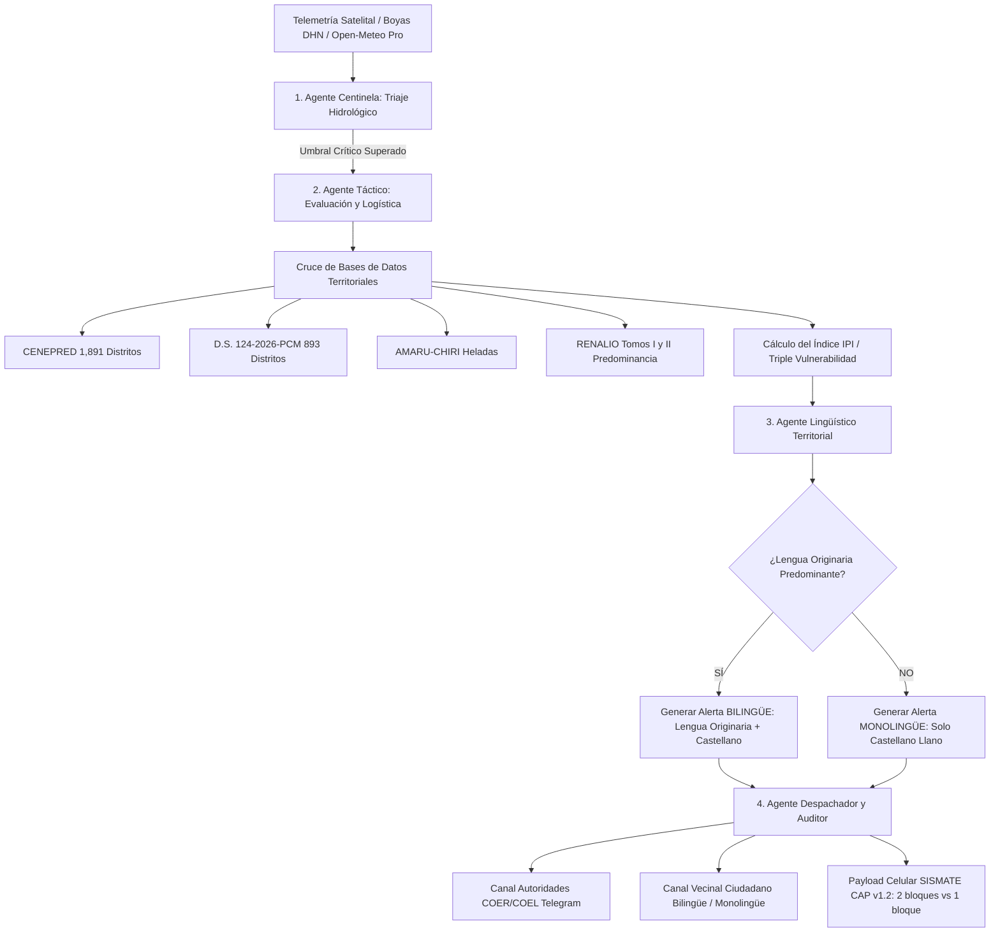

# PROPUESTA TÉCNICA Y DOCTRINA OPERACIONAL
## SISTEMA DE ALERTA TEMPRANA ETNOTERRITORIAL Y DIFUSIÓN BILINGÜE SOBERANA
### Integración COEN-Digital: 1,891 Distritos CENEPRED, D.S. 124-2026-PCM, AMARU-CHIRI y RENALIO Tomos I y II (MINCUL / MINEDU)

**Documento:** PT-COEN-ETNO-2026-001 (Versión Definitiva en Producción)  
**Clasificación:** Doctrinal / Técnico Operacional / Soberanía Territorial  
**Fecha:** Septiembre 2026  
**Área:** Centro de Operaciones de Emergencia Nacional (COEN) / INDECI / Presidencia del Consejo de Ministros / Viceministerio de Interculturalidad  

---

## 1. RESUMEN EJECUTIVO Y MANDATO DOCTRINAL

El presente documento técnico establece la arquitectura de software, las reglas de negocio y los contratos de datos para la **emisión de alertas tempranas geolocalizadas multi-agente** en el territorio peruano, aprovechando de forma convergente y soberana:
1. El catálogo nacional de **1,891 distritos** con nivel de peligro CENEPRED SIGRID.
2. Los **893 distritos declarados en Estado de Emergencia** por el Fenómeno El Niño bajo el **Decreto Supremo N° 124-2026-PCM**.
3. El catálogo de **distritos críticos de heladas y friajes** (AMARU-CHIRI).
4. El **Registro Nacional de Lenguas Indígenas u Originarias (RENALIO Tomos I y II)** oficializado por el Ministerio de Cultura mediante el **Decreto Supremo N° 009-2021-MC**.

### Regla de Oro del Despacho Lingüístico:
* **Distrito con Lengua Originaria Predominante:** El despacho es **SIEMPRE BILINGÜE OBLIGATORIO**. Se emite prioritariamente en la lengua originaria del territorio (ej. *Runasimi Chanka, Collao o Áncash, Aymara, Asháninka, Awajún*) y se acompaña **SIEMPRE y de forma OBLIGATORIA con su versión en Castellano Llano**.
* **Distrito Predominantemente Hispanohablante:** El despacho se emite **ÚNICAMENTE en Castellano Comunitario / Llano**, optimizando ancho de banda y evitando traducciones forzadas donde no existe comunidad lingüística originaria predominante (e.g. Piura, Catacaos, Íllimo, Lima Costa).

---

## 2. MARCO LEGAL Y DOCTRINAL DE APLICABILIDAD

1. **Constitución Política del Perú (Art. 48):** Son idiomas oficiales el castellano y, en las zonas donde predominen, también lo son el quechua, el aimara y las demás lenguas aborígenes.
2. **Ley N° 29735:** Ley que regula el uso, preservación, desarrollo, recuperación, fomento y difusión de las lenguas originarias del Perú.
3. **Decreto Supremo N° 009-2021-MC:** Aprueba la lista oficial de predominancia de lenguas indígenas u originarias a nivel distrital, provincial y departamental (RENALIO).
4. **Decreto Supremo N° 124-2026-PCM:** Declara el Estado de Emergencia en 893 distritos por peligro inminente y déficit/exceso hídrico ante FEN.
5. **Estándar Internacional CAP v1.2 (ITU-T X.1303 / OASIS):** Protocolo de Alerta Común adoptado por el Estado peruano para el Sistema de Mensajería de Alerta Temprana de Emergencia (**SISMATE**).

---

## 3. ARQUITECTURA DEL SISTEMA Y REGLAS DE NEGOCIO



### 3.1. Lógica Condicional del Agente Lingüístico (`linguistic_agent.py`)

Para cualquier UBIGEO consultado en el territorio nacional:

```python
es_originaria_predominante = (variante_linguistica not in ["CASTELLANO_LLANO", "CASTELLANO_LLANO_NORTE"])

if es_originaria_predominante:
    # CASO BILINGÜE OBLIGATORIO:
    # 1. Mensaje en lengua originaria auténtica
    # 2. Mensaje en castellano llano empático
    es_bilingue = True
    info_cap = [info_castellano, info_originaria]  # 2 bloques <info> en CAP v1.2
else:
    # CASO MONOLINGÜE CASTELLANO:
    # Únicamente castellano comunitario
    es_bilingue = False
    info_cap = [info_castellano]  # 1 único bloque <info> en CAP v1.2
```

---

## 4. MATRIZ DE APLICACIÓN POR JURISDICCIONES REPRESENTATIVAS

A partir de los catálogos del RENALIO Tomo I (Andinas) y Tomo II (Amazónicas), se fijan los siguientes estándares operativos verificados:

| Jurisdicción / Cuenca | UBIGEO | Peligro Hidrometeorológico | Estatus Legal D.S. 124 | Lengua Predominante RENALIO | Formato de Difusión Requerido | Bloques CAP v1.2 SISMATE |
|---|:---:|---|:---:|---|:---:|:---:|
| **Lurigancho-Chosica / Huarochirí** (Lima) | `150118` | Huaicos (Qdas. Carossio y Pedregal) | **DECLARADO** | Runasimi Chanka / Central | **BILINGÜE** (Quechua + Castellano) | `es-PE` + `qu-PE` |
| **Huaraz / Callejón de Huaylas** (Áncash) | `020101` | Aluvión (Río Quillcay / Palcacocha) | **DECLARADO** | Runasimi Ancashino (Huaylas) | **BILINGÜE** (Quechua + Castellano) | `es-PE` + `qu-PE` |
| **Santa Rosa - Mazocruz / Ilave** (Puno) | `210505` | Heladas severas (-14°C) / Friaje | **DECLARADO** | Aymara Altiplánico | **BILINGÜE** (Aymara + Castellano) | `es-PE` + `ay-PE` |
| **Satipo / Pangoa / Río Tambo** (Junín) | `120601` | Desborde ríos Perené y Satipo | **DECLARADO** | Asháninka Amazónico | **BILINGÜE** (Asháninka + Castellano) | `es-PE` + `cni-PE` |
| **Santa María de Nieva / Cenepa** (Amazonas) | `010401` | Inundación Río Marañón y Nieva | **DECLARADO** | Awajún Amazónico | **BILINGÜE** (Awajún + Castellano) | `es-PE` + `agr-PE` |
| **Urubamba / Ollantaytambo** (Cusco) | `081301` | Crecida violenta Río Vilcanota | **DECLARADO** | Runasimi Collao (Cusco) | **BILINGÜE** (Quechua + Castellano) | `es-PE` + `qu-PE` |
| **Piura / Catacaos / Bajo Piura** (Piura) | `200101` | Desborde Río Piura (>1900 m³/s) | **DECLARADO** | Castellano Comunitario | **MONOLINGÜE** (Solo Castellano) | `es-PE` |
| **Trujillo / El Porvenir** (La Libertad) | `130102` | Huaico Qda. San Ildefonso | **DECLARADO** | Castellano Comunitario | **MONOLINGÜE** (Solo Castellano) | `es-PE` |
| **Íllimo / Valle La Leche** (Lambayeque) | `140304` | Desborde Río La Leche | **DECLARADO** | Castellano Comunitario | **MONOLINGÜE** (Solo Castellano) | `es-PE` |

---

## 5. FORMULACIÓN DEL ÍNDICE DE PRIORIDAD DE INTERVENCIÓN (IPI)

El cálculo del IPI se ejecuta en memoria para los **1,891 distritos nacionales**:

$$\text{IPI} = (0.35 \times P_{\text{CENEPRED}}) + (0.30 \times E_{\text{DS124}}) + (0.15 \times H_{\text{AMARU}}) + (0.20 \times B_{\text{RENALIO}})$$

Donde:
* **$P_{\text{CENEPRED}}$ (35%)**: Peligro CENEPRED (*Muy Alto = 100, Alto = 70, Medio = 40, Bajo = 10*).
* **$E_{\text{DS124}}$ (30%)**: Estado de Emergencia D.S. 124-2026-PCM (*Vigente = 100, No vigente = 0*).
* **$H_{\text{AMARU}}$ (15%)**: Exposición crítica a heladas altoandinas (*Crítico = 100, No crítico = 0*).
* **$B_{\text{RENALIO}}$ (20%)**: Brecha de vulnerabilidad lingüística (*Lengua nativa predominante = 100, Hispanohablante = 25*).

---

## 6. IMPLEMENTACIÓN EN FRONTEND: GEOVISOR C2, DOCTRINA Y GLOSARIO

1. **7ma Capa Cartográfica en Geovisor C2 (`/geovisor`):**  
   - Conmutador dedicado: *"RENALIO & Triple Vulnerabilidad (IPI)"*.
   - Nodos púrpuras con pulso táctico en Chosica, Huaraz, Mazocruz, Satipo, Nieva y Catacaos.
   - Drawer lateral con desglose en vivo del IPI y régimen de alerta.
2. **Consola Doctrinal & Fórmulas (`/doctrina`):**  
   - Pestaña IPI (Activo) con ranking en vivo y exportador CSV oficial.
   - Pestaña IPH (Índice de Probabilidad de Huaico) e ISH (Índice de Severidad de Helada) listas para desarrollo posterior.
3. **Consola de Glosario Técnico & Catálogo de Mapas (`/glosario`):**  
   - Fichas técnicas pormenorizadas de las 7 capas cartográficas, los 4 agentes, los 3 índices y la normativa nacional.

---

## 7. CRONOGRAMA DE IMPLEMENTACIÓN Y ESTADO DE ENTREGABLES

| Fase | Tarea Principal | Componentes Involucrados | Estado |
|:---:|---|---|:---:|
| **Fase 1** | Ajuste estricto de la regla bilingüe vs. monolingüe | `linguistic_agent.py`, `dispatcher_agent.py`, `schemas.py` | **100% COMPLETADO** |
| **Fase 2** | Endpoint unificado de consulta etnoterritorial e IPI | `main.py`, `historical_data_service.py` | **100% COMPLETADO** |
| **Fase 3** | Ranking y exportador oficial en CSV | `historical_data_service.py`, `main.py` | **100% COMPLETADO** |
| **Fase 4** | Consola Doctrinal & Fórmulas Matemáticas | `frontend/src/app/doctrina/page.tsx` | **100% COMPLETADO** |
| **Fase 5** | 7ma Capa Cartográfica RENALIO en Geovisor C2 | `frontend/src/components/GeovisorConsole.tsx` | **100% COMPLETADO** |
| **Fase 6** | Consola de Glosario Técnico & Catálogo de Mapas C2 | `frontend/src/app/glosario/page.tsx` | **100% COMPLETADO** |
| **Fase 7** | Validación de compilación y pruebas end-to-end | Next.js Build (`next build` code 0) | **100% COMPLETADO** |

---

**Documento validado y puesto en producción operacional para el Centro de Operaciones de Emergencia Nacional (COEN).**
