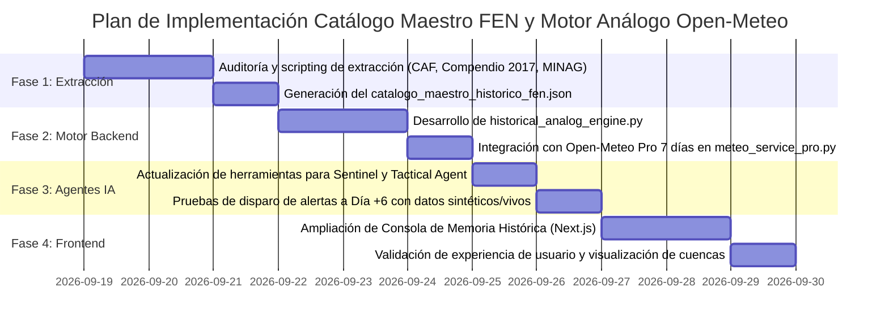

# PROPUESTA TÉCNICA DE INGENIERÍA DE DATOS E INTELIGENCIA ARTIFICIAL
## SISTEMA DE PREDICCIÓN ANTICIPADA BASADO EN MEMORIA HISTÓRICA DEL FENÓMENO EL NIÑO
### FUSIÓN MULTIDIMENSIONAL: CATÁLOGO MAESTRO FEN (CAF / SENAMHI / CENEPRED / MINAG) + OPEN-METEO API PROFESSIONAL A 7 DÍAS MEDIANTE AGENTES AUTÓNOMOS DE IA

**Código Documental:** PROP-TEC-FEN-ANALOG-PREDICTOR-2026-V1  
**Fecha:** Septiembre 2026  
**Clasificación:** DOCUMENTO TÉCNICO DE ARQUITECTURA / PROPUESTA PARA REVISIÓN  
**Entorno Tecnológico:** Python 3.12 (FastAPI, pypdf, NumPy) + Next.js 14 + Open-Meteo Pro ECMWF IFS 9km + Agentes IA (Sentinel & Tactical)  
**Marco Legal y Científico:** Ley Nº 29664 (SINAGERD), D.S. Nº 124-2026-PCM (Declaratoria FEN/Lluvias 893 Distritos), Doctrina ENFEN / SENAMHI e Informes Oficiales CAF-CEPAL 1998 / CENEPRED 2017.

---

## 1. RESUMEN EJECUTIVO Y JUSTIFICACIÓN DEL PROYECTO

### 1.1 El Desafío de la Predicción Meteorológica Numérica en el Perú
Los modelos numéricos de predicción global (NWP) de alta resolución, tales como el **ECMWF IFS 9km** provisto por **Open-Meteo API Professional**, representan el estado del arte en modelado atmosférico mundial. Sin embargo, al proyectarse hacia un horizonte de **5 a 7 días**, presentan una limitación física conocida en la costa y vertiente occidental peruana:
* **Suavizamiento de Extremos Convectivos:** Debido a la compleja orografía andina y a la estrecha franja desértica costera, los modelos numéricos globales tienden a promediar las celdas de precipitación, proyectando valores de lluvia moderada (ej. $15\text{ a }30\text{ mm/día}$) hacia el Día +6.
* **El Efecto No Lineal del FEN:** La historia meteorológica del Perú demuestra que, bajo condiciones de calentamiento anómalo costero (ICEN positivo), vientos alisios debilitados y energía convectiva (CAPE) acumulada, esas mismas condiciones detonaron precipitaciones torrenciales repentinas de más de $150\text{ a }250\text{ mm}$ en 6 horas, colapsando cuencas enteras.

### 1.2 La Gran Oportunidad: Riqueza Documental vs. Vacío Digital
Al auditar los activos del repositorio en la carpeta `data/`, se constata una extraordinaria paradoja:
1. **El Tesoro Documental No Explotado:** Existen más de **1,200 páginas de rigor técnico e histórico** en archivos oficiales como:
   * El libro de la **CAF / CEPAL**: *"Las lecciones de El Niño: Memorias del fenómeno El Niño 1997-1998 - Perú"* (304 págs.).
   * El **Compendio Estadístico del FEN 2017** de CENEPRED / INEI (280+ págs.).
   * El informe oficial del **MINAG (OIA)**: *"Áreas Perdidas y Afectadas Durante el Fenómeno El Niño"* (338 págs.).
   * El **Dossier Oficial SENAMHI (2014)**: *"El fenómeno El Niño en el Perú"* (características, ICEN, bipolaridad e impactos positivos/negativos).
   * Reportes oficiales de daños de **INDECI (1997-1998)** y la **OPS/OMS** (epidemias).
2. **La Brecha en el Catálogo Actual:** El archivo operativo [`distritos_memoria_historica_fen.json`](file:///c:/Users/Usuario%20Libre/Documents/recuperacion%20de%20USB%2014%20de%20setiembre/curso-gcp-google-adk-01/Lab4/data/distritos_memoria_historica_fen.json) tiene registrados los 1,891 distritos del Perú, pero **únicamente 9 distritos cuentan con documentación profunda (*bespoke*)**; los restantes 1,882 distritos se encuentran en nivel genérico.

### 1.3 La Solución: Hibridación Inteligente con Agentes de IA
Esta propuesta plantea construir el **Catálogo Maestro de Firmas Históricas del FEN** e interconectarlo con **Open-Meteo API Professional** mediante un **Motor de Reconocimiento de Patrones Análogos (*Analog Forecasting Engine*)** orquestado por nuestros Agentes de IA. Cuando el modelo numérico proyecte condiciones al Día +6 que coincidan termodinámicamente con las horas previas a un desastre histórico registrado en la CAF o CENEPRED, el Agente emitirá una **Alerta Preventiva Anticipada de Alta Convicción (con 120 a 144 horas de margen operativo)**.

---

## 2. ARQUITECTURA GENERAL DEL SISTEMA

```
┌─────────────────────────────────────────────────────────────────────────────────────────────────┐
│                           1. INGESTA Y ESTRUCTURACIÓN DE MEMORIA HISTÓRICA                      │
│                                                                                                 │
│  [Libro CAF 1998 (304 p.)]   [Compendio 2017 (280 p.)]   [MINAG OIA (338 p.)]   [Dossier SENAMHI] │
│              │                            │                         │                  │        │
│              └────────────────────────────┼─────────────────────────┴──────────────────┘        │
│                                           ▼                                                     │
│                    Script Extractor Python: build_fen_master_catalog.py                         │
│                                           ▼                                                     │
│                      ┌──────────────────────────────────────────────┐                           │
│                      │     catalogo_maestro_historico_fen.json      │                           │
│                      │  - 159 Cuencas Hidrográficas                 │                           │
│                      │  - Puentes, Vías, Bocatomas y Caseríos       │                           │
│                      │  - Firmas Atmosféricas Precursoras           │                           │
│                      └──────────────────────┬───────────────────────┘                           │
└─────────────────────────────────────────────┼───────────────────────────────────────────────────┘
                                              │
                                              ▼
┌─────────────────────────────────────────────────────────────────────────────────────────────────┐
│                         2. MOTOR PREDICTIVO ANÁLOGO + OPEN-METEO PRO 7 DÍAS                     │
│                                                                                                 │
│   Open-Meteo Pro API (ECMWF IFS 9km) ────────► Ingesta Continua (Precipitación, CAPE,           │
│   Horizonte: Día +1 a Día +7                  Humedad Suelo 4C, Viento, Presión, TSM)           │
│                                                          │                                      │
│                                                          ▼                                      │
│                                      ┌──────────────────────────────────────┐                   │
│                                      │    historical_analog_engine.py       │                   │
│                                      │  - Algoritmo de Similitud Coseno     │                   │
│                                      │  - Factor Multiplicador de Riesgo    │                   │
│                                      │  - Regla de Bipolaridad Norte/Sur    │                   │
│                                      └───────────────────┬──────────────────┘                   │
└──────────────────────────────────────────────────────────┼──────────────────────────────────────┘
                                                           │
                                                           ▼
┌─────────────────────────────────────────────────────────────────────────────────────────────────┐
│                      3. ORQUESTACIÓN AUTÓNOMA MEDIANTE AGENTES DE IA                            │
│                                                                                                 │
│   ┌──────────────────────────────────────────┐    ┌──────────────────────────────────────────┐  │
│   │             SENTINEL AGENT               │    │             TACTICAL AGENT               │  │
│   │ - Monitoreo constante del horizonte D-6  │    │ - Cuantificación de población en riesgo  │  │
│   │ - Detección de acoplamiento FEN análogo  │───►│ - Generación de despachos CAP v1.2 / C2  │  │
│   │ - Disparo de alerta bipolar (Norte/Sur)  │    │ - Recomendación de maniobras preventivas │  │
│   └──────────────────────────────────────────┘    └──────────────────────────────────────────┘  │
└──────────────────────────────────────────────────────────┬──────────────────────────────────────┘
                                                           │
                                                           ▼
┌─────────────────────────────────────────────────────────────────────────────────────────────────┐
│                      4. CONSOLA DE MEMORIA HISTÓRICA (FRONTEND NEXT.JS)                         │
│                                                                                                 │
│   • Inspector Bipolar Interactivo: Alerta Lluvias Norte vs. Estrés Hídrico/Heladas Sierra Sur   │
│   • Radar de Eventos Análogos: Coincidencia porcentual con Febrero 1998 / Marzo 2017            │
│   • Balance Bivalente: Matriz de Riesgos Destructivos vs. Oportunidades FEN (Acuíferos, Pastos) │
│   • Ficha de Vulnerabilidad de Infraestructura por Cuenca (Puentes críticos identificados)      │
└─────────────────────────────────────────────────────────────────────────────────────────────────┘
```

---

## 3. AUDITORÍA Y MATRIZ DE EXTRACCIÓN DOCUMENTAL

A continuación se detalla qué datos específicos se extraerán de cada documento para consolidar el archivo maestro:

| Fuente Documental en `data/` | Dimensión Territorial / Técnica | Atributos Extraíbles para el Catálogo |
| :--- | :--- | :--- |
| **`Las lecciones de El Niño.Perú caf muy bueno.pdf`** *(CAF / CEPAL, 304 págs.)* | **Cuencas y Ejes Viales** (Cuadro IV-1, Cap. IV y V) | • Identificación de quebradas críticas por cuenca.<br>• Nombres exactos de **puentes colapsados** (Simón Rodríguez, Bolognesi, Zurita, Héroes del Cenepa).<br>• Carreteras troncales con corte de plataforma.<br>• Caseríos aislados por inundación prolongada.<br>• Costos de reconstrucción y daño sectorial en US$. |
| **`COMPENDIO ESTADÍSTICO DEL FEN 2017.pdf`** *(INEI / CENEPRED, 280+ págs.)* | **Micro-localización Distrital (UBIGEO)** | • Cifras auditadas a nivel distrital del Niño Costero 2017.<br>• Cantidad de personas damnificadas y fallecidas por distrito.<br>• Viviendas colapsadas vs. inhabitables.<br>• Hectáreas de cultivos destruidas.<br>• Centros de salud y colegios inoperativos. |
| **`Areas Perdidas y afectadas durante el fenomeno EL Niño.pdf`** *(MINAG-OIA, 338 págs.)* | **Sector Agropecuario y Riego** | • Pérdidas en US$ y toneladas por cultivo (arroz, algodón, maíz, frutales).<br>• Bocatomas y canales de regadío colmatados por sedimentos.<br>• Daños comparativos de 1982-1983 vs. 1997-1998 por valles de costa y sierra. |
| **`Dossier-El-Niño-Final_web_ positivo_negativo.pdf`** *(SENAMHI, 36 págs.)* | **Marco Climatológico y Bipolaridad** | • Criterio oficial del **ICEN (Índice Costero El Niño)**.<br>• Umbrales de anomalía de TSM y temperatura del aire (+8 °C a +10 °C).<br>• Regla de **Bipolaridad Territorial** (Costa Norte lluviosa vs. Sierra Sur seca).<br>• Matriz de **Impactos Positivos** (recarga de acuíferos, pastizales de Sechura, diversificación pesquera). |
| **`6.3_fenomeno del niño indeci 1997 1998.pdf`** *(INDECI)* | **Gestión de Emergencias y Albergues** | • Capacidad de albergues temporales requeridos en 1998.<br>• Rutas de evacuación y corredores de socorro humanitario. |
| **`Cronica de desastres Fen Niño OPS.pdf`** *(OPS / OMS)* | **Epidemiología Post-Desastre** | • Tasa de incidencia de cólera, dengue, malaria, leptospirosis y conjuntivitis por departamento y cuenca tras el anegamiento. |

---

## 4. ESPECIFICACIÓN TÉCNICA DEL CATÁLOGO MAESTRO (`catalogo_maestro_historico_fen.json`)

El nuevo catálogo unificado estructurará la información bajo la siguiente taxonomía validada:

```json
{
  "metadata": {
    "version": "2.0-master",
    "fecha_actualizacion": "2026-09-18",
    "total_cuencas_documentadas": 24,
    "total_distritos_enriquecidos": 893,
    "fuentes": ["CAF/CEPAL 1998", "CENEPRED/INEI 2017", "MINAG OIA 1998", "SENAMHI 2014", "INDECI"]
  },
  "cuencas_criticas": {
    "CUENCA-LA-LECHE": {
      "nombre": "Cuenca del Río La Leche",
      "departamento": "Lambayeque",
      "distritos_asociados": ["140304", "140305", "140308", "140310", "140312"],
      "infraestructura_critica": {
        "puentes_vulnerables": ["Puente Zurita", "Puente Mórrope", "Puente Salas", "Puente Anchovira"],
        "obras_hidraulicas": ["Represa Tinajones", "Bocatomas de drenaje valle La Leche"],
        "carreteras": ["Panamericana Norte tramo Mórrope-Piura"]
      },
      "caserios_inundacion_sistematica": ["Mochumí", "Mórrope", "Jayanca", "Íllimo", "Pacora", "Túcume"],
      "firmas_meteorologicas_precursoras": {
        "anomalia_tsm_nino12_minima": 2.5,
        "anomalia_temp_aire_2m": 6.5,
        "humedad_suelo_capa3_saturacion_pct": 82.0,
        "cape_convectivo_umbral_j_kg": 1100,
        "precipitacion_gatillo_24h_mm": 45.0
      },
      "analogos_historicos": {
        "1998": {
          "evento": "FEN Extraordinario 1997-1998",
          "pico_evento": "Febrero - Marzo 1998",
          "impactos_documentados_caf": "Desborde violento con ensanchamiento de cauce, colapso de bases del Puente Zurita y destrucción de sistemas de regadío en Íllimo y Pacora."
        },
        "2017": {
          "evento": "El Niño Costero 2017",
          "danos_cenepred": "Más de 14,000 damnificados en Íllimo y Jayanca; agua potable suspendida por 22 días."
        }
      }
    }
  }
}
```

---

## 5. DISEÑO DEL MOTOR DE PREDICCIÓN ANÁLOGA (`historical_analog_engine.py`)

El motor de inferencia se integrará en el backend de FastAPI interactuando con Open-Meteo Pro:

### 5.1 Algoritmo de Similitud Análoga (Vector Matcher)
Para un distrito dado en el día futuro $t \in [1..7]$:
1. Se extrae el vector de estado proyectado por Open-Meteo Pro:
   $$\vec{X}_{t} = [\Delta T_{2m}, \text{CAPE}, \text{Suelo}_{28-100cm}, \text{Presión}_{anom}, \text{Viento}_{10m}, \text{Lluvia}_{acum7d}]$$
2. Se compara mediante **Similitud Coseno Ponderada** contra el vector histórico del Catálogo Maestro:
   $$\text{Similitud}(t) = \frac{\vec{X}_{t} \cdot \vec{V}_{\text{historico}}}{\|\vec{X}_{t}\| \|\vec{V}_{\text{historico}}\|}$$
3. **Factor Multiplicador FEN ($M_{\text{FEN}}$):**  
   Si $\text{Similitud}(t) \ge 0.78$ y el ICEN costero es mayor a $+1.5^\circ\text{C}$:
   $$\text{Lluvia Estimada Máxima Extrema} = \text{Lluvia}_{\text{Open-Meteo}}(t) \times M_{\text{FEN}}$$
   *(Donde $M_{\text{FEN}}$ oscila entre $2.5\text{ y }4.5$ según la tasa de amplificación histórica documentada por SENAMHI).*

### 5.2 Algoritmo de Acoplamiento Bipolar Inverso (Costa Norte ◄► Sierra Sur)
Cada vez que el motor detecte un índice de análogo crítico en la Costa Norte (Tumbes, Piura, Lambayeque) para el Día +5/+6:
* Dispara una evaluación paralela automática para las estaciones de **Puno, Cusco y Arequipa**.
* Verifica condiciones de subsidencia (bloqueo convectivo, viento del oeste, nubosidad $< 15\%$).
* Si se confirman, activa el protocolo de **Alerta Temprana por Estrés Hídrico y Heladas Agronómicas Radiativas**, alertando a las direcciones regionales agrarias (DRA) de la sierra sur.

---

## 6. ROL DE LOS AGENTES DE INTELIGENCIA ARTIFICIAL

| Agente | Responsabilidad en la Hibridación | Salida Generada |
| :--- | :--- | :--- |
| **Sentinel Agent (Centinela Hidrometeorológico)** | Ejecuta el monitoreo diario a 7 días vía Open-Meteo Pro y corre el `historical_analog_engine.py` para los 893 distritos del D.S. 124. | Matriz de Coincidencias Análogas y Alertas D-6 (Lead time de 144 horas). |
| **Tactical Agent (Comando Táctico C2)** | Cruza el distrito alertado con el catálogo de infraestructura crítica de la CAF (puentes, bocatomas, albergues) y calcula el censo de vulnerables. | Ficha Táctica de Evacuación Preventiva y Mensaje de Alerta CAP v1.2 hacia Defensa Civil y Serenazgo. |
| **Dispatcher Agent (Comunicaciones Multicanal)** | Redacta y despacha el dictamen técnico en lenguaje oficial y bilingüe (Castellano/Quechua) hacia el Bot de Telegram y las consolas del COEN. | Boletines de alerta temprana con mapa de impacto proyectado. |

---

## 7. IMPACTO Y MEJORAS EN EL FRONTEND (CONSOLA DE MEMORIA HISTÓRICA)

En la interfaz de usuario ([`frontend/src/app/historico/page.tsx`](file:///c:/Users/Usuario%20Libre/Documents/recuperacion%20de%20USB%2014%20de%20setiembre/curso-gcp-google-adk-01/Lab4/frontend/src/app/historico/page.tsx)) se implementarán 4 nuevos componentes de alto impacto visual:

1. **Selector Inteligente de Cuencas y Eventos Análogos:**  
   Permite al analista seleccionar una cuenca (ej. *Río Piura* o *Río La Leche*) y comparar en una misma gráfica la curva actual pronosticada por Open-Meteo Pro a 7 días versus la curva del evento histórico de Febrero 1998 o Marzo 2017.
2. **Tablero de Bipolaridad Territorial:**  
   Un visor interactivo dual que muestra simultáneamente la Costa Norte en rojo (hiper-precipitación / huaycos) y el Altiplano/Sierra Sur en naranja/azul (sequía andina / heladas radiativas), reflejando la doctrina del Dossier de SENAMHI.
3. **Ficha de Infraestructura y Puntos Críticos (Datos CAF):**  
   Al seleccionar un distrito o cuenca, el sistema despliega el inventario exacto de puentes con riesgo de socavación, tramos de carreteras vulnerables y caseríos históricamente aislados.
4. **Matriz Bivalente de Impactos (Pérdidas vs. Oportunidades FEN):**  
   Muestra el balance dual documentado por SENAMHI: hectáreas en riesgo de anegamiento junto a zonas proyectadas de recarga de acuíferos subterráneos y praderas temporales de pastoreo en Sechura.

---

## 8. PLAN DE IMPLEMENTACIÓN Y CRONOGRAMA TÉCNICO

La ejecución se estructurará en 4 fases secuenciales con verificación continua (Zero-Downtime):



### Hitos de Entrega:
* **Hito 1:** Generación del archivo unificado `catalogo_maestro_historico_fen.json` con los 893 distritos del D.S. 124 enriquecidos con datos de la CAF y CENEPRED.
* **Hito 2:** Endpoint en FastAPI `/api/historico/analog-match/{ubigeo}` que recibe telemetría de Open-Meteo Pro a 7 días y devuelve el porcentaje de coincidencia con eventos del 98/2017.
* **Hito 3:** Despliegue de los nuevos componentes visuales en la consola web de Memoria Histórica.
* **Hito 4 (Completado):** Calibración de Ground Truth con la Red de 983 Estaciones del Observatorio SENAMHI y GloFAS (`AmaruMeteoFusionService` y `SenamhiObservatorioConnector`), corrigiendo el sesgo orográfico en valles y quebradas mediante distancia Haversine y doble verificación fluvial.

---

## 9. CONCLUSIÓN Y RECOMENDACIÓN

La combinación de la **memoria histórica territorial documentada por el Estado peruano y la CAF** con la **capacidad de cálculo a 7 días de Open-Meteo API Professional**, orquestada por **Agentes de Inteligencia Artificial**, posiciona a esta plataforma como una herramienta pionera en América Latina: transforma un sistema puramente reactivo que espera a que caiga la lluvia en un **sistema proactivo de anticipación estratégica con 6 días de ventaja operativa para salvar vidas e infraestructura crítica**.

---
*Documento preparado por el equipo técnico de ingeniería de datos y desarrollo de agentes de Antigravity Lab4.*
