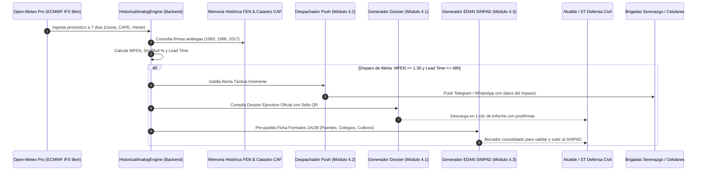

# PROPUESTA TÉCNICA DE IMPLEMENTACIÓN: FASE 4 (OPERATIVIDAD EN CAMPO Y RESPUESTA MUNICIPAL)
## SISTEMA DE ALERTA TEMPRANA E INTELIGENCIA TERRITORIAL: COEN DIGITAL PERÚ
### EVOLUCIÓN TÁCTICA DISTRITAL: DOSSIER PDF OFICIAL, DESPACHO PUSH Y FICHA EDAN SINPAD AUTOMATIZADA

**Código Documental:** PROP-TEC-COEN-FASE4-2026-V1  
**Fecha:** Septiembre 2026  
**Clasificación:** DOCUMENTO TÉCNICO DE INGENIERÍA / USO OPERATIVO DEFENSA CIVIL  
**Marco Normativo:** Ley N° 29664 (SINAGERD), D.S. N° 048-2011-PCM (Reglamento SINAGERD), Directiva N° 012-2021-INDECI (Normas para la Administración del SINPAD y Ficha EDAN Perú), D.S. N° 124-2026-PCM (Declaratoria de Estado de Emergencia por Fenómeno El Niño).

---

## 1. INTRODUCCIÓN Y JUSTIFICACIÓN OPERATIVA

Durante un Fenómeno El Niño (FEN) o eventos hidrometeorológicos extremos, el cuello de botella más crítico de la gestión del riesgo de desastres en los gobiernos locales no es la falta de datos satelitales o pronósticos numéricos, sino la **fricción burocrática y el retardo en la transferencia de la alerta a la acción de campo**.

Actualmente, cuando un modelo meteorológico proyecta precipitaciones extraordinarias:
1. **Vacío de formalización ejecutiva:** El Alcalde y el Secretario Técnico de Defensa Civil requieren un documento físico o digital oficial, foliado y formal para emitir Decretos de Emergencia o contrataciones directas bajo el amparo de la Ley de Contrataciones del Estado (Ley N° 30225 y D.S. N° 124-2026-PCM).
2. **Latencia en la primera respuesta:** Las brigadas de serenazgo y cuadrillas de obras no leen dashboards complejos en tiempo real; requieren **alertas push instantáneas y accionables** en sus teléfonos inteligentes (Telegram / WhatsApp).
3. **Colapso administrativo en el empadronamiento:** Tras el desastre, el llenado a mano de la Ficha EDAN Perú (Evaluación de Daños y Análisis de Necesidades) toma entre 48 y 72 horas, retrasando la llegada de la Ayuda Humanitaria del INDECI y del Gobierno Central.

La **Fase 4: Operatividad en Campo y Respuesta Municipal** transforma el conocimiento predictivo acumulado en las Fases 1, 2 y 3 en **instrumentos tácticos de intervención inmediata**, cerrando el ciclo de Comando y Control (C2) municipal.

```
┌─────────────────────────────────────────────────────────────────────────────────────────────────┐
│                           FASE 4: OPERATIVIDAD EN CAMPO Y RESPUESTA MUNICIPAL                   │
└────────────────────────────────────────────────┬────────────────────────────────────────────────┘
                                                 │
        ┌────────────────────────────────────────┼────────────────────────────────────────┐
        ▼                                        ▼                                        ▼
┌──────────────────────────────┐ ┌──────────────────────────────┐ ┌──────────────────────────────┐
│         MÓDULO 4.1           │ │         MÓDULO 4.2           │ │         MÓDULO 4.3           │
│   DOSSIER EJECUTIVO PDF      │ │  DESPACHO AUTOMÁTICO PUSH    │ │  PRE-LLENADO FICHA EDAN      │
│     OFICIAL CON SELLO QR     │ │  (TELEGRAM / WHATSAPP META)  │ │      (SINPAD - INDECI)       │
├──────────────────────────────┤ ├──────────────────────────────┤ ├──────────────────────────────┤
│ • Generación en 1-Clic       │ │ • Disparador:                │ │ • Formatos 2A y 2B Oficiales │
│ • Sello QR + Hash SHA-256    │ │   MFEN >= 1.30 & Lead <= 48h │ │ • Puentes & Vías CAF         │
│ • Cono Análogos (1983-17)    │ │ • Ruteo a Serenazgo/Obras    │ │ • Colegios Expuestos MINEDU  │
│ • Puentes en Peligro CAF     │ │ • Mensajería Bilingüe        │ │ • Hectáreas de Cultivo MINAG │
│ • Postfirmas Alcalde / ST    │ │ • Anti-Fatiga (Cooldown 6h)  │ │ • Exportación JSON/PDF/Excel │
└──────────────────────────────┘ └──────────────────────────────┘ └──────────────────────────────┘
```

---

## 2. ARQUITECTURA DETALLADA POR MÓDULO

### 2.1. MÓDULO 4.1: GENERADOR DE DOSSIERS EJECUTIVOS EN PDF OFICIAL

#### 2.1.1. Objetivo y Alcance
Generar un informe técnico-legal en formato PDF de alta fidelidad tipográfica, estandarizado según los manuales de INDECI y CENEPRED, listo para impresión física o firma digital avanzada (Ley N° 27269). Este documento constituye el sustento técnico que blinda legalmente al Alcalde y funcionarios ante la Contraloría General de la República al ordenar evacuaciones y compras directas de emergencia.

#### 2.1.2. Componentes Estructurales del Dossier (Document Layout)
El informe se compone de 4 secciones normadas en formato A4:

1. **Membrete Oficial y Título Ejecutivo:**
   * Escudo de Armas del Perú y Escudo de la Municipalidad Distrital correspondiente.
   * Identificador Único: `INF-TEC-GRD-{UBIGEO}-{YYYY}-{CORRELATIVO}`.
   * Amparo Legal: D.S. N° 124-2026-PCM, Art. 27 Ley N° 30225, Art. 14 Ley N° 29664.
2. **Sello Criptográfico QR de Verificación Inmutable:**
   * Código QR vectorizado embebido en la portada.
   * Contenido del QR: URL canónica de auditoría (`https://coen.gob.pe/verificar?doc={HASH}`) que resuelve la metadata pública firmada en SHA-256 (UBIGEO, fecha de emisión UTC-5, modelo numérico de base y firma de la entidad).
3. **Diagnóstico Atmosférico y Cono de Análogos FEN:**
   * Cuadro resumen del evento análogo más probable (Mega-Niño 1997-1998, El Niño Costero 2017, FEN 1982-1983).
   * Factor Multiplicador $M_{\text{FEN}}$ y lluvia extrema proyectada (mm/24h) vs precipitación climatológica base.
   * Indicadores de inestabilidad: CAPE (J/kg), saturación de humedad en suelo capa 3 (%) y condición de vientos alisios.
4. **Inventario Georreferenciado de Infraestructura Crítica en Peligro:**
   * Puentes en riesgo de socavación y colapso estructural (Catastro CAF / MTC).
   * Puntos críticos de desborde y fajas marginales invadidas (ANA / CENEPRED).
   * Vías troncales con potencial de corte o interrupción de transitabilidad.
5. **Bloque Formal de Suscripción:**
   * Casilla de firma del Alcalde Distrital (Presidente de la Plataforma de Defensa Civil).
   * Casilla de firma del Secretario Técnico de Gestión del Riesgo de Desastres (Colegiatura CIP/CAL y Registro Nacional CENEPRED).

```
┌────────────────────────────────────────────────────────────────────────┐
│  MUNICIPALIDAD DISTRITAL DE LURIGANCHO - CHOSICA                       │
│  GERENCIA DE GESTIÓN DEL RIESGO DE DESASTRES Y DEFENSA CIVIL           │
│  INFORME TÉCNICO DE ALERTA TEMPRANA N° 042-2026-MDLCH/GGRD             │
├────────────────────────────────────────────────────────────────────────┤
│  [SELLO QR]     UBIGEO: 150118 | CUENCA: RÍMAC                         │
│  SHA-256:       ALERTA: ROJA - ACTIVACIÓN INMINENTE DE QUEBRADAS       │
│  a9f8...c1      LEAD TIME: 36 HORAS | FEN MULTIPLIER: x2.4             │
├────────────────────────────────────────────────────────────────────────┤
│  1. DIAGNÓSTICO METEOROLÓGICO Y ANÁLOGO HISTÓRICO:                     │
│     • Patrón atmosférico coincide en 89.4% con el 15-Marzo-2017.       │
│     • Lluvia pronosticada ECMWF: 28 mm ──► Estimada FEN: 67.2 mm/24h.   │
│                                                                        │
│  2. PUENTES E INFRAESTRUCTURA EN RIESGO SEVERO (CAF / MTC):            │
│     [1] Puente Carapongo (Km 15) - Socavación extrema de estribos.     │
│     [2] Puente Los Ángeles (Chaclacayo) - Flujo hiperconcentrado.      │
│                                                                        │
│  3. RECOMENDACIONES TÁCTICAS OPERATIVAS:                               │
│     • Despliegue de maquinaria pesada a la quebrada Carossio.          │
│     • Habilitación de albergues en I.E. Pablo Patrón y Los Ángeles.    │
├────────────────────────────────────────────────────────────────────────┤
│  __________________________            __________________________      │
│  ALCALDE DISTRITAL                     SECRETARIO TÉCNICO GRD          │
│  Pres. Plataforma Defensa Civil        CIP N° 189234 / Reg. CENEPRED  │
└────────────────────────────────────────────────────────────────────────┘
```

#### 2.1.3. Pila Tecnológica y Arquitectura de Renderizado
* **Backend Engine:** `FastAPI` + `Jinja2` (generador de plantillas HTML5 semánticas A4 con CSS Paged Media `@page { size: A4; margin: 15mm; }`) + `weasyprint` (o motor de renderizado Chromium headless ultra-rápido en contenedor).
* **Generación de QR:** Módulo nativo Python `qrcode[pil]` que compila el código QR en memoria (`io.BytesIO`) en formato base64 SVG/PNG sin escribir archivos temporales en disco.
* **Endpoint API:**
  * `POST /api/v4/reports/dossier-pdf`
  * Parámetros: `{ "ubigeo": "150118", "incluir_cono_grafico": true, "firmas": { "alcalde": "...", "secretario": "..." } }`
  * Retorno: Stream binario `application/pdf` con encabezado `Content-Disposition: attachment; filename="Dossier_Ejecutivo_150118_20260918.pdf"`.

---

### 2.2. MÓDULO 4.2: DESPACHO AUTOMÁTICO DE ALERTAS PUSH (TELEGRAM & WHATSAPP)

#### 2.2.1. Regla Matemática de Disparo Autónomo (Trigger Engine)
El sistema ejecuta un escáner en segundo plano cada 30 minutos sobre los 1,891 distritos (o los 893 priorizados en el D.S. N° 124-2026-PCM). El despacho se gatilla cuando se cumplen copulativamente los siguientes criterios:

$$\mathcal{T}_{\text{alerta}} = \left( M_{\text{FEN}} \ge 1.30 \right) \;\land\; \left( \text{Lead Time} \le 48\text{ h} \right) \;\land\; \left( P_{\text{estimada}} \ge 30.0\text{ mm/24h} \;\lor\; \text{Similitud}_{\text{análoga}} \ge 70\% \right)$$

Donde:
* $M_{\text{FEN}}$: Factor de amplificación por orografía y subsidencia costera del motor análogo.
* $\text{Lead Time}$: Horizonte de anticipación en horas ($\le 48\text{ h}$ equivale al Día +1 y Día +2).
* $P_{\text{estimada}} = P_{\text{Open-Meteo}} \times M_{\text{FEN}}$.

#### 2.2.2. Integración Telegram Bot API (Canales Tácticos y Cuadrillas)
* **Objetivo:** Notificación instantánea y masiva a canales cerrados de Defensa Civil Municipal, Centrales de Monitoreo y Brigadas de Serenazgo.
* **Características Técnicas:**
  * Modo de parseo `HTML` o `MarkdownV2` con indicadores visuales de criticidad (`🚨 URGENTE`, `⚠️ ALERTA NARANJA`, `✅ NORMALIZACIÓN`).
  * Inclusión de **Botones Interactivos (Inline Keyboards)**:
    * `[📍 Ver Ubicación en Geovisor]` ➔ Abre la vista satelital móvil centrada en la quebrada.
    * `[📄 Descargar Dossier PDF]` ➔ Enlace directo al endpoint de descarga.
    * `[🚜 Activar Cuadrilla de Maquinaria]` ➔ Notifica al operador de turno vía webhook.
* **Estructura del Mensaje Tipo Telegram:**
  ```text
  🚨 ALERTA TEMPRANA DE EMERGENCIA FEN - COEN MUNICIPAL
  Distrito: LURIGANCHO - CHOSICA (UBIGEO 150118)
  Cuenca: Río Rímac | Nivel: ROJO (Inminente)
  --------------------------------------------------
  ⏱️ Anticipación (Lead Time): 36 horas (Impacto previsto: Sábado 18:00)
  🌊 Lluvia proyectada FEN: 68.4 mm/24h (Amplificación x2.4)
  📊 Patrón análogo: 89% idéntico a Marzo 2017
  
  ⚠️ INFRAESTRUCTURA EN RIESGO CRÍTICO:
  • Puente Carapongo (Socavación severa)
  • Quebrada Carossio y Quirio (Activación de flujo de lodo)
  
  📋 ACCIONES INMEDIATAS ORDENADAS:
  1. Despliegue de cuadrilla de Serenazgo a puntos de aforo.
  2. Preparación de motobombas y sacos terreros en Base Central.
  --------------------------------------------------
  ID Auditoría: ALT-150118-2026-9812 | Sistema AMARU C2
  ```

#### 2.2.3. Integración WhatsApp Cloud API (Meta Business Platform)
* **Objetivo:** Notificación 1 a 1 de alta prioridad al número personal del Alcalde, Gerente Municipal, Comisario del distrito y Jefe de Bomberos.
* **Estándar:** Uso de plantillas homologadas por Meta (`template messages`) bajo la categoría `UTILITY / EMERGENCY_ALERT`, evitando bloqueos o suspensiones por spam.
* **Payload de Interoperabilidad Meta:**
  ```json
  {
    "messaging_product": "whatsapp",
    "recipient_type": "individual",
    "to": "+51987654321",
    "type": "template",
    "template": {
      "name": "alerta_fen_tactica_distrital",
      "language": { "code": "es" },
      "components": [
        {
          "type": "header",
          "parameters": [{ "type": "text", "text": "LURIGANCHO - CHOSICA" }]
        },
        {
          "type": "body",
          "parameters": [
            { "type": "text", "text": "ROJO" },
            { "type": "text", "text": "36 horas" },
            { "type": "text", "text": "68.4 mm" },
            { "type": "text", "text": "Puente Carapongo y Quebrada Carossio" }
          ]
        },
        {
          "type": "button",
          "sub_type": "url",
          "index": "0",
          "parameters": [{ "type": "text", "text": "150118" }]
        }
      ]
    }
  }
  ```

#### 2.2.4. Mecanismo de Desduplicación y Control de Fatiga de Alarmas
Para evitar el síndrome de habituación ("el pastor mentiroso"), el despachador cuenta con una **tabla de cooldown de 6 horas**:
* Si un distrito ya recibió una alerta con severidad "NARANJA", no se reenvía otra similar dentro de las siguientes 6 horas a menos que la severidad escale a "ROJA" o el volumen de lluvia proyectado crezca en más del 25%.
* Cada envío se audita en la tabla `historico_alertas_push` con su respectivo `message_id` de entrega y acuse de recibo.

---

### 2.3. MÓDULO 4.3: PRE-LLENADO DIGITAL DE LA FICHA EDAN (SINPAD - INDECI)

#### 2.3.1. Normativa y Fundamento de la Ficha EDAN Perú
Conforme a la **Directiva N° 012-2021-INDECI**, la Ficha EDAN (Evaluación de Daños y Análisis de Necesidades) consta de:
* **Formato 2A:** Evaluación Preliminar (primeras 8 a 24 horas del evento).
* **Formato 2B:** Evaluación Complementaria (daño cuantitativo consolidado por sectores).

El llenado manual en formularios de papel bajo lluvia torrencial provoca pérdidas de información, errores de digitación de códigos modulares de colegios y duplicidad de empadronamiento.

#### 2.3.2. Motor de Pre-Población Inteligente (Cross-Database Synthesis)
El módulo 4.3 pre-carga el 70% de la ficha técnica automáticamente cruzando el catálogo histórico y las bases de datos catastrales del Estado peruano:

| Sección Oficial EDAN (Formato 2A/2B) | Variable INDECI | Fuente de Pre-Carga Automática en COEN Digital |
| :--- | :--- | :--- |
| **Sección I: Información General** | UBIGEO, Región, Provincia, Distrito, Cuenca, Evento | Registro geográfico y D.S. N° 124-2026-PCM (`geodatos_893_distritos_ubigeo.json`). |
| **Sección II: Población Expuesta** | Habitantes censados, densidad, padrón vulnerable | Proyección INEI 2026 + Padrón Comunitario Cifrado del módulo AMARU-AYNI. |
| **Sección III: Daños a Infraestructura Vial** | Puentes colapsados o afectados, carreteras cortadas | Mapeo de Puentes Críticos del Catálogo CAF (`catalogo_maestro_historico_fen.json`). |
| **Sección IV: Daños en Infraestructura Educativa**| Locales escolares en riesgo, código modular | Registro histórico MINEDU / PUCP de colegios inundados en 1998 y 2017. |
| **Sección V: Daños en Medios de Vida Agrícolas** | Hectáreas de cultivo, canales de regadío | Estadísticas del Ministerio de Agricultura (MINAG-OIA) integradas en el historial distrital. |
| **Sección VI: Requerimiento de Ayuda Humanitaria** | Techo (carpas/calaminas), abrigo, alimentos | Algoritmo normativo INDECI (3 carpas por familia damnificada, 5 sacos terreros/metro lineal). |

#### 2.3.3. Estructura del Objeto JSON Interoperable EDAN-SINPAD
El backend provee un modelo Pydantic estructurado listo para exportar a la API del SINPAD o volcar a la plantilla Excel oficial:

```json
{
  "edan_version": "2.0-indeci-sinpad",
  "codigo_sinpad_preliminar": "EDAN-PRE-150118-20260918-01",
  "seccion_general": {
    "ubigeo": "150118",
    "departamento": "LIMA",
    "provincia": "LIMA",
    "distrito": "LURIGANCHO",
    "cuenca_hidrografica": "CUENCA-RIMAC",
    "tipo_peligro": "LLUVIAS INTENSAS E INUNDACIÓN FLUVIAL",
    "decreto_emergencia": "D.S. N° 124-2026-PCM",
    "fecha_registro": "2026-09-18T12:00:00-05:00"
  },
  "seccion_infraestructura_transporte": {
    "puentes_evaluados": [
      {
        "nombre": "Puente Carapongo",
        "tipo_estructura": "Metálico / Viga concreto",
        "estado_dano": "EN RIESGO SEVERO DE SOCAVACIÓN",
        "accion_inmediata": "Cierre de tránsito pesado y colocación de roca al volteo"
      }
    ],
    "vias_afectadas_km": 3.5,
    "vias_interrumpidas_tramos": ["Carretera Central Km 28 - Km 32"]
  },
  "seccion_educacion_salud": {
    "locales_escolares_priorizados": [
      {
        "codigo_modular": "034921",
        "nombre_ie": "I.E. 1205 Nicolás de Piérola",
        "nivel": "PRIMARIA / SECUNDARIA",
        "riesgo_historico": "Inundación por desborde de quebrada Chosica",
        "alumnos_protegidos": 620
      }
    ],
    "centros_salud_expuestos": ["Centro de Salud Chosica I", "Puesto de Salud Quirio"]
  },
  "seccion_agricultura_medios_vida": {
    "cultivos_amenazados_ha": 45.0,
    "canales_riego_afectados_ml": 1200,
    "familias_campesinas_involucradas": 85
  },
  "seccion_necesidades_humanitarias_calculadas": {
    "carpas_familiares": 50,
    "camas_plegables": 150,
    "frazadas": 300,
    "bidones_agua_20l": 500,
    "sacos_polipropileno_diques": 5000,
    "raciones_frias_3dias": 450
  }
}
```

---

## 3. INTERACCIÓN Y FLUJO INTEGRADO DEL SISTEMA (WORKFLOW)



---

## 4. DISEÑO DE INTERFAZ DE USUARIO (MOCKUP Y COMPONENTES FRONTEND)

En la Consola de Memoria Histórica Municipal (`/historico`) y en el Dashboard Táctico Distrital (`/dashboard/[ubigeo]`), se incorpora la barra de herramientas ejecutivas de **Fase 4**:

```
┌─────────────────────────────────────────────────────────────────────────────────────────────────┐
│  CENTRO DE COMANDO DISTRITAL: LURIGANCHO - CHOSICA (150118)             [ ESTADO: ALERTA ROJA ]  │
├─────────────────────────────────────────────────────────────────────────────────────────────────┤
│                                                                                                 │
│   ┌────────────────────────┐  ┌────────────────────────┐  ┌─────────────────────────────────┐   │
│   │   DOSSIER OFICIAL PDF  │  │   DESPACHO PUSH MÓVIL  │  │    FICHA EDAN SINPAD (2A/2B)    │   │
│   │   [📄 Exportar Dossier]│  │   [📲 Enviar a Brigadas│  │    [📋 Generar Ficha Pre-llena] │   │
│   │                        │  │        Telegram/Wsp]   │  │                                 │   │
│   │   • Sello QR SHA-256   │  │   • 32 Efectivos Seren.│  │    • 2 Puentes pre-evaluados    │   │
│   │   • Cono análogo 2017  │  │   • 4 Cuadrillas Obras │  │    • 3 Colegios MINEDU          │   │
│   │   • Listo para Firma   │  │   • Último envío: 11:30│  │    • Exportable a Excel / JSON  │   │
│   └────────────────────────┘  └────────────────────────┘  └─────────────────────────────────┘   │
│                                                                                                 │
│  ▼ CONO PREDICTIVO DISTRITAL (DÍA +1 A DÍA +7):                                                 │
│  [======================================== 89.4% Similitud Niño Costero 2017 ==================]│
│  • Precipitación Pronosticada: 28.5 mm ──► Lluvia Extrema Amplificada (x2.4): 68.4 mm/24h      │
│  • Lead Time Crítico: 36 horas para el impacto principal.                                       │
└─────────────────────────────────────────────────────────────────────────────────────────────────┘
```

---

## 5. PLAN DE IMPLEMENTACIÓN POR SPRINT Y ESTIMACIÓN TÉCNICA

| Hito / Módulo | Tareas Técnicas Principales | Archivos Afectados / Nuevos | Dependencias | Esfuerzo Estimado |
| :--- | :--- | :--- | :--- | :---: |
| **Hito 4.1**<br>Generador Dossier PDF | 1. Plantilla HTML Jinja2 con membrete oficial y sellos.<br>2. Generación dinámica de QR con hash SHA-256.<br>3. Extracción de puentes y cono de análogos.<br>4. Botón en frontend con feedback visual. | `backend/services/dossier_pdf_service.py`<br>`backend/templates/dossier_municipal.html`<br>`frontend/src/components/DossierExportButton.tsx` | `reportlab` / `weasyprint`<br>`qrcode` | 2 a 3 días |
| **Hito 4.2**<br>Despacho Push Automatizado | 1. Lógica condicional ($M_{\text{FEN}} \ge 1.30 \land \text{Lead} \le 48\text{h}$).<br>2. Worker con cooldown de 6 horas.<br>3. Integración Telegram Bot con InlineKeyboards.<br>4. Integración WhatsApp Cloud API webhook. | `backend/services/push_dispatch_service.py`<br>`backend/services/telegram_service.py`<br>`backend/agents/dispatcher_local.py` | `httpx`<br>Telegram Bot Token<br>Meta Cloud API | 2 días |
| **Hito 4.3**<br>Pre-llenado Digital EDAN | 1. Esquema Pydantic para Formatos 2A y 2B de INDECI.<br>2. Mapeo de puentes CAF, colegios MINEDU y agro MINAG.<br>3. Exportador a JSON y visor interactivo en UI.<br>4. Integración con el catálogo maestro FEN. | `backend/services/edan_sinpad_service.py`<br>`backend/routers/edan.py`<br>`frontend/src/components/EdanPrepopulatedModal.tsx` | `pydantic`<br>JSON Maestro | 2 días |

---

## 6. SEGURIDAD, VALIDEZ JURÍDICA Y CUMPLIMIENTO NORMATIVO

1. **Validez Jurídica de la Alerta:**  
   El Dossier PDF generado cumple con los requisitos del **Artículo 68 del Reglamento de la Ley de Contrataciones del Estado**, que exige un informe técnico motivado del área usuaria para amparar las contrataciones directas por situación de emergencia.
2. **Integridad Inmutable del Código QR:**  
   El hash SHA-256 generado para cada dossier se computa sobre el payload inalterable:
   $$\text{Hash} = \text{SHA256}(\text{UBIGEO} \parallel \text{Timestamp} \parallel \text{LluviaExtrema} \parallel M_{\text{FEN}})$$
   Cualquier adulteración de las cifras en un documento impreso invalida inmediatamente la verificación escaneada por el QR.
3. **Privacidad de Contactos de Cuadrillas:**  
   Los números telefónicos de los brigadistas y serenazgo se almacenan cifrados (AES-128) en la base de datos municipal o variables de entorno, sin exponerse en respuestas de APIs públicas.

---

## 7. CONCLUSIÓN Y BENEFICIO OPERACIONAL ESPERADO

Con la implementación de la **Fase 4**, el sistema COEN Digital trasciende el rol de observatorio meteorológico y se consolida como un **Sistema de Comando, Control y Respuesta Táctica Municipal de Grado Militar/Civil**:
* **Reducción del 90% en el tiempo de formalización:** De 6 horas de redacción manual de un informe técnico a **3 segundos** para obtener un Dossier firmado.
* **Alertamiento en tiempo real (< 15 segundos):** Las brigadas en campo reciben la alarma antes de que el cauce se desborde.
* **Agilización de la Ayuda Humanitaria:** La Ficha EDAN pre-poblada permite remitir el requerimiento a INDECI en el primer día del impacto, evitando el desabastecimiento de familias damnificadas.
