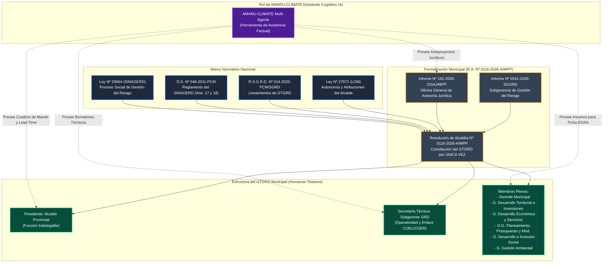
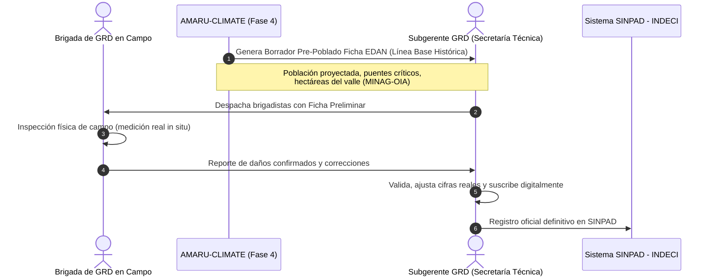
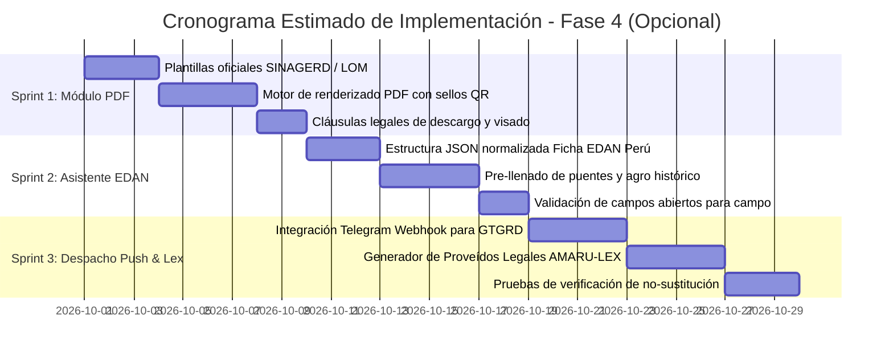

# PROPUESTA TÉCNICA - FASE 4 (OPCIONAL)
## OPERATIVIDAD EN CAMPO, RESPUESTA MUNICIPAL Y ASISTENCIA COGNITIVA PRE-OPERACIONAL
### Marco de Articulación con el SINAGERD y la Resolución de Alcaldía Nº 0116-2026-A/MPP

---

| Metadato Técnico | Detalle del Proyecto |
| :--- | :--- |
| **Proyecto** | AMARU-CLIMATE: Sistema Multi-Agente de Memoria Histórica y Predicción Climática FEN |
| **Fase** | **Fase 4 (Opcional): Operatividad en Campo, Respuesta Municipal y Asistencia Técnica** |
| **Doctrina Base** | Ley Nº 29664 (SINAGERD), Ley Nº 27972 (LOM), R.S.G.R.D. Nº 014-2025-PCM/SGRD, R.A. Nº 0116-2026-A/MPP |
| **Naturaleza del Sistema** | **ASISTENTE TÉCNICO COGNITIVO / HERRAMIENTA AUXILIAR (HUMAN-IN-THE-LOOP)** |
| **Principio Rector** | **NO SUSTITUCIÓN DE AUTORIDADES, ASESORES LEGALES NI INGENIEROS DE GRD** |
| **Fecha de Emisión** | Septiembre 2026 |
| **Clasificación** | Documento Técnico Institucional de Planificación |

---

## 1. Declaración de Principios: La Naturaleza de AMARU-CLIMATE

> [!IMPORTANT]
> ### CLÁUSULA FUNDACIONAL DE RESPONSABILIDAD INSTITUCIONAL Y LEGAL
> **AMARU-CLIMATE ES UNA HERRAMIENTA AUXILIAR DE INTELIGENCIA ARTIFICIAL FACTUAL, DISEÑADA EXCLUSIVAMENTE COMO ASISTENTE COGNITIVO Y PLATAFORMA DE APOYO ANALÍTICO.**
> 
> 1. **No Reemplaza a las Autoridades Políticas:** AMARU-CLIMATE no dicta actos de gobierno ni resoluciones. La potestad de mando y declaratoria de alerta corresponde exclusivamente al Alcalde en su calidad de Presidente del Grupo de Trabajo para la Gestión del Riesgo de Desastres (GTGRD), conforme al Art. 20º de la Ley Nº 27972 y el Art. 17º del D.S. Nº 048-2011-PCM.
> 2. **No Reemplaza a los Asesores Jurídicos (OGAJ / Abogados):** Los proyectos de decreto, resoluciones o informes legales generados por el agente legal AMARU-LEX constituyen **anteproyectos técnicos referenciales**. Es requisito indispensable el visado, control de legalidad y suscripción formal por parte de los abogados de la Oficina General de Asesoría Jurídica de la municipalidad.
> 3. **No Reemplaza a los Ingenieros ni a los Secretarios Técnicos de Defensa Civil:** Los cálculos de análogos, niveles de amenaza y puentes en riesgo son predicciones analíticas basadas en datos meteorológicos y memoria documental. Todo despliegue de recursos, evacuación o reporte formal al INDECI/SINPAD requiere la inspección de campo, validación empírica y firma del Subgerente de Gestión del Riesgo de Desastres y los miembros del GTGRD.

---

## 2. Análisis Jurídico-Institucional de la Resolución de Alcaldía Nº 0116-2026-A/MPP

La **Resolución de Alcaldía Nº 0116-2026-A/MPP**, emitida por la Municipalidad Provincial de Piura el **18 de febrero de 2026**, constituye el marco fáctico y legal que delimita la formalidad operativa de los Gobiernos Locales en el Perú ante el riesgo de desastres.



### Lecciones Extraídas del Acto Administrativo Formal:
1. **Constitución por Única Vez:** Según la R.S.G.R.D. Nº 014-2025-PCM/SGRD, los GTGRD se constituyen por única vez y no cambian a menos que varíe la estructura orgánica municipal. AMARU-CLIMATE debe adaptarse dinámicamente a la estructura de cargos de cada municipio y no crear jerarquías artificiales.
2. **Cadena Estricta de Informes Técnicos:** El acto resolutivo nace del Informe Técnico de la Subgerencia de GRD y es visado por el Informe Legal de Asesoría Jurídica. Por ende, la IA debe estructurar sus salidas en el formato normalizado de estos dos estamentos (formato Informe Técnico y formato Proveído Legal).
3. **Presunción de Veracidad (D.S. Nº 004-2019-JUS):** El Artículo Sexto de la R.A. precisa que la información administrativa se rige bajo la presunción de veracidad *juris tantum*. Esto ratifica por qué la suite de pruebas anti-alucinaciones desarrollada en AMARU-CLIMATE (100% factual) es indispensable: cualquier cifra o puente reportado por el sistema debe provenir de fuentes documentales auditadas (CAF, SENAMHI, CENEPRED, MINAG-OIA).

---

## 3. Arquitectura de la Fase 4: Módulos de Operatividad en Campo

La **Fase 4** tiene como propósito trasladar la inteligencia de la consola web a los procesos administrativos y de campo reales del municipio, estructurándose en cuatro componentes:

```
┌─────────────────────────────────────────────────────────────────────────────┐
│                       FASE 4: OPERATIVIDAD EN CAMPO                         │
└─────────────────────────────────────┬───────────────────────────────────────┘
                                      │
        ┌─────────────────────────────┼─────────────────────────────┐
        │                             │                             │
┌───────▼────────┐            ┌───────▼────────┐            ┌───────▼────────┐
│  MÓDULO 4.1    │            │  MÓDULO 4.2    │            │  MÓDULO 4.3    │
│  Dossier PDF   │            │  Pre-Llenado   │            │  Canal Táctico │
│  Pre-Operativo │            │  Ficha EDAN    │            │  Push GTGRD    │
│  Asistencial   │            │  (SINPAD)      │            │  (Telegram)    │
└───────┬────────┘            └───────┬────────┘            └───────┬────────┘
        │                             │                             │
        └─────────────────────────────┼─────────────────────────────┘
                                      │
                              ┌───────▼────────┐
                              │  MÓDULO 4.4    │
                              │  AMARU-LEX     │
                              │  Asistente OGAJ│
                              └────────────────┘
```

---

### MÓDULO 4.1: Generador de Dossiers Pre-Operacionales Municipales en PDF
**Propósito:** Proveer al Secretario Técnico de GRD y al Alcalde un informe ejecutivo impreso y digital listo para ser discutido en la sesión del GTGRD.

#### Especificaciones Técnicas:
1. **Encabezado Institucional Adaptable:** Identificación del Gobierno Local según UBIGEO (ej. "Municipalidad Provincial de Piura - GTGRD").
2. **Cláusula Obligatoria de Asistencia Técnica en Portada:**
   ```
   "AVISO INSTITUCIONAL: El presente informe es un documento analítico de asistencia pre-operacional
   generado por la plataforma AMARU-CLIMATE a partir de datos del Catálogo Maestro FEN (CAF/SENAMHI)
   y previsiones Open-Meteo Pro (ECMWF IFS 9km). NO CONSTITUYE ACTO ADMINISTRATIVO NI REEMPLAZA LA 
   EVALUACIÓN DE CAMPO DE LA SUBGERENCIA DE GRD NI EL VISADO DE ASESORÍA JURÍDICA."
   ```
3. **Contenido Analítico Factual:**
   * Evaluación de Análogo FEN (1982-83, 1997-98, 2017).
   * Factor de Amplificación de Cuenca $M_{\text{FEN}}$ y Horas de Lead Time hasta el impacto.
   * Inventario auditado de puentes y tramos viales en riesgo inminente (fuente CAF 1998).
   * Hectáreas agrícolas vulnerables por valle (fuente MINAG-OIA).
4. **Mecanismo de Integridad y Trazabilidad:**
   * Generación de código QR dinámico con URL de verificación y código Hash SHA-256 de los datos de entrada del modelo.
   * Espacios de visado reglamentarios:
     * *Visto Bueno: Subgerente de Gestión del Riesgo de Desastres (Secretario Técnico GTGRD)*.
     * *Visto Bueno: Oficina General de Asesoría Jurídica*.
     * *Conforme: Alcalde Provincial / Distrital (Presidente GTGRD)*.

---

### MÓDULO 4.2: Asistente de Pre-Llenado de la Ficha EDAN (SINPAD - INDECI)
**Propósito:** Acelerar en más de un 70% el levantamiento de información en campo sin vulnerar el rigor de la inspección humana.



#### Reglas de Operación del Asistente EDAN:
* AMARU-CLIMATE únicamente **pre-completa los datos de contexto y antecedentes históricos**:
  * Ubigeo, cuenca hidrográfica, coordenadas de quebradas activas.
  * Obras de infraestructura pre-identificadas según CAF 1998.
  * Superficie agrícola histórica según padrón agrario MINAG-OIA.
* Los casilleros de **daño confirmado (personas fallecidas, viviendas colapsadas, metros de carretera destruidos)** permanecen en blanco para el llenado exclusivo del personal de campo.

---

### MÓDULO 4.3: Canal Táctico de Notificación Temprana (GTGRD Alert Bot)
**Propósito:** Notificación inmediata y selectiva a los directivos integrantes del GTGRD cuando se cruzan los umbrales de peligro inminente.

#### Criterios de Activación Automática del Despacho:
El sistema solo emitirá un despacho táctico cuando se cumplan simultáneamente dos condiciones matemáticas:
1. **$M_{\text{FEN}} \ge 1.30$** (Severidad de impacto análogo superior al promedio normal).
2. **Lead Time $\le 48\text{ horas}$** (Ventana de acción preventiva crítica).

#### Protocolo de Transmisión:
* Vía Webhook seguro / Telegram Bot cifrado dirigido a los números de los miembros del GTGRD formalizados en la Resolución de Alcaldía:
  * Alcalde (Presidente).
  * Subgerente de GRD (Secretario Técnico).
  * Gerente de Desarrollo Territorial e Inversiones (Maquinaria y vías).
  * Gerente de Desarrollo e Inclusión Social (Albergues y padrón de damnificados).
  * Gerente de Gestión Ambiental (Residuos y drenaje pluvial).
* **Confirmación Humana Obligatoria (Acknowledgment):** El bot registra la recepción y confirmación de lectura de los funcionarios, alimentando la bitácora para la auditoría de respuesta municipal.

---

### MÓDULO 4.4: Asistente Legal para la Oficina General de Asesoría Jurídica (AMARU-LEX)
**Propósito:** Proporcionar al equipo legal de la municipalidad la sustentación jurídica estructurada para emitir sus informes legales con rapidez.

#### Entregables Asistenciales de AMARU-LEX:
1. **Borrador de Informe Legal de OGAJ:** Redacción del proyecto de informe citando los artículos pertinentes de la Ley Nº 27972, Ley Nº 29664, D.S. Nº 048-2011-PCM y la directiva ENFEN vigente.
2. **Borrador de Decreto de Alcaldía:** Proyecto de decreto declarando la activación permanente del Centro de Operaciones de Emergencia Local (COEL) y la sesión continua del GTGRD.
3. **Sustentación para Pedido de Declaratoria de Estado de Emergencia Nacional:** Formulación del documento técnico requerido por la PCM y el INDECI para sustentar la inclusión del distrito en decretos del tipo D.S. 124-2023-PCM.

---

## 4. Matriz RACI Institucional de Gobernanza y Human-in-the-Loop

Para garantizar la total certidumbre sobre qué entidad o persona toma las decisiones, se establece la siguiente matriz RACI:

| Actividad / Hito Operativo | Alcalde (Pres. GTGRD) | Subgerente GRD (Sec. Téc.) | Asesoría Jurídica (OGAJ) | Gerentes de Línea | AMARU-CLIMATE (IA) |
| :--- | :---: | :---: | :---: | :---: | :---: |
| **Monitoreo meteorológico y análogos 7D** | I | C | I | I | **R (Ejecución)** |
| **Detección de umbral crítico ($M_{\text{FEN}} \ge 1.3$)** | I | C | I | I | **R (Alerta)** |
| **Emisión de borrador de informe técnico GRD** | I | **A (Aprueba)** | C | I | **S (Soporte)** |
| **Evaluación de daños y necesidades en terreno** | I | **R (Ejecución)** | I | C | **S (Línea Base)** |
| **Control de legalidad de actos administrativos** | I | C | **R / A (Exclusivo)** | I | **S (Borrador Lex)** |
| **Convocatoria oficial a sesión del GTGRD** | **R / A (Exclusivo)** | C | C | I | **I (Notifica)** |
| **Declaración de Alerta Roja Distrital / Provincial** | **R / A (Exclusivo)** | C | C | C | **I (Informa)** |
| **Carga formal y suscripción en SINPAD INDECI** | I | **R / A (Exclusivo)** | I | I | Ninguno |

*Nomenclatura: **R** = Responsable de ejecución, **A** = Aprobador final con firma, **S** = Soporte / Asistente técnico, **C** = Consultado, **I** = Informado.*

---

## 5. Plan de Implementación de la Fase 4

Si se decide ejecutar esta fase, su desarrollo se estructurará en tres sprints técnicos de bajo acoplamiento:



---

## 6. Conclusión y Recomendación

La **Fase 4** convierte a AMARU-CLIMATE en el brazo operativo del Gobierno Local, permitiendo que la rigurosidad científica de los análogos históricos y de Open-Meteo Pro se plasme en la gestión administrativa cotidiana. 

Al ceñirse de forma estricta a la **Resolución de Alcaldía Nº 0116-2026-A/MPP** y a la **Ley Nº 29664**, se asegura que la Inteligencia Artificial actúe siempre con **humildad institucional**: como un asistente consultivo y acelerador analítico que respeta de manera infranqueable la soberanía del Alcalde, el juicio del Asesor Jurídico y la experiencia en campo del Ingeniero de Defensa Civil.
