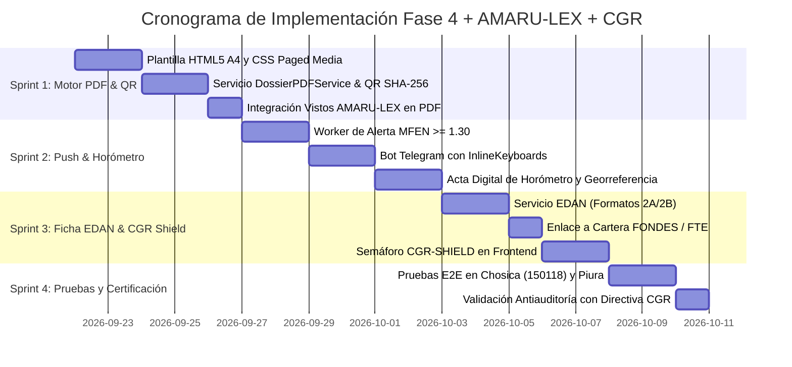

# PROPUESTA TÉCNICA DE IMPLEMENTACIÓN: FASE 4 (OPERATIVIDAD EN CAMPO) Y AMARU-LEX
## SISTEMA DE GESTIÓN DEL RIESGO DE DESASTRES: COEN DIGITAL PERÚ
### INTEGRACIÓN TRIPARTITA: INTELIGENCIA FÍSICA PREDICTIVA, BLINDAJE JURÍDICO Y CONTROL PREVENTIVO CONCURRENTE (CGR)

**Código Documental:** PROP-IMP-FASE4-AMARULEX-CGR-2026-V1  
**Fecha:** Septiembre 2026  
**Clasificación:** DOCUMENTO TÉCNICO DE INGENIERÍA DE SOFTWARE & GESTIÓN PÚBLICA  
**Marco Legal y Normativo de Control:**  
- **SINAGERD:** Ley Nº 29664 y D.S. Nº 048-2011-PCM (Reglamento).  
- **Emergencia FEN:** D.S. Nº 124-2026-PCM, D.S. Nº 130-2026-PCM, D.U. Nº 031-2026 y D.U. Nº 032-2026.  
- **Contrataciones del Estado:** TUO de la Ley Nº 30225 (Art. 27 lit. b) y D.S. Nº 344-2018-EF (Art. 100).  
- **Sistema Nacional de Control (CGR):** Ley Nº 27785, Directiva Nº 013-2022-CG/NORM (Control Simultáneo) y Criterios del **Informe Nº 10671-2026-CG/AGR-SOP** de la Contraloría General de la República.  
- **Sistemas de Información:** Directiva Nº 012-2021-INDECI (SINPAD / Ficha EDAN Perú).

---

## 1. RESUMEN EJECUTIVO Y OBJETIVO DEL SISTEMA

La implementación de la **Fase 4 (Operatividad en Campo y Respuesta Municipal)** en conjunto con **AMARU-LEX** y el **Módulo de Blindaje Antiauditoría de Contraloría (CGR-SHIELD)** tiene como objetivo dotar a los 1,891 municipios del país (priorizando los 893 declarados en emergencia) de una **solución integral de Comando, Control y Blindaje Administrativo (C2-Legal)**.

### El Reto Operativo en los Gobiernos Locales
1. **La Parálisis por Temor a la Contraloría:** El Informe Nº 10671-2026-CG/AGR-SOP de la CGR reveló que en **el 58% de las Fichas Técnicas de la ANA (893 casos), los municipios no hicieron ninguna gestión**, y en **el 71% (1,096 casos) no se ejecutó obra alguna**. Los alcaldes y gerentes paralizan los trámites por temor a observaciones de auditoría o denuncias penales por compras directas mal sustentadas.
2. **La Brecha entre el Satélite y la Cuadrilla:** Los pronósticos numéricos globales (ECMWF IFS 9km) no llegan a los choferes de volquetes ni a los operadores de motobombas en el terreno.
3. **El Colapso Documental Post-Desastre:** El llenado a mano de la Ficha EDAN para el SINPAD demora hasta 72 horas, congelando la llegada de carpas, víveres y partidas presupuestales del FONDES.

### La Solución Técnica Implementada
El sistema articula una cadena sinérgica ininterrumpida de 3 capas:
$$\text{Predicción Física } (M_{\text{FEN}} \ge 1.30) \;\Longrightarrow\; \text{Blindaje Legal (AMARU-LEX + CGR)} \;\Longrightarrow\; \text{Acción Táctica en Campo (Fase 4)}$$

```
┌──────────────────────────────────────────────────────────────────────────────────────────────────┐
│                            ARQUITECTURA DE TRIPLE IMPACTO INSTITUCIONAL                          │
├───────────────────────────────┬──────────────────────────────────┬───────────────────────────────┤
│    1. INTELIGENCIA FÍSICA     │       2. BLINDAJE JURÍDICO       │     3. CONTROL PREVENTIVO     │
│   (Motor Análogo + OpenMeteo) │     (AMARU-LEX / D.S. 124-PCM)   │     (Auditoría Inversa CGR)   │
├───────────────────────────────┼──────────────────────────────────┼───────────────────────────────┤
│ • Telemetría viva a 7 días    │ • Invocación Art. 27 Ley 30225   │ • Directiva 013-2022-CG/NORM  │
│ • Amplificación MFEN >= 1.30  │ • Minuta Resolución de Alcaldía  │ • Control de Horómetro/Diésel │
│ • Identificación Puentes CAF  │ • Amparo D.U. 031-2026 (MEF)     │ • Contador Regresivo SEACE    │
│ • Umbral Lead Time <= 48h     │ • Advertencia Omisión de Función │ • Checklist FTR de la ANA     │
└───────────────────────────────┴──────────────────────────────────┴───────────────────────────────┘
                                                │
                                                ▼
┌──────────────────────────────────────────────────────────────────────────────────────────────────┐
│                        FASE 4: PRODUCTOS OPERATIVOS DE CAMPO ENTREGABLES                         │
├───────────────────────────────┬──────────────────────────────────┬───────────────────────────────┤
│     MÓDULO 4.1: DOSSIER       │      MÓDULO 4.2: PUSH MÓVIL      │     MÓDULO 4.3: FICHA EDAN    │
│      EJECUTIVO OFICIAL        │      TACTICO GEOLOCALIZADO       │        SINPAD PRE-LLENADA     │
├───────────────────────────────┼──────────────────────────────────┼───────────────────────────────┤
│ • PDF A4 institucional 1-clic │ • Bot Telegram & WhatsApp Meta   │ • Formatos 2A y 2B de INDECI  │
│ • Sello QR con Hash SHA-256   │ • Ruteo a Serenazgo / Obras      │ • Colegios expuestos MINEDU   │
│ • Vistos Legales Inyectados   │ • Acta Digital de Horómetro      │ • Hectáreas agrícolas MINAG   │
│ • Firmas Alcalde + Sec. Téc.  │ • Geoseguimiento Antifraude      │ • Enlace a Cartera FONDES/MEF │
└───────────────────────────────┴──────────────────────────────────┴───────────────────────────────┘
```

---

## 2. ESPECIFICACIÓN DETALLADA DE COMPONENTES POR MÓDULO

### 2.1. MÓDULO 4.1: GENERADOR DE DOSSIER EJECUTIVO PDF OFICIAL Y BLINDADO

#### A. Propósito y Estructura Normativa
Generar en menos de 2 segundos un informe técnico-legal en formato PDF (hoja A4 estándar, paged media) foliado digitalmente, que sirve como **Informe Técnico Sustentatorio de Situación de Emergencia** exigido por el Artículo 100 del Reglamento de la Ley de Contrataciones del Estado para aprobar contrataciones directas.

#### B. Componentes del Dossier PDF
1. **Membrete Oficial y Título:**
   - Escudo Distrital y de la República del Perú.
   - Denominación: `INFORME TÉCNICO DE GESTIÓN DEL RIESGO DE DESASTRES Nº {CORRELATIVO}-2026-MD{DISTRITO}/GGRD`.
   - Visto Legal de Amparo: D.S. Nº 124-2026-PCM, D.S. Nº 130-2026-PCM, D.U. Nº 031-2026 y Ley Nº 29664.
2. **Sello Criptográfico QR de Verificación Inmutable:**
   - Código QR renderizado en alta resolución en la esquina superior derecha.
   - Contenido del QR: URL canónica oficial `https://coen.gob.pe/verificar?h={SHA256}`.
   - Algoritmo de Hash:
     $$\text{Payload} = \text{UBIGEO} + \text{FechaISO} + \text{PrecipitaciónExtrema} + M_{\text{FEN}} + \text{PuentesEnRiesgo}$$
     $$\text{Hash} = \text{SHA-256}(\text{Payload})$$
3. **Sección Diagnóstico Meteorológico y Cono de Análogos:**
   - Gráfico de dispersión y proyección a 7 días: lluvia Open-Meteo Pro (ECMWF 9km) vs Lluvia Amplificada FEN ($M_{\text{FEN}}$).
   - Similitud analógica porcentual contra eventos históricos (1983, 1998, 2017).
   - Inestabilidad convectiva CAPE (J/kg) y condición de vientos alisios.
4. **Catálogo de Infraestructura Crítica y Puentes en Riesgo:**
   - Tabla de puentes vulnerables con metraje de luz, tipología estructural y tipo de falla histórica (socavación de pilares / desborde de accesos).
   - Relación de bocatomas y canales de regadío según el catastro CAF/ANA.
5. **Anexo de Blindaje de Auditoría CGR (Directiva Nº 013-2022-CG/NORM):**
   - Justificación de la "Ventana Dorada Logística": Acreditación de que esperar un proceso de licitación clásico (45 días) generaría un colapso irreversible ante el Lead Time de 48 horas.
   - Hoja de cubicación estimada y consumo de diésel B5 según horas-máquina estandarizadas.
6. **Bloque de Suscripción Oficial:**
   - Firma y postfirma del **Alcalde Distrital** (Presidente de la Plataforma de Defensa Civil).
   - Firma y postfirma del **Secretario Técnico de GRD / Defensa Civil** (con número de CIP y Registro Nacional CENEPRED).
7. **Proyecto de Resolución de Alcaldía Anexo:**
   - Minuta legal redactada automáticamente con los artículos 1º (Aprobación de Contratación Directa), 2º (Encargo a Logística) y 3º (Regularización SEACE en 10 días).

---

### 2.2. MÓDULO 4.2: DESPACHO PUSH TÁCTICO Y ACTAS DIGITALES DE HORÓMETRO

#### A. Lógica de Disparo y Criterio Físico-Matemático
El motor en segundo plano evalúa la telemetría cada 30 minutos y ejecuta el despacho push cuando se cumple:
$$\mathcal{T}_{\text{alerta}} = (M_{\text{FEN}} \ge 1.30) \;\land\; (\text{Lead Time} \le 48\text{ h}) \;\land\; (P_{\text{estimada}} \ge 30.0\text{ mm/24h} \;\lor\; \text{Similitud}_{\text{análoga}} \ge 70\%)$$

#### B. Canales de Notificación y Formato de Mensajería
1. **Telegram Bot API (Canal Cuadrillas y Defensa Civil):**
   - Mensaje estructurado con indicadores visuales de nivel rojo.
   - **Botones Interactivos (Inline Keyboards):**
     - `[📍 Ver Mapa Satelital de la Quebrada]`
     - `[📄 Descargar Dossier PDF Oficial]`
     - `[🚜 Registrar Inicio de Maquinaria en Campo]`
2. **WhatsApp Cloud API (Meta Platform):**
   - Notificación de alta prioridad directa al teléfono del Alcalde, Gerente Municipal y Comisario PNP bajo plantilla aprobada `EMERGENCY_ALERT`.

#### C. Acta Digital de Verificación de Maquinaria y Horómetro (Escudo contra Hallazgo CGR 2026)
Para erradicar la observación recurrente de la Contraloría sobre "maquinaria fantasma" o "cobro indebido de horas de descolmatación":
1. Al pulsar `[🚜 Registrar Inicio de Maquinaria]`, el operador o brigadista abre un mini-formulario móvil (PWA/Telegram WebApp).
2. El operador captura:
   - Placa / Serie de la excavadora/volquete.
   - **Fotografía obligatoria del horómetro** del tablero de la máquina.
   - **Geolocalización GPS automática** (precisión < 10 m).
3. El sistema genera un registro digital inmutable con hash cronológico. Al finalizar la jornada, se repite el procedimiento para calcular las horas efectivas netas, eliminando toda discrepancia entre el avance físico de campo y las valorizaciones de gabinete.

---

### 2.3. MÓDULO 4.3: PRE-LLENADO DIGITAL DE LA FICHA EDAN Y ARTICULACIÓN FONDES

#### A. Estandarización INDECI / SINPAD
Automatiza la formulación de los Formatos oficiales:
- **Formato 2A:** Evaluación Preliminar Rápida (primeras 8 horas).
- **Formato 2B:** Evaluación Complementaria y Padrón Familiar (primeras 72 horas).

#### B. Algoritmo de Cruce de Datos Multifuente
El backend consolida:
1. **Sector Transportes:** Cruza los puentes y vías del catálogo CAF de la cuenca evaluada.
2. **Sector Educación:** Extrae los locales escolares de la cuenca (base histórica MINEDU/PUCP) con código modular y aforo estudiantil.
3. **Sector Agricultura:** Estima hectáreas de panllevar y canales de regadío susceptibles según los registros de MINAG-OIA.
4. **Sector Ayuda Humanitaria:** Calcula automáticamente la necesidad logística bajo directivas de INDECI:
   - Carpas familiares = $\lceil \text{Familias Damnificadas} \times 1.0 \rceil$
   - Bidones de agua 20L = $\lceil \text{Población Damnificada} \times 2.0 \rceil$
   - Sacos terreros para diques = $\text{Metros lineales de cauce vulnerable} \times 10$

#### C. Enlace Directo a Cartera de Financiamiento FONDES / MEF
Resuelve la situación adversa identificada en el **Informe Nº 10671-2026-CG/AGR-SOP** (municipios que no tramitan financiamiento):
- El sistema compila el expediente con la **Ficha Técnica de Emergencia (FTE)** requerida por la Dirección General de Presupuesto Público del MEF para activar la transferencia de recursos del Fondo para Intervenciones ante Desastres Naturales (FONDES), amparado en el D.U. Nº 031-2026.

---

### 2.4. MÓDULO 4.4: SEMÁFORO DE AUDITORÍA INVERSA PREVENTIVA (CGR-SHIELD)

Módulo integrado en la Consola AMARU-LEX (`/lex`) que audita en tiempo real los expedientes de emergencia distritales:
1. **Auditoría de FTR de la ANA:** Alerta si el distrito tiene Fichas Técnicas Referenciales de la ANA pendientes de atención para evitar cargos por omisión de funciones.
2. **Temporizador Regresivo SEACE (10 días):** Alerta en rojo el día 7 y día 9 si la contratación directa aún no ha sido publicada en el portal SEACE.
3. **Control de Rendimiento de Diésel:** Comprobación de que el volumen de diésel B5 adquirido coincide con las horas efectivas registradas en los horómetros digitales.

---

## 3. ARQUITECTURA DE SOFTWARE Y ARCHIVOS A CREAR / MODIFICAR

```
backend/
├── agents/
│   └── dispatcher_local.py                # [NUEVO] Despachador de alertas push y webhook Telegram/WhatsApp
├── services/
│   ├── dossier_pdf_service.py             # [NUEVO] Generador de Dossiers PDF con WeasyPrint/ReportLab y QR
│   ├── edan_sinpad_service.py             # [NUEVO] Motor de pre-llenado de Fichas EDAN Formatos 2A y 2B
│   ├── cgr_audit_shield_service.py        # [NUEVO] Auditor preventivo basado en criterios de Contraloría
│   ├── historical_analog_engine.py        # [MODIFICAR] Exposición de triggers MFEN >= 1.30 y Lead <= 48h
│   └── legal_framework_service.py         # [MODIFICAR] Suministro de considerandos y minutas de resolución
├── templates/
│   └── dossier_ejecutivo_a4.html          # [NUEVO] Plantilla semántica HTML5/CSS Paged Media para el PDF
└── main.py                                # [MODIFICAR] Montaje de nuevos endpoints /api/v4/...

frontend/src/
├── app/
│   ├── historico/page.tsx                 # [MODIFICAR] Barra de acciones rápidas (Dossier, Push, EDAN)
│   └── lex/page.tsx                       # [MODIFICAR] Incorporación del semáforo CGR-SHIELD
└── components/
    ├── DossierExportModal.tsx             # [NUEVO] Modal de previsualización, foliación y descarga de PDF
    ├── EdanPrepopulatedModal.tsx          # [NUEVO] Visor interactivo y exportador de la Ficha EDAN
    └── CgrAuditWidget.tsx                 # [NUEVO] Widget de semáforo preventivo de riesgos de control
```

---

## 4. DISEÑO DE ENDPOINTS DE LA API REST (BACKEND FASTAPI)

| Método | Endpoint | Descripción | Payload / Parámetros |
| :---: | :--- | :--- | :--- |
| `POST` | `/api/v4/reports/dossier-pdf` | Genera y transmite el archivo binario PDF oficial con sello QR y postfirmas. | `{ "ubigeo": "150118", "incluir_resolucion": true, "alcalde": "...", "secretario": "..." }` |
| `POST` | `/api/v4/dispatch/push-alert` | Ejecuta el despacho de alerta táctica hacia canales Telegram y WhatsApp. | `{ "ubigeo": "150118", "nivel": "ROJO", "cuadrillas": ["SERENAZGO", "OBRAS"] }` |
| `POST` | `/api/v4/dispatch/horometro-log` | Registra el acta digital de campo de una maquinaria con foto GPS y horómetro. | `{ "ubigeo": "150118", "maquinaria_id": "EXC-01", "horometro": 1420.5, "foto_b64": "..." }` |
| `GET` | `/api/v4/edan/prepopulate/{ubigeo}` | Retorna el objeto estructurado JSON de la Ficha EDAN 2A/2B para el SINPAD. | Parámetro de ruta: `ubigeo` (ej. 150118) |
| `GET` | `/api/v4/cgr/audit-status/{ubigeo}` | Diagnóstico preventivo de riesgos de auditoría de Contraloría (CGR-SHIELD). | Parámetro de ruta: `ubigeo` |

---

## 5. PLAN DE IMPLEMENTACIÓN POR SPRINTS Y CRONOGRAMA



---

## 6. SEGURIDAD, INTEGRIDAD Y VALIDEZ PROBATORIA

1. **Inmutabilidad del Sello QR:** Toda alteración de los datos meteorológicos o de la lista de puentes en el documento impreso produce una discrepancia inmediata al escanear el QR contra la base canónica SHA-256 del COEN.
2. **Georreferenciación Criptográfica de Horómetros:** Las fotografías tomadas por los brigadistas en el río incorporan metadatos EXIF validados por el servidor (latitud, longitud, altitud y hora satelital UTC-5), constituyendo **prueba documental fehaciente ante la Comisión de Control Concurrente de la Contraloría**.
3. **Privacidad y Ley Nº 29733:** Los datos de familias damnificadas pre-llenados en la Ficha EDAN 2B se tratan bajo estricta confidencialidad humanitaria, accesibles únicamente por personal acreditado con DNI electrónico o credenciales municipales validadas.

---

## 7. CONCLUSIÓN Y BENEFICIOS INSTITUCIONALES

Con la ejecución de esta propuesta técnica, el Estado peruano y los gobiernos locales logran:
* **Cero Parálisis Administrativa:** El Alcalde cuenta con el respaldo legal (AMARU-LEX) y el documento técnico foliado (Dossier PDF) para contratar maquinaria en horas sin riesgo de sanciones.
* **Cero Impunidad y Cero Obras Fantasma:** El registro digital de horómetros y control simultáneo responde con exactitud a las observaciones históricas de la Contraloría General de la República.
* **Respuesta Rápida y Dignificación del Damnificado:** La Ficha EDAN digitalizada y el enlace al FONDES permiten que la ayuda humanitaria y los recursos del Estado lleguen mientras la emergencia ocurre, no meses después.
